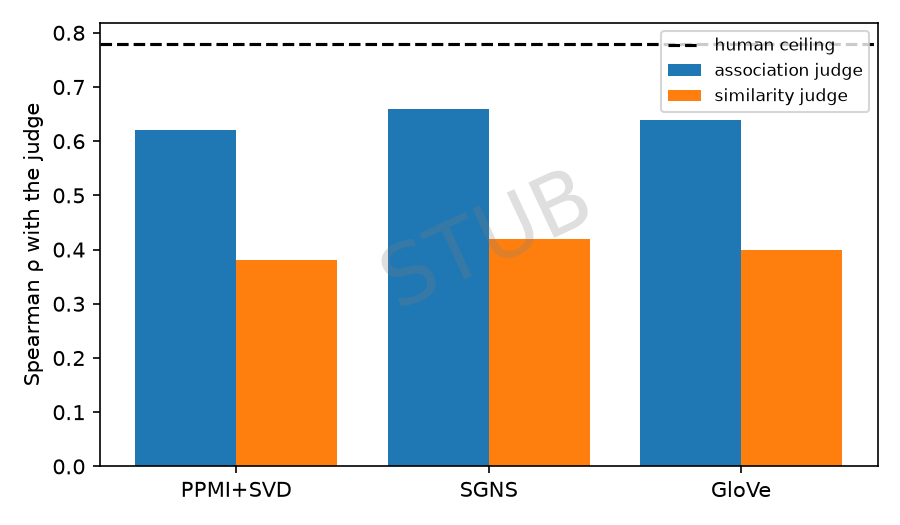
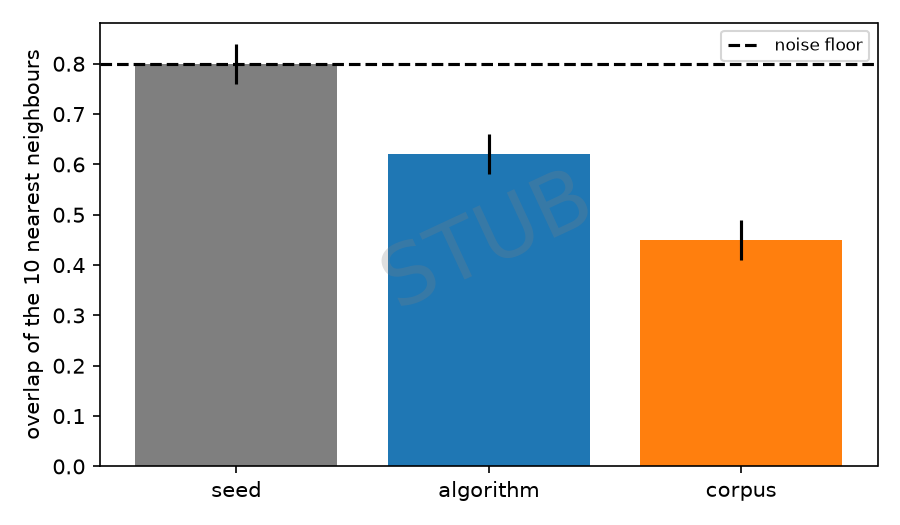

# The Universal Translator {#sec-ch-meaning-as-arrangement}

<!-- Task 6 template -->
*Part III, a speculative test: there is no judge, and a failure is not informative.* This chapter follows @sec-ch-meaning-as-generation. **Question: can two spaces be aligned from relations alone?**

*Data, models and loss.* Data: Two static spaces (SGNS and PPMI-SVD) trained on different texts or languages, with no dictionary, and a random rotation as the null; human languages first, whales and birds, Goedel's shorthand notebooks and SETI only as speculative cases. The models are in @sec-ch-zoo-of-models; the loss of each is stated there once.

| Model | Zoo | Role in this chapter |
|:--|:--|:--|
| SGNS | @sec-zoo-sgns | a space to align |
| PPMI-SVD | @sec-zoo-ppmi-svd | a second space to align |

The coordinates of a trained space mean nothing on their own. The loss depends on the vectors only through dot products or cosines, so any rotation of the space gives the same loss, and a trained space is one arbitrary point of an orbit; what is real is the arrangement, the distances and the angles between directions. Saussure's meaning as a system of differences [@saussure1916cours] and the representational similarity of neuroscience [@kriegeskorte2008representational; @edelman1998representation] say the same of minds. The question of this chapter is what survives a change of coordinates, what a training objective leaves free and what it breaks, and how two spaces can be compared when their coordinates are not comparable: two seeds, two languages, two senses.

The scope is the invariance of a space and the comparison of spaces. The stability of nearest neighbours across seeds, losses and texts is already measured in the section on many runs (@sec-likeness-many-spaces), salvaged from the chapter on likeness (@sec-ch-meaning-as-likeness), and this chapter takes up the alignment that it hands over; the senses a shared space can hold is the chapter on senses (@sec-ch-meaning-across-senses); a transformation along a path is the chapter on generation of the chapter on generation (@sec-prop-paths); and what changes with the situation of use is the chapter on context (@sec-ch-meaning-in-context).

*Goals and expectations (proposed, to be confirmed by the author before any experiment).*

*Goal 1, the arrangement determines the space (Saussure, Kriegeskorte).* A set of vectors is fixed up to rotation and reflection by its pairwise inner products. The expectation, which has an analytic answer, is that classical multidimensional scaling of a distance matrix recovers a space whose distances equal the originals, and that a coordinate-dependent readout does not survive the change (@sec-arr-arrangement). *This goal receives Q14 (@sec-likeness-handed-to-meaning-as-arrangement).*

*Goal 2, two seeds are two views of one arrangement.* The expectation is that two spaces trained on the same text with different seeds are related by an orthogonal map up to noise, so that an orthogonal Procrustes alignment brings their neighbours into agreement far above a random map, and that the residual after alignment is the seed gap of the chapter on likeness. The run uses the trained spaces of that chapter (@sec-aligning-two-spaces).

*Goal 3, alignment without pairs (Quine's indeterminacy, the universal translator).* The expectation is that two spaces of languages that describe a similar world can be aligned with no dictionary and that the matching is well determined where the structures are similar, which is evidence against the radical case of indeterminacy for that part of the structure and not a refutation of it. Quine's radical case would be two alignments of equal fit that disagree on the neighbours of held-out words [@quine1960word]; the run counts distinct equal-loss alignments and their disagreement (@sec-same-map-different-north). *This goal receives Q14 (@sec-likeness-handed-to-meaning-as-arrangement).*

*Goal 4, relative representations (Moschella and colleagues).* If each item is described by its cosines to a set of anchors, two spaces become comparable without alignment. The expectation is that relative representations of two seeds are closer than their raw coordinates by a stated margin; the run is a small experiment on the spaces of the chapter on likeness [@moschella2023relative] (@sec-arr-relative).

*Goal 5, the shape of a representation.* The expectation is that the persistent homology of the point cloud of a trained space is stable across seeds and that it does or does not support the manifold hypothesis of the appendix on dimensionality; the run needs a persistence computation, which is not yet in the allowed dependencies (@sec-measuring-shape-representation).

## What the Philosophies Say About Arrangement {#sec-arr-philosophy}
*Plan (about 3 pages). Meaning as a system of differences without positive terms [@saussure1916cours], to be read at the page; Klein's Erlangen programme, that a geometry is what survives a group of transformations [@klein1893comparative]; Quine on the indeterminacy of translation and the rotation as its weak case [@quine1960word]; the structuralist reading that a representation is a pattern of similarities [@edelman1998representation; @kriegeskorte2008representational]; and the symmetries a model has, from the rotation of its residual stream to the equivariance of its layers [@bronstein2021geometric]. What a vector carries: positions that mean something only relative to each other.*

## What Is Real Is the Arrangement {#sec-arr-arrangement}
*Plan (about 3 pages). Goal 1. Recovering a space from its distance matrix; the groups of transformations and what each preserves (rotation and reflection: distances and angles; uniform scaling: angles and the cosine, not distances; translation: differences, not dot products; invertible linear maps: linear readability, not distances); the origin of the symmetry in the objective, and what the optimizer chooses inside the orbit; the symmetry breakers (elementwise nonlinearities, ordered coordinates, a few dimensions of large value). These are the points of the summary chapter's section on symmetries, here with the test.*

## Relative Representations {#sec-arr-relative}
*Plan (about 2 pages). Goal 4. Anchors, the cosines to anchors as coordinates, and the comparison of two seeds with and without them.*

<!-- salvaged from embedding-technologies-stubs/tangent_spaces_geodesics.qmd, section sec-erlangen-programme-deep-learning -->
## The Erlangen Programme for Deep Learning {#sec-erlangen-programme-deep-learning}
*What is a representation invariant to? Symmetries, invariances, and equivariances.*

<!-- salvaged from embedding-technologies-stubs/tangent_spaces_geodesics.qmd, section sec-symmetries-each-sense -->
## The Symmetries of Each Sense {#sec-symmetries-each-sense}
*Images vary by translation and viewpoint, audio by time shift, pitch, and speaker, video by motion, and text by none of these. A shared semantic space can be seen as a quotient by the nuisance symmetries of each modality: the same dog from any angle, in any voice.*

<!-- salvaged from embedding-technologies-stubs/tangent_spaces_geodesics.qmd, section sec-lie-groups-continuous-symmetries -->
## Lie Groups and Continuous Symmetries {#sec-lie-groups-continuous-symmetries}
*$SO(n)$, $SE(n)$, and Rotary Position Embeddings (RoPE), a structure that was adopted at scale.*

<!-- salvaged from embedding-technologies-stubs/tangent_spaces_geodesics.qmd, section sec-gauge-equivariance -->
## Gauge Equivariance {#sec-gauge-equivariance}
*When coordinate frames depend on local manifold position.*

<!-- salvaged from embedding-technologies-stubs/cross_domain_transfer.qmd, section sec-gauge-freedom -->
## Gauge Freedom {#sec-gauge-freedom}
*A trained space is determined only up to an isometry, the relabelling invariance of @sec-ch-symbols-without-interior seen from the other side, so comparing two spaces is a geometric problem.*

<!-- salvaged from embedding-technologies-stubs/cross_domain_transfer.qmd, section sec-aligning-two-spaces -->
## Aligning Two Spaces {#sec-aligning-two-spaces}
*Canonical correlation analysis (Hotelling, 1936), orthogonal Procrustes, and Mikolov's 2013 linear map between the embedding spaces of two languages: the classical, linear forms of alignment, and the precursors of the contrastive alignment of @sec-ch-meaning-across-senses.*

<!-- salvaged from embedding-technologies-stubs/cross_domain_transfer.qmd, section sec-optimal-transport-wasserstein-distances -->
## Optimal Transport & Wasserstein Distances {#sec-optimal-transport-wasserstein-distances}
*Monge-Kantorovich formulations for transporting probability mass across latent manifolds.*

<!-- salvaged from embedding-technologies-stubs/cross_domain_transfer.qmd, section sec-domain-adaptation-distribution-alignment -->
## Domain Adaptation & Distribution Alignment {#sec-domain-adaptation-distribution-alignment}
*Maximum Mean Discrepancy (MMD) and adversarial manifold alignment.*

<!-- salvaged from embedding-technologies-stubs/cross_domain_transfer.qmd, section sec-zero-shot-cross-domain -->
## Zero-Shot Cross-Domain Transfer {#sec-zero-shot-cross-domain}
*Transfer through aligned spaces, and the evidence for and against representational convergence across models.*

<!-- salvaged from embedding-technologies-stubs/cross_domain_transfer.qmd, section sec-principles-parameters -->
## Principles and Parameters {#sec-principles-parameters}
*Chomsky's picture (1981) of languages as one shared core with a few switches, read geometrically: multilingual models encode grammatical relations in a subspace shared across languages, with directions specific to each (2020), the same shared-plus-specific structure as the concept subspaces of @sec-ch-meaning-as-region.*

<!-- salvaged from embedding-technologies-stubs/contextual_vectors.qmd, section sec-do-different-models-share -->
## Do Different Models Share a Geometry? {#sec-do-different-models-share}
*Claims of representational convergence across models, as a bridge to Chapters [-@sec-ch-meaning-as-arrangement] and [-@sec-ch-meaning-across-senses], which take up alignment between spaces and across modalities.*

<!-- salvaged from embedding-technologies-stubs/topological_deep_learning.qmd, section sec-what-pairwise-structure-cannot -->
## What Pairwise Structure Cannot Express {#sec-what-pairwise-structure-cannot}
*Moving beyond pairwise edges to simplicial complexes, cell complexes, and Combinatorial Complexes (CCs).*

<!-- salvaged from embedding-technologies-stubs/topological_deep_learning.qmd, section sec-topological-cochains-boundary-operators -->
## Topological Cochains & Boundary Operators {#sec-topological-cochains-boundary-operators}
*Modeling multi-way interactions, flows, faces, and higher-order cavities.*

<!-- salvaged from embedding-technologies-stubs/topological_deep_learning.qmd, section sec-hodge-theory-topological-message -->
## Hodge Theory & Topological Message Passing {#sec-hodge-theory-topological-message}
*Decomposing flows into gradient, curl, and harmonic parts, and learning representations on manifolds with topological holes.*

<!-- salvaged from embedding-technologies-stubs/topological_deep_learning.qmd, section sec-measuring-shape-representation -->
## Measuring the Shape of a Representation {#sec-measuring-shape-representation}
*Persistent homology in latent spaces, with barcodes and persistence diagrams as tools to test the manifold hypothesis of @sec-manifold-hypothesis.*

## Technologies That Exploit Arrangement {#sec-arr-technologies}
*Plan (about 1 page). Procrustes and canonical correlation alignment, optimal transport and its entropic approximation, domain adaptation and zero-shot transfer, equivariant networks and gauge-equivariant convolutions, model compression that uses the symmetry of the residual stream, and topological message passing. For each: cost (optimal transport is cubic in the number of points without approximation), and whether the gain is shown against a plain baseline at matched tuning.*

## Same Map, Different North {#sec-same-map-different-north}
*Plan (1 page). Findings: a trained space is fixed only up to an isometry, so comparing two is a geometric problem, and the classical alignments, optimal transport, domain adaptation and zero-shot transfer each answer a version of it. Achieved for the representation of meaning: what is real is the arrangement (@sec-prop-arrangement), and spaces trained apart can be compared through it. Computation: does scale make independently trained spaces more alike, and if so, what is left for alignment to do? Read from the evidence for and against representational convergence, dated. That hypothesis is contested, so the chapter attributes it with its test and what the test found, and names which evidence is independent of its proponents. Smoke test: train two seeds of the predictor of @sec-ch-meaning-as-likeness, align them by orthogonal Procrustes and check that the cosines survive (the answer to exercise 3 of Learning by Prediction found the first within 3% of the second after the best rotation). Still out of reach: aligning two spaces from paired examples is one problem, and aligning two systems of communication with no parallel data and no way to check the result is another, the universal translator of the Epilogue. Joining the senses in one space is the next step (@sec-ch-meaning-across-senses).*

*Sources and gaps (first pass).* Sourced in `references/`: Saussure and the structuralist readings, the Erlangen programme and geometric deep learning, relative representations, gauge and coordinate-independent networks, the pull-back metric, orthogonal symmetries of transformers. Not yet sourced: Mikolov's 2013 map between languages (no entry in the collection); optimal-transport references as named in the earlier chapter; a persistent-homology tool; Saussure at the page.

*Open question for the author: this chapter holds two subjects, what survives a change of coordinates (the symmetries, which is the longest section of the earlier summary chapter) and the comparison of two spaces (alignment, optimal transport, the universal translator). It may be one chapter or two.*

<!-- salvaged from chapters/properties_of_meaning.qmd (snapshot: embedding-technologies-stubs-v2/properties_of_meaning.qmd), section sec-prop-arrangement -->

## What Is Real Is the Arrangement {#sec-prop-arrangement}
*The coordinates mean nothing on their own; only the relations between meanings, their distances and the angles between their directions, carry information.*

Figure (planned): a table of pairwise distances among a handful of words, with no coordinates anywhere, from which the map can still be redrawn.

Earned in @sec-ch-symbols-without-interior (invariance to relabelling) and in this chapter (the shape of a representation, and comparing two spaces by their relations).

Sources (first pass). Meaning as a system of differences [@saussure1916cours]; representation as a pattern of similarities [@edelman1998representation; @kriegeskorte2008representational]; communicating across latent spaces through relative positions [@moschella2023relative].

<!-- salvaged from chapters/properties_of_meaning.qmd (snapshot: embedding-technologies-stubs-v2/properties_of_meaning.qmd), section sec-prop-invariance -->

## Meaning Survives Symmetries {#sec-prop-invariance}
*The space can be turned, and in some cases stretched, without changing what it says; what it says is exactly what survives these transformations.*

Figure (planned): the same map before and after a rotation, with every distance and every analogy preserved, next to a shear that breaks them.

The symmetries, each to be stated with the group that defines it and the quantity it preserves:

- Rotation and reflection (the orthogonal group): preserve all distances, dot products, and angles. Distances are invariant; directions are equivariant, since they turn with the space, and only the angles between them are invariant.
- Uniform scaling: preserves angles and cosine similarity, but not distances or dot products. Whether it is a symmetry depends on which similarity the model was trained with.
- Translation (a shift of the origin): preserves distances and differences, so analogy offsets survive; it does not preserve dot products or cosine similarity unless the space is centred.
- Invertible linear maps: preserve the span of a representation and linear readability, but not distances. This is the coarser notion used when comparing representations.
- Permutation of the dimensions: a special case of rotation, which is why no single coordinate has an identity.

The invariance is of the pair (space, readout). A classifier or the next layer fixes a basis, so turning the space is harmless only if the readout is turned with it.

Where the symmetry comes from. The symmetry belongs to the objective, not to convergence. If the loss depends on the embeddings only through inner products or cosines, replacing every vector by its rotation leaves the loss unchanged at every point of the landscape, so the minimisers form an orbit and a trained model is one arbitrary point on it. Whether separate runs land on the same orbit is a different question, and the symmetry does not answer it. The size of the group depends on the objective. A model that scores a pair by a dot product between two sets of vectors, such as the input and output vectors of a word model, is unchanged by any invertible linear map applied to one set and its inverse transpose to the other, which is the non-uniqueness of a matrix factorisation [@levy2014neural]. Cosine similarity, by normalising, reduces the group to rotations and reflections. What picks one representative inside the orbit is the optimiser and its regularisation: gradient descent on a factorised model has an implicit bias, towards low-norm or low-rank solutions, that depends on initialisation and step size [@gunasekar2017implicit; @arora2019implicit]. In this sense the invariance is partly a by-product of how the spaces are found. What is not a by-product is that the information is relational: a set of vectors is fixed up to rotation and reflection by its pairwise inner products, so rotation invariance and "only relations carry information" are the same statement. Which relations are shared between independently trained spaces is another matter, and is contested: after calibrating for network scale, the agreement that remains is in the local neighbourhoods, not in the global spectrum or the local distances [@groger2026aristotelian] (@sec-prop-senses). If the training signal is itself relational, such as which words co-occur or which pairs are similar, the data single out no coordinate system, and the rotation freedom is the redundancy left over from describing a relational structure with coordinates.

What breaks the symmetry. Anything that depends on coordinates singles out the axes and gives them meaning. Elementwise nonlinearities create a privileged basis [@elhage2022toy]. Training that makes the first coordinates carry a usable embedding on their own, as in Matryoshka representations, gives the axes an order [@kusupati2022matryoshka]. In trained transformers a few dimensions of the hidden state take unusually large values, which dominate cosine similarity and Euclidean distance [@kovaleva2021bert; @timkey2021rogue] and break low-precision quantization [@dettmers2022llmint8]; that the optimiser is responsible for them is a common view that this chapter does not establish. Features stored in superposition are a statement about which directions matter, and trained spaces are often anisotropic, so the symmetry group of the data is smaller than the group of the geometry [@razzhigaev2023shape].

Global and local. Everything above applies one transformation to the whole space. A local symmetry lets the transformation vary from point to point. This is the gauge idea: on a curved space, the choice of an orthonormal frame at each point is arbitrary, and only frame-independent quantities (distances, angles, curvature) are meaningful. Three forms appear in the literature, with different standing:

- Non-rigid maps between spaces. Two spaces trained on the same data may differ by an isometry of the underlying manifold rather than a single global rotation, and a representation built from the pullback metric is invariant to it. Relative representations already allow other similarity functions for invariance to deformations of bounded distortion.
- Transport of a relation. An analogy repeats a step from one place to another, which needs a rule for carrying a vector between points. In flat space this is vector addition; on a curved space it is parallel transport, and going round a loop returns the vector rotated (holonomy). Hyperbolic word embeddings solve analogies this way.
- Invariance of the map, not of the space. Embeddings trained with augmentations are locally flat along nuisance directions of the input, and which directions differs by region.

The literature supports the pieces: gauge equivariance is developed for data on manifolds, and the pullback metric and parallel transport for latent spaces. No source found treats an embedding space as having a local gauge symmetry of its own; stating it so would be this book's synthesis, to be marked as such.

Local non-uniformity also limits the global story: anisotropy and intrinsic dimension vary across layers and, by region, within a space.

Earned in @sec-ch-symbols-without-interior (invariance to relabelling), @sec-tangent-spaces-geodesics (curved space, geodesics, and parallel transport) and in this chapter (the shape of a representation, which symmetries a training objective leaves intact, and aligning two spaces up to a rotation and comparing them independently of one).

Sources (first pass). Geometry as what survives a group of transformations [@klein1893comparative; @bronstein2021geometric, section 4.5 on gauges and bundles]; comparing representations independently of rotation or invertible linear maps [@kornblith2019similarity]; communicating across latent spaces through relative positions, invariant to isometries and rescalings [@moschella2023relative]; the same models related by an isometry of the underlying manifold, through the pullback metric [@yu2025relative; @arvanitidis2018latent]; an exact rotation symmetry of the residual stream of a transformer, used to compress and quantize [@ashkboos2024slicegpt; @ashkboos2024quarot]; features as nearly orthogonal directions in superposition [@elhage2022toy]; the claim that separate models converge on a shared representation, up to such a map [@huh2024platonic], and its sceptical readings [@groger2026aristotelian; @koepke2026plato]. Local forms: gauge equivariance on manifolds [@cohen2019gauge; @weiler2021coordinate]; parallel transport and holonomy [@needham2021visual]; analogy by parallel transport in hyperbolic space [@tifrea2019poincare; @nickel2017poincare]; invariance to augmentations and its cost [@bardes2022vicreg; @ericsson2021invariance]; variation of anisotropy and intrinsic dimension [@razzhigaev2023shape]. Origin and breaking of the symmetry: factorisation non-uniqueness [@levy2014neural]; implicit bias of gradient descent in matrix factorisation [@gunasekar2017implicit; @arora2019implicit]; privileged bases [@elhage2022toy]; nested embeddings [@kusupati2022matryoshka]; outlier and rogue dimensions [@kovaleva2021bert; @timkey2021rogue; @dettmers2022llmint8]. To add: a classical reference for a configuration being fixed up to rotation by its inner products.

<!-- salvaged from chapters/tests_of_meaning.qmd (snapshot: embedding-technologies-stubs-v2/tests_of_meaning.qmd), section sec-test-translator -->

## The Universal Translator {#sec-test-translator .idea}
*Two spaces, no dictionary: can the structure of one be mapped onto the structure of the other from the relations alone?*

Varies the language, or the species (lateral). There may be no judge and no ground truth. The test is asymmetric: a pass is informative, a failure is not, because the spaces may differ for reasons that say nothing about meaning. It needs calibration on two human languages before any other case is claimed. Introduced in @sec-symbols-tests (idea 15 of `notes/ideas.qmd`); the property it rests on is @sec-prop-arrangement and the symmetries of @sec-prop-invariance.

Rungs (first draft):

0. Calibration on two human languages with no dictionary, and with a small seed dictionary, against a random rotation as the null.
1. Recovery of structure beyond the words (relations, not points).
2. A test of order (a shuffled text as the control).
3. Later rungs are speculative and are not listed until the earlier ones have results.

Expected reach: this chapter reaches 0.

<!-- salvaged from chapters/meaning_as_likeness.qmd (snapshot: embedding-technologies-stubs-v2/meaning_as_likeness.qmd), section sec-likeness-which: the questions that the likeness chapter hands on -->

## Questions Handed On From the Likeness Chapter {#sec-likeness-handed-to-meaning-as-arrangement}

Harris, Firth and Wittgenstein offer a theory of where meaning is derived from use and the words around it. Harris's measurable claim (1954) is that "difference of meaning correlates with difference of distribution" [@harris1954distributional]; Firth (1957) takes collocation as one level of meaning, next to the context of situation [@firth1957synopsis]; and Wittgenstein (1953) says that the meaning of a word is its use "for a large class of cases—though not for all" [@wittgenstein1953philosophical, §43].

::: {.test #q-likeness-4}
**Q4. Does company recover likeness?** If likeness of meaning shows as likeness of company, are the things judged alike indeed near, and correspondingly, are the ones judged near alike?

*See* @sec-loss-decides-near.
:::

Harris's claim and Wittgenstein's are about use, and use is a matter of how much has been used. If likeness is recovered from company, it should improve as the company grows, up to what the raters themselves agree on.

::: {.test #q-likeness-5}
**Q5. Does more company give more likeness?** As the amount of text grows, does the agreement of the space with the judges keep growing, and where does it stop against the ceiling of the raters?

*See* @sec-loss-decides-near.
:::

In a graded space, near and far are not complements. Between them lies the null hypothesis, the cosine of unrelated pairs, and "not alike" can sit in the null, or even near. So "far implies not alike" is not the contrapositive of "alike implies near" and needs a test of its own, and each side of both tests must be compared with the null hypothesis and not with its opposite.

::: {.test #q-likeness-6}
**Q6. Does far imply not alike?** Do the pairs judged unlike, and the pairs that sit far from each other, also fall below the null of random pairs, or do they sit in it, and does anything below the null carry a meaning?

*See* @sec-loss-decides-near.
:::

Quine's holism (1951) says that what meets experience is the whole system of beliefs and not a sentence alone [@quine1951two]. Applied to a space, the position of a word is defined by its relations to all the others, so it should move little when an unrelated part of the web changes.

::: {.test #q-likeness-13}
**Q13. Does nearness belong to the meaning or to one draw?** How much of the nearness survives another random start, another algorithm, another text, or the removal of a part of the text?

*See* @sec-likeness-many-spaces.
:::

Quine's indeterminacy of translation (1960) goes further. Rival manuals can fit all the evidence and still disagree on countless sentences [@quine1960word]. The coordinates of a space are free up to a rotation, which changes the description and leaves every relation unchanged; his thesis would need two spaces that fit the relations equally well and still disagree on held-out neighbours.

::: {.test #q-likeness-14}
**Q14. Is a space more than its coordinates?** If two spaces differ only by a change of coordinates, do they say the same, and when two spaces agree on every relation, can they still disagree on the neighbours of unseen items?

*Not answerable in this chapter, because one space carries no comparison with another. See* @sec-ch-meaning-as-arrangement.
:::

<!-- salvaged from chapters/meaning_as_likeness.qmd (snapshot: embedding-technologies-stubs-v2/meaning_as_likeness.qmd), section sec-loss-decides-near -->

## The Loss Decides What Is Near {#sec-loss-decides-near .idea}
Here we check whether nearness survives a change of loss. If counting, predicting and weighted least squares on the same text give the same neighbours, the nearness belongs to the text, and if they do not, it belongs to the loss. It answers Q4, Q5 and Q6 (@sec-likeness-handed-to-meaning-as-arrangement).

*Words, static: counting (SVD of PPMI), predicting (skip-gram with negative sampling) and weighted least squares on log counts (GloVe) on the same text, the cleanest test of whether nearness survives a change of loss. The pairs judged alike and the pairs judged unlike are each compared with the null of random pairs, which tests alike implies near and far implies not alike separately, since in a graded space they are not contrapositives. Each rewards co-occurrence, which is not similarity, so the three agree with a judge of association better than with a judge of similarity. Harris is the origin of the shared idea. For him the distribution of an element is "the sum of all its environments", a pair's co-occurrence is to be stated "in terms of probability, based on the frequency of that occurrence in a sample" (p. 146), and the total restriction on an element is its departure from equiprobability, which is what pointwise mutual information measures. He rejects listing it element by element, since that gives no simple description and does not order the restrictions from larger to smaller, and groups elements into ordered sets instead [@harris1954distributional, pp. 146–147]: the sparse-matrix problem that the SVD and the predictor each solve in a different way. Whether the three count as different families is stated with the limit that they share data and the same distributional idea [@levy2015improving; @mikolov2013efficient; @pennington2014glove; @deerwester1990indexing]. GloVe did not train well on text8 in a first try and did on a larger text, so "the same text" has to be checked first: if GloVe still fails on text8 with tuned settings, the three losses are compared on fil9 (the text of Q5), and the failure on the small text is reported as a result about the loss and not hidden.*

*The three objectives (counting, predicting, contrasting) are stated once in the zoo of models (@sec-zoo-objectives).*

*The expectation of this section is contested at scale, and the contrary result is stated here. Baroni, Dinu and Kruszewski (2014 [@baroni2014dont]) compared count and predict models over many parameter settings on 14 tasks, and "to our own surprise" found a "thorough and resounding victory" of the predicting ones: for the best setting on each task, Spearman or accuracy 84 against 74 on the 65 pairs of Rubenstein–Goodenough, 91 against 76 on the TOEFL synonyms, 75 against 66 on the AP categorisation and 68 against 49 on the analogy task, and the worst setting across tasks 74 against 11 on Rubenstein–Goodenough, so the predicting models are also far less sensitive to the choice of hyperparameters. Levy, Goldberg and Dagan (2015, held in `references/`) then showed that much of the difference came from design choices and hyperparameters which the count models were not given, and that with them the gap mostly closes; the experiment of this section therefore gives the counting model the same hyperparameter budget, and reports the spread across settings (and not only the best) next to the means.*

*What the first counting model already showed, read in the PDF of Landauer and Dumais (1997, *Psychological Review* 104; page numbers from the journal) [@landauer1997solution]. Their SVD of a log-entropy weighted word-by-article matrix (30,473 articles, no word order) chose, by the largest cosine, the right synonym on 51.5 of 80 retired TOEFL items, 64.4 per cent, against 64.5 per cent for a large sample of non-native applicants to US colleges (p. 220), a judge whose ceiling is a population and not a single rater. The finding that matters for this section is the dimension: with two or three dimensions (the factor-analytic and Osgood spaces of @sec-likeness-which) the score corrected for guessing was 13 per cent, with the full transformed matrix and no reduction only 16 per cent of the items were right, and between about 45 and 53 per cent over a broad region around 300 dimensions (p. 220), and they conclude that the right dimensionality "approximately tripled" what was learned. Their footnote says that the unreduced transformed matrix is close to a pointwise mutual information analysis. So the nearness that tracks synonymy is made by the reduction and not by the counting alone (for an association judge the counts alone are about as good, which is the finding of Nematzadeh, Meylan and Griffiths [@nematzadeh2017evaluating]), and a fourth arm for the experiment (the PPMI rows with no reduction) is the null of how much the learned dimensions add. Two further points. The cosine was chosen "because [it] usually work[s] best in the information-retrieval application" (their note 4), an empirical and not a principled choice, to be set against the norm discussion of @sec-reading-nearness-correctly. And the estimated gain in words known per paragraph was mostly indirect: 0.0007 words per encounter of a word itself against 0.15 words per text sample from the effect of reading on all other words (p. 224), which is nearness as inference from words that were never seen together, and is also the strength and the risk of a score that gives near to words only through company.*

*Statistics for this section, from Batchkarov, Kober, Reffin, Weeds and Weir (2016, six pages, read in full [@batchkarov2016critique]). Three problems of the judge and one fix. (1) The judge is noisy: for 13 annotators of WordSim-353 the agreement between annotators, converted to Cohen's $\kappa$ over 2 to 5 bins, ranges from 0.21 to 0.62, against 0.7 to 0.91 for sentiment, text classification, entailment and dialogue-act tagging in the sources they quote; "tiger–cat" ranges from 0.5 to 0.9 among the 13; in MEN the two raters differ by more than two points of seven for 10.4 per cent of the pairs, and the scores look bimodal, as if on a three-point scale; the pair chicken–rice scores 0.14 in SimLex and 0.68 in MEN, and man–woman 0.33 and 0.84. (2) The set is small: 30 to 3,000 pairs, of "tidy" frequent words, so that the vocabulary of a real model is almost all outside it. By bootstrapping the pairs 500 times for word2vec (CBOW, negative sampling, window 5, Wikipedia of 2011) the Spearman correlation has a standard deviation of 0.12 on the 30 pairs of Miller–Charles, 0.06 on RG-65, 0.04 on WordSim-353, 0.03 on SimLex-999 (mean 0.31) and 0.01 on MEN, with the range for MEN as wide as 0.06; they conclude that a difference below 0.02 (Swivel against word2vec on three of the sets) may not be significant. (3) There is no single similarity: "every downstream application defines its own kind of similarity", and learning the notion of a similarity benchmark does not transfer to extrinsic performance (they quote Schnabel et al. 2015, held in `references/`). The fix is a sanity check for the judge and not for the model: add uniform noise $U(-n, n)$ to every word vector (mean $L_2$ norm 2.4, $n \in [0, 3]$) and require that the score fall monotonically to zero as $n$ grows, and that random vectors score zero (their Table 1b: means between $-0.08$ and $0.08$). MC and RG fail it (the correlation can rise with noise, with high variance), MEN does best, and WordSim-353 and SimLex behave like MEN with a higher variance. This chapter adopts three of its habits in every figure: a bootstrap over pairs (and not only over seeds, which is the other null of @sec-likeness-many-spaces), a random-vector baseline at zero, and the noise sanity check run on the judge before it is used on a model. The consequence for the comparison of the three losses is that "the three bars are close" is stated only when the differences are larger than the bootstrap interval, which for a set of 30 pairs is wide.*

*Two more habits from SimVerb-3500 (Gerz, Vulić, Hill, Reichart and Korhonen 2016, read in the PDF [@gerz2016simverb]), the verb benchmark built with the SimLex-999 instructions (rate similarity from 0 to 10, give low ratings to antonyms, and keep relatedness apart: to snore and to snooze, to walk and to crawl, are related and not similar). (1) The ceiling is the thing that saturates: on the 222 verb pairs of SimLex-999 the pairwise agreement between annotators is Spearman 0.717 and the best system reached 0.727, so "automatic approaches have reached or surpassed the inter-annotator agreement ceiling" on that set and the benchmark could no longer tell. On 3,500 pairs the agreement is 0.84 (the mean pairwise correlation of raters, IAA-1) and 0.86 (one rater against the mean of the others, IAA-2) and the best model is 0.628 (a vector space refined with linguistic constraints on a paraphrase database; the best purely distributional ones are lower), so the gap is again visible. This is the reason for the two definitions of the ceiling and the check that a model is below it before any claim of "human level". (2) The set shifts the result, and not only through its size: the same models on a random subset of 222 pairs vary by up to 0.05 with the subset (so they average over repeated 10-fold splits), 170 pairs shared between the two sets agree at $\rho = 0.91$, and a fixed development set of 500 pairs and a test set of 3,000 are given so that a model is not tuned on what it is scored on. (3) Subsets tell more than the mean: the models are better for frequent verbs, and much more steeply so for the purely distributional ones, whereas a model that uses a hand-made resource is only slightly affected; the score falls with the number of WordNet senses of the verbs, again for distributional models beyond about 5 senses and for the others beyond 10; and of 1,378 pairs of verbs that share a top-level VerbNet class (a linguist's notion of alike), 603 are rated below 5. These three are the frequency, polysemy and judge-versus-taxonomy cuts of this chapter (@sec-reading-nearness-correctly, and the limit of one vector per word in @sec-ch-meaning-in-context), run at the level of a benchmark that already exists.*

*Expected result: the three bars of each colour are close to each other, the association bars are higher than the similarity bars, and all stay below the ceiling of the human raters.*

*Q5 needs one more run (planned, not run). Train each of the three models on nested texts of one source, below and above text8: 1% and 10% of text8, text8 (17 million words), and fil9, the cleaned first $10^9$ bytes of the same Wikipedia dump (about 124 million words), whose first $10^8$ characters are text8, so that the source and the cleaning stay fixed and only the amount changes. Keep the vocabulary of text8 at every size, so that the pairs scored are the same. Score each against the same judges and the same null at every size, plot agreement against corpus size on a log axis with the ceiling of the raters as a line, and repeat the four cells of @sec-likeness-relation-split at each size, to see whether the relation that nearness follows changes with the amount of text. Q5 is answered by whether the curve keeps rising, flattens below the ceiling, or reaches it, within a range of one order of magnitude above text8; what happens beyond it is read from the literature and from pretrained spaces, and not claimed. This section answers Q5 (@sec-likeness-handed-to-meaning-as-arrangement) only if that run is made.*

{#fig-stub-loss-agreement width=70%}

::: {.questions}
1. Skip-gram with negative sampling uses $k$ noise words for each real pair. Which matrix does it factorize implicitly, and what is the effect of $k$?

2. What is the role of the weight $f(x)$ in the loss of GloVe, and what are its usual parameters?

3. Reproduce @fig-stub-loss-agreement: train the three losses on the same text (for example text8) and compute the Spearman correlation of their cosines with a similarity judge and an association judge on the same word pairs (SimLex-999 and its association column), together with the unreduced PPMI rows as a null.
:::

::: {.answers}
1. The word-context matrix of pointwise mutual information, shifted by $\log k$: the optimal dot product between a word vector and a context vector is $\mathrm{PMI}(w,c) - \log k$ [@levy2014neural]. A larger $k$ lowers every entry, so pairs must be more associated than chance to get a positive value, and it works as the shift that the PPMI of the counting model does by cutting at zero.

2. The weight limits the influence of the pairs. A pair that occurs rarely is noisy and gets a small weight, and a pair that occurs very often is not allowed to dominate: $f(x) = \min(1, (x/x_{\max})^{\alpha})$ with $x_{\max} = 100$ and $\alpha = 3/4$ in the authors' experiments [@pennington2014glove]. Without it every pair would count the same in the least-squares sum, whatever the number of times it was seen.

3. The script `loss_agreement.py` computes the figure from the spaces that `train_spaces.py` writes (text8, 30,000 words, window of 5, 100 dimensions, three seeds per loss). The steps are: count and take the PPMI of the pairs; reduce it by SVD; train SGNS and GloVe on the same pairs; score each pair of SimLex-999 by the cosine of its two words; correlate with the similarity column and with the association column (`scipy.stats.spearmanr`); repeat with the cosine of the unreduced PPMI rows; and draw the bars with the spread over the seeds and the agreement of the raters as the ceiling. The scripts were written and not yet run together, so the figure of the chapter is still the stub.
:::

<!-- salvaged from chapters/meaning_as_likeness.qmd (snapshot: embedding-technologies-stubs-v2/meaning_as_likeness.qmd), section sec-likeness-many-spaces -->

## Many Runs, Many Spaces {#sec-likeness-many-spaces .idea}
Here we check how much of what the previous sections found belongs to the meaning and how much to one draw of seed, algorithm and corpus, by measuring how much of the nearness survives each change. It answers Q13 (@sec-likeness-handed-to-meaning-as-arrangement).

*This is the global check, and it comes late on purpose: it needs the models, the losses and the statistics of the sections before it. We expect diversity, and the question is what to make of it. A model is one draw from a family of spaces, and three kinds of difference separate two spaces, each with a different reading: (1) the same data, algorithm and compute, with another seed; (2) another algorithm on the same data; (3) another algorithm on other data. Coordinates are not comparable in any of them, because the loss leaves a rotation free (@sec-prop-invariance), so the comparison is of what the coordinates say about nearness: the overlap of the nearest neighbours of each word, the correlation of the two similarity matrices over the same items [@kriegeskorte2008representational], a rotation-invariant similarity of representations [@kornblith2019similarity], or the position of each item relative to a set of anchors [@moschella2023relative]. The order matters. The difference between seeds is the noise floor, the null for the other two: a gap between two algorithms that is not larger than the gap between two seeds says nothing about the algorithms, and the same holds for a gap between two corpora that is smaller than the gap between two algorithms. What survives the three differences is the candidate for a property of meaning and not of a run; what changes with the seed is an accident of one run; what changes with the algorithm but not the data is the loss; what changes with the data is the corpus, its language and its size. Whether separately trained models converge on a shared structure is claimed [@huh2024platonic] and disputed, and what remains after calibration is mostly the local neighbourhoods and not the global geometry [@groger2026aristotelian; @koepke2026plato]. For nearness this is the natural test, since the neighbourhood is the object that the property talks about. The same three differences apply at every level (words, sentences, images, pairs of senses), and a result is stated with the one it was measured under.*

*Three papers already measure the seed and corpus null, and they put the expectation at risk (read in the PDFs; none of the numbers below was reproduced here). Antoniak and Mimno (2018 [@antoniak2018evaluating]) train 50 models per algorithm (LSA, SGNS, GloVe, PPMI-SVD) in three settings, the same corpus fixed, with shuffled documents, and with a bootstrap sample of the documents, and find that nearest-neighbour similarities "are highly sensitive to small changes in the training corpus", more so for smaller corpora and for longer documents, with cases of "zero set overlap" in the top 10 of the same query word between bootstrap samples; their remedy is to average over bootstrap samples and never to rely on one model. Wendlandt, Kummerfeld and Mihalcea (2018 [@wendlandt2018factors]) define stability as the percentage overlap of the 10 nearest neighbours of a word between spaces (a word such as *international* has 40 per cent across three models) and find that even words of 100 to 200 occurrences are often unstable; a regression finds that part of speech and domain matter, and frequency, by itself, adds almost nothing (R² 0.301 with and without it), which is not what the frequency-as-cause reading of @sec-reading-nearness-correctly would have predicted. Hellrich and Hahn (2016 [@hellrich2016bad]) find the same low reliability for English and German, historical and modern, and conclude that word neighbourhoods are not a safe basis for conclusions about meaning or its change. Two consequences. First, the seed null is not small and not the same for every word, so the comparison of @sec-likeness-many-spaces is run per word (or per frequency and part-of-speech stratum) and with bootstrap resamples of the documents as well as seeds; the same words that are unstable between runs are the weakest cases of every other section. Second, the expectation "the local neighbourhood survives all three" is to be tested at the level of the set (overlap of 10 neighbours, rank correlation of the neighbours) and stated with the baseline that a random pair of bootstrap runs already gives; the safer form is "the first few neighbours of a frequent, well-defined word".*

*Expected result: the overlap of the nearest neighbours is highest between seeds, lower between algorithms and lowest between corpora, and the algorithm and corpus bars count only where they lie clearly below the seed bar.*

*Q13 also asks what happens when part of the text is removed (planned, not run). Besides the three differences above, drop a random 10%, 50% and 90% of the documents (without replacement, so the subset is not a bootstrap resample, which repeats documents), train again, and report the overlap of the nearest neighbours against the full-text space and against another seed at each size. This separates a nearness that comes from the whole web of the text from one that depends on a few passages, the case Quine's holism says should not happen.*

{#fig-stub-many-spaces width=70%}

::: {.questions}
1. Why is the overlap of the nearest neighbours a better way to compare two spaces than comparing their coordinates?

2. What do Antoniak and Mimno find about the stability of the nearest neighbours when the training corpus changes a little?

3. Reproduce @fig-stub-many-spaces: the overlap of the 10 nearest neighbours of the same words between two spaces that differ in seed, in loss and in text, with the seed gap as the noise floor.
:::

::: {.answers}
1. The coordinates of a space are free up to a rotation, because the loss depends on the vectors only through dot products or cosines, so two spaces that say the same can have unrelated coordinates. The neighbours of a word do not change under a rotation, so their overlap compares what the spaces say about nearness and not how the axes were drawn [@kriegeskorte2008representational; @kornblith2019similarity].

2. They train 50 models per algorithm (LSA, SGNS, GloVe and PPMI-SVD) on the same corpus, on shuffled documents and on a bootstrap sample of the documents. They find that the nearest-neighbour similarities "are highly sensitive to small changes in the training corpus", more so for smaller corpora and for longer documents, with cases of zero overlap in the top 10 between two bootstrap samples; they advise averaging over bootstrap samples and not relying on one model [@antoniak2018evaluating].

3. The script `stability.py` takes 2,000 query words and, for each pair of spaces, the share of the $k$ nearest neighbours that they have in common (for $k$ from 1 to 50), averaged over the words: seeds (three seeds of each loss), losses (counting against SGNS against GloVe), texts (the two halves of text8, the text with 10 per cent of it removed, and text8 against an equal amount of fil9 that does not overlap it, the same source with disjoint text). It also gives the agreement of the global geometry, the Spearman correlation of the cosines of 200,000 random pairs. The seed gap is the floor: a difference between losses or texts counts only if it lies clearly below it. The scripts were written and not yet run together, so the figure of the chapter is still the stub.
:::

## Candidate Sections {#sec-meaning-as-arrangement-candidates}

Experiments that could go in this chapter, not run:

- The shape of a representation (persistent homology).
- Curse of dimensionality: the shape of a representation (persistent homology).

## Question and Answer {#sec-meaning-as-arrangement-answer}

*Question:* can two spaces be aligned from relations alone?

*Answer:* to be written when the chapter is answered.

*Next:* from messages to machines: can the function of a system we did not build be recovered (@sec-ch-alien-technology)?

## Exercises {#sec-meaning-as-arrangement-exercises}

At most ten: six or seven to think over or look up, two or three to reproduce a result or a figure. To be written with the chapter.
