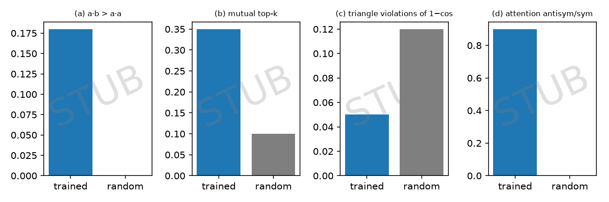

# Meaning as Difference: Opposition, Relation and Negation {#sec-ch-meaning-as-difference}

The chapter on nearness asked how far apart two meanings are. It did not ask how they differ. The step from one meaning to another is itself meaningful: from man to woman, from hot to cold, from Paris to France, from a sentence to its negation. A property of a space of meanings would be that such a step is a thing in its own right: the same step can be taken from elsewhere (an analogy), the opposite of a meaning has a place, and a relation is an operator that is named once and applied to many pairs. The question of this chapter is how much of difference a vector space carries. It starts from two sceptical results: that the offset of an analogy is often an artefact of how it is tested, and that a nearest-neighbour query cannot say no.

The scope is differences between pairs of meanings: analogy and relation, opposition and negation, and the relations of a knowledge graph. It does not cover the likeness that opposites share, which is the chapter on nearness (@sec-ch-meaning-as-likeness); a direction that carries one quality for many items at once (@sec-ch-meaning-as-direction); regions and hierarchy (@sec-ch-meaning-as-region); how a negation combines with the rest of a sentence (@sec-ch-meaning-and-structure); or whether a negated sentence is false, which is a verdict on the world (@sec-ch-meaning-and-truth).

*Goals and expectations (proposed, to be confirmed by the author before any experiment; each is kept or dropped by the run named in its paragraph).*

*Goal 1, meaning as a system of differences (Saussure, Gentner, Turney and Pantel).* If a sign has value through its differences from the others, a relation should be a property of pairs and not of points. The expectation is that for some relations (grammatical ones such as plural and tense, and some semantic ones) the offset between the two words of a pair is more consistent across pairs than chance, and that it beats the baselines of the sceptics (answer from the third word only, and ignore the first pair), and that for other relations it does not. The run is the analogy test with the input words excluded, in both directions, on the spaces of the chapter on nearness (@sec-diff-offset).

*Goal 2, opposition (Osgood, Mohammad and colleagues).* An opposite shares the contexts of its pair and differs along one axis. The expectation is that the offsets of antonym pairs (hot to cold, big to small) are more aligned with each other than the offsets of random pairs, and less than those of grammatical relations; the antonym lists are to be specified (@sec-diff-opposites).

*Goal 3, relations as operators (Bordes, Sun and colleagues).* Each model of knowledge-graph embedding expresses some patterns of relation (symmetric, antisymmetric, inverse, compositional) and not others, so on a toy graph with one relation of each pattern a model that cannot express a pattern must fail on it. The expectation has an analytic answer that the papers state; the run checks that the implementations agree with it (@sec-knowledge-graph-embeddings-historical).

*Goal 4, negation (Birkhoff and von Neumann, Widdows).* A single query vector under a dot product realizes only a limited family of rankings, so negation and conjunction fail in one-vector retrieval, and negation as the orthogonal complement of a subspace works over the reals. The run counts the rankings that a query vector of dimension 2 and 3 can realize over a small set of items, and compares subtracting a vector with projecting it out on a toy "A and not B" query (@sec-what-fixed-dimension-dot).

*Goal 5, which relation holds between two near items.* A cosine says that two items are near and not in which way. The expectation is that a relation that is given as an input, a label that selects the offset or the operator, can be recovered for pairs that were never seen with it, for the relations on which Goal 1 finds a consistent offset, and cannot for the others. The run takes the labelled pairs of Goal 1 and asks which relation holds between a held-out pair, from the offset alone, against a classifier on the two vectors and a shuffled-label null (@sec-diff-offset). *This goal receives Q19 of @sec-gallery-neighbours.*

## What the Philosophies Say About Difference {#sec-diff-philosophy}
*Plan (about 3 pages). Saussure's claim that a sign has value only through its differences from the other signs [@saussure1916cours], to be read at the page before it is quoted; Gentner's structure mapping, in which an analogy is a one-to-one, relationally consistent mapping of parts [@gentner1983structure], and Turney and Pantel's distinction between attributional similarity (between two words) and relational similarity (between two pairs), which does not reduce to the first [@turney2010frequency, §2.4]; Tversky's asymmetry of likeness [@tversky1977features], which a symmetric score cannot say; opposition as one axis (Osgood's bipolar scales [@osgood1957measurement]) and as lexical contrast [@mohammad2013computing]; and negation as a logical operation on subspaces [@birkhoff1936logic]. For each account: what it says a difference would be, what a vector carries of it, and where it stops. What stops it is stated here and handed on: the truth of a negation to the chapter on truth, its place in a sentence to the chapter on composition.*

## Is the Offset Consistent? {#sec-diff-offset}
*Plan (about 4 pages). The offset between word vectors encodes relations such as plural or gender [@mikolov2013linguistic], and it is the best-known and the most contested property. For it: the offset method is a linear combination of three pairwise similarities, and a similar amount of relational similarity can be recovered from sparse counts [@levy2014linguistic], with derivations of why offsets appear [@allen2019analogies; @ethayarajh2019linear]. Against it: a literal implementation returns an input word almost always, baselines that ignore the first pair recover part of the success, and the result depends on how similar the words are and on the test implementation [@linzen2016analogies; @rogers2017toomany; @schluter2018analogy]. The run reports the offset against those baselines, in both directions, per relation, on the three spaces of the nearness chapter (script `offset.py`, moved here from that chapter's code directory); the standard test is itself a combination of three cosines, so a failure may come from the nearness and not from the relation. Null: the baselines. Judge: the Google analogy set, restricted to the vocabulary.*

## Are Opposites Directions? {#sec-diff-opposites}
*Plan (about 2 pages). Antonyms are near in a space of company because they share contexts, and for Mohammad and colleagues opposites are at least as similar as near-synonyms under a distributional measure [@mohammad2013computing]. The question here is the other half: do opposites differ along a consistent direction? The run takes lists of antonym pairs (to be specified: the pairs flagged as antonyms by a lexicon, or a short hand-made list, said to be so), computes the cosine between the offsets of all pairs of pairs, and compares it with the same quantity for random pairs and for a grammatical relation (plural). Null: random pairs. If the offsets of antonyms do not align, the opposite is not a direction but a region of the space around the word, which is the subject of the chapter on regions.*

<!-- salvaged from embedding-technologies-stubs/graph_embeddings.qmd, section sec-what-relation-can-be -->
## What a Relation Can Be {#sec-what-relation-can-be}
*Symmetric, antisymmetric, inverse, and compositional relations, and the algebra each one needs. A relation between things is not the only asymmetry: the likeness of two things is itself directional in human judgement [@tversky1977features] (@sec-likeness-not-distance), which a symmetric score cannot say and which the asymmetric relations of this section are the machinery to express.*

<!-- salvaged from embedding-technologies-stubs/graph_embeddings.qmd, section sec-knowledge-graph-embeddings-historical -->
## Knowledge Graph Embeddings, as a Historical Sequence {#sec-knowledge-graph-embeddings-historical}
*Each model fixes a relation pattern that the previous one could not express.*

*Translational Models (TransE).*
*Relations as spatial translations ($\mathbf{h} + \mathbf{r} \approx \mathbf{t}$).*

*Bilinear & Multiplicative Models (DistMult, ComplEx).*

*Rotational Models (RotatE).*
*Relations as rotations in the complex plane ($\mathbb{C}^D$).* *Likeness here is defined modulo an operator, $\mathbf{t} \approx \mathbf{h} \circ \mathbf{r}$: two pairs are analogous if the same rotation maps both (Sun et al., ICLR 2019, to add), and Paris and France are related without being alike (@sec-likeness-other-objects).*

<!-- salvaged from embedding-technologies-stubs/vector_databases.qmd, section sec-what-fixed-dimension-dot -->
## What a Fixed-Dimension Dot Product Can Express {#sec-what-fixed-dimension-dot}
*Where the dot product comes from: a dual encoder trained with the contrastive loss of @sec-ch-meaning-as-likeness, in which a question and the passage that answers it are a positive pair and the other passages of the batch are the negatives [@karpukhin2020dense, Section 3.2]. The structural limit: how many distinct rankings and subsets a query vector of dimension $d$ can realize, and what that means for negation, conjunction, and multi-hop queries. Relevance is also not likeness. A passage covers a question, and the converse does not hold, so what a retriever wants is directional, and Tversky's contrast model splits it into three quantities: what the two share, what the question asks and the passage lacks, and what the passage adds that was not asked [@tversky1977features] (@sec-likeness-not-distance). A two-tower dot product can be asymmetric, but it returns one number where the contrast returns three, so a missing fact and an extraneous paragraph both lower the score and cannot be told apart. Late interaction in the style of ColBERT sums the best match of each query token over the document, which is asymmetric in the direction of coverage of the question (from memory of the paper, to be checked, and not yet in `references/`). A reranking head that outputs the three quantities separately is an idea, not a result, and is kept in `notes/ideas.qmd`.*

*A similarity threshold is not portable. A cut-off on cosine ("keep results above 0.8") reads the same everywhere only if the space is isotropic and its density is uniform. Neither holds in trained spaces (@sec-reading-nearness-correctly): a cone-shaped space raises every cosine, and a dense region puts unrelated items inside the same radius that, in a sparse region, holds only close ones. So a retriever should prefer top-$k$ or a threshold calibrated per query (for instance, relative to the distance to the $k$-th neighbour) and centre the vectors first; the check is the precision of results above the threshold, binned by local density.*

<!-- salvaged from embedding-technologies-stubs/graph_embeddings.qmd, section sec-graph-databases-vs-vector -->
## Technologies That Exploit Difference {#sec-diff-technologies}
*Plan (about 1 page). Knowledge-graph completion and link prediction (a missing fact is the pair that a relation operator maps best); audits of bias by analogy and the reliability of that use [@nissim2020fair; @bolukbasi2016man; @gonen2019lipstick]; negation-aware and conjunctive retrieval, where one dot product fails; and the convergence of graph databases and vector databases (@sec-graph-databases-vs-vector). For each technology: the cost per query or per triple, whether it parallelizes, and whether quality at matched tuning supports the newer model over the older one (re-evaluations in which older knowledge-graph models match newer ones once trained with equal tuning are reported, from memory and not yet read).*

## Arrows That Point One Way {#sec-arrows-that-point-one}
*Plan (1 page). Findings: whether the offset of a relation is more consistent than the baselines for some relations and not others; whether opposites are a direction or a region; which relation patterns (symmetric, antisymmetric, inverse, compositional) each knowledge-graph model can and cannot express, in the order in which each fixed what the previous one could not; and what one dot product cannot rank. Achieved for the representation of meaning: difference as a relation (@sec-prop-difference), with a direction for each relation that survives the baselines. Computation: whether embeddings learned from data make explicit graph structure unnecessary, read from cost per query and quality at matched data, dated. Still out of reach: a pairwise edge cannot express an interaction among three or more things (@sec-what-pairwise-structure-cannot), and the truth of a negation is a verdict on the world (@sec-ch-meaning-and-truth).*

*Sources and gaps (first pass).* Sourced in `references/`: the offset and its sceptics, relational similarity, lexical contrast, the logic of subspaces. Not yet read for this chapter: Saussure at the page; the knowledge-graph papers (TransE and RotatE are in `references/`, DistMult and ComplEx are not); the claim about re-evaluations of knowledge-graph models.

<!-- salvaged from chapters/properties_of_meaning.qmd (snapshot: embedding-technologies-stubs-v2/properties_of_meaning.qmd), section sec-prop-difference -->

## Difference Is a Relation {#sec-prop-difference}
*The step from one meaning to another is itself meaningful, and the same step can be taken from elsewhere.*

Figure (planned): the analogy parallelogram, with the step from "man" to "woman" repeated from "king" to "queen". It is to be drawn together with the baselines of the sceptics (below), and not from a two- or three-dimensional projection alone, which the sceptics do not accept as evidence of an analogy regularity [@schluter2018analogy].

Earned in @sec-ch-meaning-as-likeness (analogy), this chapter (relations as translations and rotations), and @sec-ch-meaning-as-arrangement (aligning two spaces by their steps rather than their points).

Sources (first pass). The offset between word vectors encodes relations such as plural or gender [@mikolov2013linguistic; @mikolov2013efficient; @pennington2014glove]; analogy as a mapping of relations, in cognitive science [@rumelhart1973model; @gentner1983structure]; relations as translations of the space [@bordes2013translating]. The same distinction in the vector-space literature: attributional similarity (between two words, from a word–context matrix) against relational similarity (between two pairs, from a pair–pattern matrix), which does not reduce to the first (mason and carpenter are alike, and stone and wood are alike, but mason : glass and carpenter : clay do not share a relation); on 374 SAT analogy questions the pair–pattern cosine reached 56 per cent against 57 per cent for the average college applicant and the best attributional method 35 per cent [@turney2010frequency, §2.4 and §6]. That is a reason to state difference as a property of pairs and not of points. Human relational similarity also fails the axioms that the parallelogram assumes: ratings of the same two pairs change with the order of presentation (4.76 against 2.36 for angry : smile and exhausted : run), the triangle inequality fails for triads whose middle pair has two relations (nurse : patient, mother : baby, frog : tadpole), and no single geometric comparison of difference vectors works for every relation type [@chen2017evaluating].

Sceptics and balance. This is the best-known and the most contested property. For it: the offset method is equivalent to maximizing a linear combination of three pairwise similarities, and a similar amount of relational similarity can be recovered from traditional sparse distributional representations, so it is not an artefact of neural training [@levy2014linguistic]; and there are derivations of why offsets should appear in skip-gram-type embeddings, with explicit error terms [@allen2019analogies; @ethayarajh2019linear]. Against it: a literal implementation of the offset returns one of the input words almost always, and when the input words are excluded, baselines that ignore one or both of the first pair recover part of the success; reversing the direction of an analogy changes the accuracy although the offset is the same; and the plural category may measure that a plural lies near its singular, not that an offset is consistent [@linzen2016analogies, p. 5]. The offset method also depends on how similar the words are in the space [@rogers2017toomany], the standard test implementations distort the result [@schluter2018analogy], and the use of analogies to expose bias is itself unreliable: the constrained and unconstrained versions give different pictures [@nissim2020fair, p. 6]. What survives: for some relations, in some spaces, the offset between pairs is more consistent than chance, and, to a first order, the same co-occurrence statistics that give nearness explain it. Stated that way, difference is weaker and better supported than "the analogy parallelogram". To be earned it must be reported against the baselines of Linzen (answer from the third word only, and ignore the first) and in both directions.

<!-- salvaged from chapters/meaning_as_likeness.qmd (snapshot: embedding-technologies-stubs-v2/meaning_as_likeness.qmd), section sec-likeness-which: the questions that the likeness chapter hands on -->

## Questions Handed On From the Likeness Chapter {#sec-likeness-handed-to-meaning-as-difference}

Wittgenstein's family resemblance and Goodman's discs both show likeness without a common feature. Wittgenstein calls the network of games a family resemblance. Like the members of a family, each game resembles some others in build, features or temper, and no single trait runs through all of them [@wittgenstein1953philosophical, §67]. Goodman gives the same structure with three discs, the first half red and half blue, the second half blue and half yellow, and the third half yellow and half red. Each two discs share a colour, and there is no colour common to all three [@goodman1972seven]. In a longer chain the ends can share nothing at all, a first game alike a second and the second alike a third, with the first and the third alike in no respect, so likeness need not be transitive. Tversky's experiments (1977) add that judged likeness is not symmetric and does not obey the triangle inequality, because it weighs common and distinctive features with weights that depend on which item is the subject [@tversky1977features]. Every score of this chapter reads likeness as a distance, so what a space keeps of these properties has to be asked. A space does not make nearness transitive. The angle between two vectors obeys the triangle inequality, so two near steps bound the third pair by the sum of the angles, but the ends of a chain can still be far apart. Two pairs with cosine 0.7 allow a cosine of almost zero between the ends. A ball around a point is therefore a poor model of a family, which is taken up for regions in @sec-ch-meaning-as-region.

::: {.test #q-likeness-9}
**Q9. Is likeness a distance?** Which of the properties of a distance (identical things at zero distance, symmetry, the triangle inequality) does nearness keep, which judgements of likeness break, and is nearness transitive (if $a$ is near $b$ and $b$ is near $c$, is $a$ near $c$)?

*See* @sec-likeness-not-distance.
:::

Company also has a cost. Harris's substitution test measures which words can stand in the same frame. In his example, *oculist* and *eye-doctor* occur in almost the same environments, while *lawyer* does not. In "I've had my eyes examined by the same oculist for twenty years" an informant may put in *eye-doctor* but in general not *lawyer*, and "it is not a question of whether the above sentence with lawyer substituted is true or not" [@harris1954distributional]. The test sees which words fit a frame, not whether the sentence is true. Opposites and negations occur in the same frames as their counterparts ("the water was hot" and "the water was cold" fit the same frame, and contradict each other), so company puts them near; a measure of semantic distance can even make them "dissimilar and hence distant in one sense, and yet are strongly related semantically and hence close in the other sense" [@budanitsky2006evaluating].

::: {.test #q-likeness-10}
**Q10. What kinds of pair does company put near without likeness?** Of the neighbours that are not alike in meaning, which kinds are systematic (opposites, negations, topical associates, frame-sharing words of another class), how near do they sit compared with paraphrases, and does anything in the space tell them apart?

*See* @sec-near-not-alike.
:::

Harris's example is also a recipe for phrases: keep the frame, change one word, and see how the sentence moves.

::: {.test #q-likeness-11}
**Q11. Does a sentence move as the word does?** If one word of a sentence is replaced by a synonym, an antonym or an unrelated word, does the cosine between the two sentences order the substitutions as the judges do?

*See* @sec-near-not-alike.
:::

Rosch (1975) made graded membership measurable [@rosch1975cognitive]. People agree on how good an example of a category each member is (for 9 of the 10 categories, 95% of the subjects agreed on the very good examples). Rosch's own instruction to the subjects gives the idea in terms of dogs: a retriever is a very "doggy dog" and a Pekinese a less doggy one. A concept then has a centre, and its members are alike to it by degrees.

::: {.test #q-likeness-12}
**Q12. Is likeness graded around a centre?** Does the nearness of a category word to its members follow people's ratings of how good an example each member is?

*See* @sec-near-not-alike.
:::

The gallery showed that near words are related in several ways, not just as synonyms sharing the meaning (forms of one word, words of one field, opposites). The cosine does not and cannot indicate which relation holds, which leads to the question:

::: {.test #q-likeness-19}
**Q19. Which relation holds between two near items?** A near pair says that some relation holds. Can a space tell which relation exists between two words, sentences, texts, sounds or pictures?

*See* @sec-ch-meaning-as-difference.
:::

<!-- salvaged from chapters/meaning_as_likeness.qmd (snapshot: embedding-technologies-stubs-v2/meaning_as_likeness.qmd), section sec-likeness-not-distance -->

## Is Likeness a Distance? Tversky's Three Axioms {#sec-likeness-not-distance .idea}

Here we check whether likeness is a distance at all, since every score of this chapter reads it as one and people's judgements of likeness do not obey the three axioms of a distance. It answers Q9 of @sec-likeness-which.

*Plan (1.5 pages, a table and four smoke tests; none has been run). Every score of this chapter, a cosine, a dot product or a Euclidean distance, reads likeness as nearness, and a distance obeys three axioms. Tversky's claim is that judged likeness breaks all three, and that what a person computes is a contrast of features, not a distance [@tversky1977features]. This section states the three, says which trained scores keep them, and gives the cheap checks. The reading below began as the author's, from a discussion of the paper, and has now been checked against the PDF of *Psychological Review* 84 (1977) (pages are those of the journal): the three axioms and the evidence against minimality and symmetry are on p. 328, the triangle example (Jamaica, Cuba, Russia) on p. 329, the focusing hypothesis ($\alpha > \beta$) on p. 333, the prototype data (Rosch) on p. 336, similarity against difference on pp. 339–340 and diagnosticity on pp. 340–342.*

*Two things read in the PDF that the sections of this chapter had not used. (1) Direction in language: "We tend to select the more salient stimulus, or the prototype, as a referent, and the less salient stimulus, or the variant, as a subject" (p. 328); "the portrait resembles the person", "an ellipse is like a circle", "Turks fight like tigers" and not the converse. The judged similarity of North Korea to Red China exceeds that of Red China to North Korea. A usable probe for a language model, with no vectors involved: for pairs with a clear prominent member, does the model prefer "a is like b" with the less prominent $a$ as the subject? The same probe applies to a two-tower score. (2) Similarity and difference: for letters, the similarity and difference ratings correlate at $-.98$ (slope $-.91$), so when the stimuli are simple the two are complements; for countries, with a prominent pair (USA–USSR) and a non-prominent pair (Tunis–Morocco), the percentages choosing the prominent pair as more similar and as more different add to 113.5 on average, against 100 if they were complements ($t(59)=3.27$, $p<.01$, p. 340). So the effect is real but is found in a contrast of well-known against less well-known pairs, and a space cannot show it with one score: a model that has $\text{sim}(a,b)$ and $\text{dissim} = 1-\text{sim}$ is a complement by construction.*

*The three axioms, each with his evidence in one line. Minimality: the similarity of a thing to itself is not constant, since in identification data some stimuli are taken for another stimulus more often than for themselves. Symmetry: $\delta(a,b) \neq \delta(b,a)$, and the direction is set by salience: the subject of the comparison is weighted more than the referent, so the less prominent variant is judged more like the prominent prototype than the reverse. Triangle inequality: Jamaica is like Cuba (geography), Cuba is like Russia (politics), and Jamaica is not like Russia, so two near pairs do not force the third to be near.*

His alternative is the contrast model. With $A$ and $B$ the feature sets of $a$ and $b$, $f$ a non-negative measure of salience, and $\theta, \alpha, \beta \ge 0$ weights,

$$S(a,b) = \theta\, f(A \cap B) - \alpha\, f(A - B) - \beta\, f(B - A).$$

*When $f$ is additive, a calculation by hand gives $S(a,b) - S(b,a) = (\alpha - \beta)\,[f(B) - f(A)]$. So symmetry fails exactly when the weights differ and the two things differ in salience, and with $\alpha > \beta$ the less salient thing is the one that is more like the other. No coordinate of a trained space is a feature of this kind: the coordinates are free up to a rotation (@sec-prop-invariance), so $A \cap B$ is not defined on them. The nearest candidates are the dictionary features that an interpretability method finds (@sec-ch-meaning-in-context).*

*Which scores keep which axiom (the entries are standard facts, and the numbers are checked by hand):*

| Score | Same value for every thing against itself | Symmetric | Triangle inequality |
|:---|:---|:---|:---|
| Euclidean distance | Yes (0) | Yes | Yes |
| Angle, $\arccos(\cos)$ | Yes (0) | Yes | Yes (a metric on the sphere) |
| $1 - \cos$ | Yes (0) | Yes | **No**: $\mathbf{u}=(1,0)$, $\mathbf{v}=(0,1)$, $\mathbf{w}=(1,1)/\sqrt{2}$ give $1 > 0.586$ |
| Dot product | **No**: $\mathbf{a}\cdot\mathbf{a} = \lVert\mathbf{a}\rVert^2$, and $\mathbf{a}\cdot(2\mathbf{a}) > \mathbf{a}\cdot\mathbf{a}$ | Yes | Not a distance |
| Two towers, $g(\mathbf{q})\cdot h(\mathbf{d})$, as in dense retrieval [@karpukhin2020dense] | No | **No**, when the towers differ | Not a distance |
| Attention logit, $\mathbf{x}_i^\top \mathbf{W}_Q^\top \mathbf{W}_K\, \mathbf{x}_j$ | No | **No**, unless $\mathbf{W}_Q^\top \mathbf{W}_K$ is symmetric | Not a distance |

*Three readings follow, and the first corrects a common shorthand. (1) "Dense scores enforce symmetry and the triangle inequality" is true only of the Euclidean distance and the angle. The cosine keeps symmetry, the dot product keeps symmetry and loses constant self-similarity, which is the form of Tversky's first violation (the cause is different: a norm in the vector, confusability in his data), and the two-tower score and the attention logit are asymmetric by construction, so for them the open question is whether the learned asymmetry has the direction that salience asks for, not whether it exists. (2) The triangle inequality bounds the angle between two vectors by the sum of the other two, yet a threshold on the cosine can still reproduce Jamaica, Cuba and Russia (three unit vectors at $0°$, $45°$ and $90°$ have cosines $0.71$, $0.71$ and $0$), so the example alone does not refute a space. What refutes a distance is judged dissimilarities $\delta(a,c) > \delta(a,b) + \delta(b,c)$, and the check needs those judgements and not a threshold. (3) The score is symmetric, the neighbour relation is not: $b$ can be among the $k$ nearest neighbours of $a$ without $a$ being among those of $b$, and a hub is exactly a point that is among those of many [@radovanovic2010hubs]. This is the prototype pull in rank form, and it appears without any asymmetric score.*

*What has been measured on word association, read in the three papers (all use association and not similarity, the first caveat of this chapter, @sec-prop-nearness). Nematzadeh, Meylan and Griffiths (CogSci 2017 [@nematzadeh2017evaluating], read in the PDF) repeat on Word2Vec and GloVe the tests that Griffiths, Steyvers and Tenenbaum (2007 [@griffiths2007topics]) ran on LSA, against the Nelson norms (5,018 cues): the Spearman correlation of the cosine with the association strength $p(\text{target}\mid\text{cue})$ is only .16 to .25 across corpora (TASA, Wikipedia, the largest available), the median rank of the first associate among 3,951 candidates falls from 48 (CBOW) and 56 (GloVe) on the small corpus to 13 and 11 on the largest, and a probabilistic score built from the vectors (a conditional probability in place of the cosine) changes the correlation by at most .03. For the triangle inequality, they select triples in which the pairs (w1, w2) and (w2, w3) are strongly associated and find, for Word2Vec and GloVe, many (w1, w3) pairs with very low similarity, as in the norms (asteroid and belt, belt and buckle, asteroid and buckle), and for asymmetry (the ratio of $p(w_2\mid w_1)$ to $p(w_1\mid w_2)$) the correlation with the norms is .18 and .01 (CBOW and skip-gram, small corpus), .20 and .19 (medium), .32 to .48 for GloVe, against .49 for a topic model estimated on the small corpus, where the cosine cannot show asymmetry at all because it is symmetric. Their conclusion is that these spaces "suffer from the same geometric constraints as predecessors", with the probabilistic reading (not the cosine) recovering part of the asymmetry; a second finding is that a plain table of co-occurrence frequencies performs about as well as the reduced models on small and medium corpora for the associates (.21 and .20 against .25 and .23 for the skip-gram), at least for relatively frequent words, so dimensionality reduction is not what makes association nearness (which is the other half of the point of Landauer and Dumais in @sec-loss-decides-near: reduction mattered for a synonym judge). Rodriguez and Merlo (CoNLL 2020 [@rodriguez2020word]) compare BERT and static spaces with the Nelson et al. (2004) association norms on three properties, association rank, asymmetry and the triangle inequality: the embeddings replicate the human associations well, the context-aware ones violate the triangle inequality as people do, and they show asymmetry whose direction does not follow the asymmetry of the human norms. Zhang, Campbell, Yu and Kumaravel (AAAI 2021 [@zhang2021circles]) use three evocation datasets, with a Bayesian asymmetry score derived from the conditional probabilities of BERT in many Wikipedia contexts, and find that contextual embeddings are rather random on similarity judgements and do well on asymmetry judgements. So a violation of the axioms found in a trained space is a fact about association, and says little about likeness until a similarity judge with the same design is used; the rank of the human first associate in a space (median rank, precision at $k$) is the statistic of the first paper. The largest association resource now is the Small World of Words (De Deyne, Navarro, Perfors, Brysbaert and Storms 2019 [@deDeyne2019small]): 12,292 cues, 88,722 participants, three responses per cue and the 1,661 primes and targets of the South Florida norms of Nelson et al. included, so that the same cues can be compared with the older norms and with a space.*

*Two further points of the theory, stated as properties of a score and not as results. Diagnosticity: the weight of a feature depends on the set of things being sorted, so that changing one item of the set reorders the classification of the others. A pairwise score in a static space does not look at the set, so the effect can come only from the clustering step; a contextual vector changes with the sentence and not with the comparison set, and a cross-encoder or a reranker, which reads both items together, can in principle use it. Similarity against difference: in a space, "more different" is the reverse of "more similar", whereas the theory has people weighing common features more in judging similarity and distinctive features more in judging difference, so the two judgements are not complements (pp. 339–340, with the effect size given above: 113.5 against 100). The second point can be tried on a judge: ask for the more similar pair and for the more different pair, and count how often the answers are not opposite.*

*Where the theory has been put into a network: a differentiable parameterisation of the contrast model, with learned prototypes and features, replaces the linear projection layer in image and language networks, and its authors report gains (a 24.7% relative accuracy gain for a frozen ResNet-50 adapter on NABirds, and a 7.8% lower perplexity for GPT-2 on PTB with 34.8% fewer parameters; the authors' figures, which the abstract and the introduction of the paper agree on [@doumbouya2025tversky]; the layer can model XOR, which a linear projection cannot, and the paper gives a unified reading of both layers as similarities to learned prototypes). So the objection "the contrast model is discrete, hence out of reach of gradient descent" is not standing, and the question for the book is whether such a score gives a better likeness of meaning and not only a better classifier.*

*Shepard's law of generalization gives a precedent for the two repairs and for the score that sits behind a distance [@shepard1987toward], read in the PDF (OCR; pages of *Science* 237). From a matrix of probabilities $p_{ij}$ that a response learned to stimulus $i$ is made to $j$, he forms the symmetric measure $g_{ij} = \sqrt{(p_{ij}\,p_{ji})/(p_{ii}\,p_{jj})}$ before scaling (p. 1318): the geometric mean removes the asymmetry and the division by the self-responses removes the non-constant self-similarity, the first two axioms put back by normalisation, which is also what a cosine does to a dot product. Then $g$ falls with the scaled distance in a way that is "monotonic, generally concave upward, and more or less approximates a simple exponential decay" (p. 1318), whatever the stimulus and the species tested; the law is derived from a random consequential region and a maximum-entropy prior on its size, and multidimensional scaling does not impose the exponential, only monotonicity. Two consequences for this chapter. (1) A score of the form $\exp(-d)$ or $\exp(\cos/\tau)$ is a likeness that decays with distance by the same law, so the question of whether a trained space is a metric space is separate from the question of whether a monotone function of its distance is the likeness that people show; the order of neighbours is invariant under that function and the values are not (which matters for thresholds, @sec-reading-nearness-correctly). (2) The metric depends on the stimuli: Euclidean ($r=2$) for integral dimensions and a city-block metric ($r=1$) for separable ones (pp. 1318–1319). Which metric of a trained space (L2, L1, angle) correlates best with a judge is therefore an experiment, and the text-based dimensions are neither clearly integral nor clearly separable. He also says that a concave "star-shaped" region ($r<1$) violates the triangle inequality, which Tversky and Gati find for separable stimuli (pp. 1321–1322; page numbers from an OCR of two columns, to be confirmed), and that noise bends the exponential towards a Gaussian, where "failure of discrimination" is mixed with generalization: the same confusion of identity with likeness as the off-diagonal entries of Tversky above.*

*The same axioms were tested on relational likeness, which the parallelogram of analogies assumes symmetric, by Chen, Peterson and Griffiths (CogSci 2017 [@chen2017evaluating], read in the PDF). Given 1,102 participants rating pairs of word pairs, they find that the cosine of difference vectors fails entirely for some relation types (similar, contrast, non-attribute) and the Euclidean distance rescues two of them, so that no single comparison strategy covers all relations; that people rate angry : smile with exhausted : run at 4.76 and the reverse order at 2.36 (hairdresser : comb with pitcher : baseball at 6.10 against 4.84), because the pair "takes" a different relation in each order, so relational similarity is not symmetric; and that triads such as nurse : patient, mother : baby, frog : tadpole violate the triangle inequality (the first two and the last two are good analogies and the first with the last is not), because the middle pair has several relations. This is Tversky's three results for pairs, and it sits with the two readings that this chapter keeps for difference (@sec-prop-difference): a single offset is a first-order summary, and the distinctions that people make are carried by the relation selected.*

*Smoke tests, none run. (a) Self-similarity: the fraction of pairs in a trained space for which $\mathbf{a}\cdot\mathbf{b} > \mathbf{a}\cdot\mathbf{a}$, and the correlation of the norm with word frequency (@sec-ch-meaning-as-likeness says the norm encodes frequency and salience). (b) Mutual neighbours: among the pairs where $b$ is in the top $k$ of $a$, the fraction in which $a$ is in the top $k$ of $b$, against random vectors of the same dimension, where hubness already appears [@radovanovic2010hubs]. (c) Triangle violations of $1-\cos$ on random triples of a trained space, which can only be counted (the angle has none). (d) Asymmetry of attention: the norm of the antisymmetric part of $\mathbf{W}_Q^\top\mathbf{W}_K$ over that of the symmetric part, per head, in a held model. What survives is stated after they are run: nearness is the cheap, symmetric, context-free summary of likeness, and the asymmetry, the context and the weights live in the scorer, which is where the later chapters put them (@sec-ch-meaning-and-truth, @sec-ch-meaning-in-context, @sec-ch-meaning-as-difference).*

*Expected result: (a) a minority of pairs with $\mathbf{a}\cdot\mathbf{b} > \mathbf{a}\cdot\mathbf{a}$ in a trained space and none for random unit vectors; (b) mutual neighbours well above the random baseline and well below 1; (c) a count of triangle violations of $1-\cos$ above zero, the angle having none by construction; (d) an attention head with a large antisymmetric part, which is a property of the weights and not of the data.*

*Q9 asks for transitivity as well, and the four checks above do not test it (planned, not run). For triples with $\mathbf{a}$ near $\mathbf{b}$ and $\mathbf{b}$ near $\mathbf{c}$, count how often $\mathbf{a}$ is near $\mathbf{c}$, against the same count for random triples and for the bound of the angles (the two ends of a chain with cosine 0.7 can be almost orthogonal), and, with a judge that has chains (Wittgenstein's games, Goodman's discs), whether the judged ends are far when the space says they are near.*

{#fig-stub-axioms width=100%}

::: {.questions}
1. State the three axioms of a distance (the ones that Tversky tests). Which of them does each of these scores keep: Euclidean distance, the angle between vectors, the dot product, one minus the cosine?

2. Give an example of an asymmetric human judgement of likeness from Tversky's experiments.

3. Reproduce @fig-stub-axioms: four smoke tests of the axioms on a trained space against random vectors of the same dimension.
:::

::: {.answers}
1. Minimality (the distance of a point to itself is zero and the smallest), symmetry ($d(a,b) = d(b,a)$) and the triangle inequality ($d(a,c) \le d(a,b) + d(b,c)$) [@tversky1977features]. Euclidean distance and the angle (the arccosine of the cosine) keep the three. The dot product is symmetric but not minimal: the dot product of a vector with itself is its squared norm, which varies from word to word, so another word can have a higher dot product with a word than the word has with itself. One minus the cosine is symmetric and minimal but breaks the triangle inequality: for three unit vectors at $0^\circ$, $45^\circ$ and $90^\circ$ in the plane, $1 - \cos 90^\circ = 1$ is larger than $(1 - \cos 45^\circ) + (1 - \cos 45^\circ) \approx 0.59$.

2. Tversky's subjects judged North Korea to be more similar to Red China than Red China to North Korea, and in a forced choice between the two phrasings a large majority chose "North Korea is similar to Red China" and only three chose the reverse [@tversky1977features]. In his contrast model the weights of the features depend on which of the two things is the subject of the comparison, so the less salient is judged more like the more salient than the reverse.

3. The script `axioms.py` runs four tests on SGNS, GloVe and the SVD of PPMI, against Gaussian vectors of the same dimension: (1) minimality, the share of words that have another word with a higher dot product than their own and the variation of the self dot product; (2) symmetry of the two towers of SGNS, the correlation of the score of $(a,b)$ with that of $(b,a)$; (3) the share of random triples that break the triangle inequality for the Euclidean distance, the angle and one minus the cosine; and (4) the share of the ten nearest neighbours that are mutual, with the skewness of how often a word is somebody's neighbour. The scripts were written and not yet run together, so the figure of the chapter is still the stub.
:::

<!-- salvaged from chapters/meaning_as_likeness.qmd (snapshot: embedding-technologies-stubs-v2/meaning_as_likeness.qmd), section sec-near-not-alike -->

## Near but Not Alike {#sec-near-not-alike .idea}
Here we check where nearness and likeness part, that is, which neighbours of a vector are not alike in meaning. It also tries the replacement of one word in a frame, as in Harris's oculist sentence, with a synonym, an antonym or an unrelated word, by the cosine between the two sentences, and the typicality of the members of a category, by the cosine of a category word to each member against Rosch's goodness-of-example ratings. It answers Q10, Q11 and Q12 of @sec-likeness-which.

*The reverse direction: the neighbours of a vector that are not alike in meaning, such as a negated sentence, an antonym ("hot" and "cold" occur in the same contexts), a contradiction. The antonym has measured numbers (Mohammad, Dorr, Hirst and Turney 2013, read in the PDF [@mohammad2013computing], §5.2, Table 8): with Lin's distributional similarity, the average over 1,358 WordNet opposites (direct and indirect, single words) is 0.064 (standard deviation 0.071), over a set of near-synonyms 0.056 (0.057) and over random pairs 0.036 (0.034), the three sets built with a shared focus word per triple (agitation with calmness, with ferment, and with a random word of the same frequency as calmness), a design that controls for frequency and that this chapter can copy; the contrasting set is significantly higher than both, and the large deviations mean that "distributional similarity alone is not sufficient to determine whether two words are contrasting or synonymous". Opposites also co-occur more often than chance and than synonyms (§5.1, Table 7: average PMI 1.47, against 0.41 and 0.03), although a focus word has other words with a higher PMI than its opposite, so co-occurrence is a cue and not a definition, which they use as a cue (PMI) and not as a likeness. Two readings follow. First, the nearness that a distributional space gives is a nearness of company, and opposites keep more company than synonyms, so the claim that is safe is that a space is a judge of *contrast or likeness together* (their "degree of contrast" tracks co-occurrence), and the claim that it puts synonyms nearer than antonyms is a hypothesis to test against a set of synonym and antonym pairs, with the standard deviation as the reason to expect an overlap. Second, a person does not confuse them when asked to fill the slot: Charles and Miller found that given a sentence with the adjective removed, most people did not supply its opposite (§5.2), so the informant test of Harris, which asks what word may stand in the frame and not what co-occurs, separates what the count does not; the likeness of the counts and the likeness of the informants are different judges (@sec-likeness-which). Third, the human judge also shows the structure: agreement that a pair has *some* contrast is high (verbs 94.7 per cent) and falls when asked whether the two are opposites (75.2 per cent), and opposites are of several kinds (antipodals such as top–bottom, complementaries such as open–shut, gradable such as long–short; §3 and Table 6), many pairs belong to more than one kind, and warm–cold or tropical–freezing have contrast without being opposites. The benchmark that asks for "contrast" is therefore not the one that asks for "opposite", and a space is credited with neither until the question is named. Where nearness detects likeness and where it only detects company, and what the next chapters add to say no. The antonym is the case where even the human judge moves: black and white are rated 2.2 alone and 4.0 beside red [@medin1993respects], and Osgood puts the two ends of a pair on one axis, so a benchmark rating of an antonym pair depends on the presentation, and a space that puts them near is not simply wrong (see the two paragraphs on Osgood and Medin in @sec-likeness-which). A third case is direction: a cosine puts "dog" and "animal" as near one way as the other, while "a dog is an animal" does not entail "an animal is a dog", and Tversky's asymmetry is the psychological form of the same fact (@sec-likeness-not-distance). The repairs are asymmetric scores and geometries, such as Gaussian embeddings compared by a divergence [@vilnis2015word] and Poincaré embeddings [@nickel2017poincare] (@sec-ch-meaning-as-region, @sec-ch-meaning-as-difference), with boxes, sparse codes, token sets and relation rotations compared in @sec-likeness-other-objects. A fourth is the pull of a prototype: a rare or novel item is assimilated to a prominent neighbour, which Tversky's focusing hypothesis predicts for people and the hubs of @sec-reading-nearness-correctly show in rank form; whether it explains plausible-but-wrong completions of a model is an untested reading (`notes/ideas.qmd`). Harris already names the exceptions of his own correlation: oculist and eye-doctor differ in "An oculist is just an eye-doctor under a fancier name", a sentence about the words and not about the doctors, and a corpus finds these by growing [@harris1954distributional, §2.3, p. 156]; the correlation is stated for a word and its company, not for an affirmed and a negated sentence, which have almost the same company and opposite truth. A fifth case is distance: a straight line in the ambient space is not a path along the data. If the data lie on a curved manifold of low dimension, nearness measured in the ambient space is the likeness measured along the manifold only inside a small neighbourhood, where the manifold is close to flat, and over a larger distance the straight line crosses regions where there is no data. So a high cosine between close neighbours is more trustworthy than a low cosine between far ones, and the order of far pairs is the weakest part of any space. This is a reason to read the top of a neighbour list and not its tail, and to compare ranks of near neighbours across spaces (@sec-likeness-many-spaces); the geometry (tangent space, geodesic, and the graph-based estimate of geodesic distance) is in @sec-tangent-spaces-geodesics, and the check on a toy manifold is there.*

*Rosch (1975 [@rosch1975cognitive], read in full, *Journal of Experimental Psychology: General* 104) is the psychological source of "graded", and it gives the fourth case a judge. Experiment 1 collected, from 209 native-speaker students on a 7-point scale, the extent to which each of 50 to 60 instances of 10 categories (fruit, bird, vehicle, vegetable, sport, tool, toy, furniture, weapon, clothing) "represents their idea or image of the meaning of the category name", with split-half correlations of .97 or higher and between-coast correlations of .92 or higher (pp. 197–198): a retriever or a German shepherd is a "doggy dog" and a Pekinese a less doggy one. These goodness-of-example norms are far more reliable than the word-similarity ratings of @sec-likeness-which (κ of .21 to .62 for WordSim-353), and they define a likeness to a category and not between two items, with a built-in direction (the instance to the category name). The test that follows is cheap: the rank correlation between the cosine of an instance and its category name (or the mean of the instances) and the goodness rating, per category, against a shuffled null and a frequency control (typicality and frequency are probably correlated, which is an assumption to check, so frequency is the first confound). The experiments that follow show why the order of the neighbours depends on the category in the context: a category name read just before a pair of physically identical stimuli speeds the "same" response for good members and slows it for poor members (Experiments 2 to 4), the effect is on "the level of meaning" and not on lines and angles (Experiments 5 and 6), and for semantic categories, unlike colour, it is removed by long practice (Experiment 9), so the internal structure is learned and is not fixed by the stimuli. The reading for this chapter is that a graded nearness has a long human precedent, that centrality (the prototype) is a property of the item with respect to a category, and that the prototype pull of the fourth case and the hubs of @sec-reading-nearness-correctly are two views of one asymmetry; whether a hub of a space is a prototype of the category, or only a frequent word, is a test with the same data.*

::: {.questions}
1. Why are antonyms such as hot and cold near in a space built from the company of words?

2. What do Mohammad and colleagues measure, and what do they find about opposites against near-synonyms and random pairs?

3. In a pretrained space, compare the cosine of five antonym pairs, five synonym pairs and five random pairs, and the cosine of a sentence with its negation and with a paraphrase of it.
:::

::: {.answers}
1. Opposites occur in the same contexts: hot and cold are both kinds of temperature, black and white kinds of colour, and a loss that rewards co-occurrence or shared company gives them similar vectors. Turney and Pantel say that antonyms have a high degree of attributional similarity [@turney2010frequency], and for Budanitsky and Hirst they are dissimilar and distant in one sense and strongly related and close in the other [@budanitsky2006evaluating]. Nothing in the loss says that the two are opposite.

2. They measure how strong the distributional similarity (Lin's measure) is between the two words of 1,358 WordNet opposites, of a set of near-synonyms and of random pairs. The average is 0.064 for the opposites, 0.056 for the near-synonyms and 0.036 for random pairs [@mohammad2013computing], so opposites are at least as similar as near-synonyms, and both far above chance.

3. Take static vectors for the words (word2vec or GloVe from the Internet, or the spaces of this chapter) and a sentence encoder for the sentences, such as a MiniLM model of the `transformers` library with the mean of the token vectors as the sentence vector. Typical results: antonyms like hot–cold have a cosine as high as synonyms or higher, well above the random pairs; "the film is good" is as near to "the film is not good" as to "the film is fine", and with some encoders nearer. The answer depends on the model and on how it was trained (a model trained with contradiction pairs as negatives can separate negations), so state the model and look at several pairs and not at one.
:::
