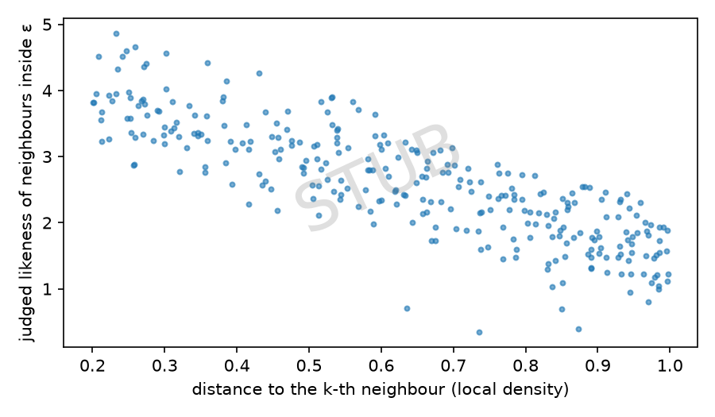

# Meaning as Likeness: What a Distance Can Carry {#sec-ch-meaning-as-likeness}

The last chapter ended with a table of one-hot symbols in which every pair of words is equally far apart, so that no pair is nearer than another, and with Rice's theorem putting exact meaning out of reach. What is left is a graded nearness, but will it work? This chapter asks what learned nearness is worth as a likeness of meaning.

Philosophy has given several answers to what meaning is, and each says what a likeness of meaning would have to be. Frege separates the idea, the sense and the reference of a sign; Harris, Firth and Wittgenstein say that a sign means what it does through its use and its company; Quine, that evidence reaches only the whole web of sentences; Wittgenstein and Goodman, that things can be alike with nothing in common to all of them; Kripke and Putnam, that a name is tied to its bearer and not to the descriptions we attach to it; Kaplan, that what a sentence says depends on who says it and where. A trained space does one thing: it puts items at distances. So the question of this chapter is which of these answers a vector with a distance can carry, and where it stops. Alike things should sit near each other and different things far apart, whether they are words, phrases, sounds, images or clips: `dog` near `puppy`, less near `wolf`, far from `car`. But "alike" is not a single relation. Similarity, relatedness and association are different readings of likeness, and each has its own judge.

The scope follows from the question. The chapter covers graded likeness of sense and of use: the loss that builds a nearness, how to read it correctly, whether it is a distance at all, how much of it survives another seed, algorithm or corpus, and the first places where near is not alike. It does not cover what a space cannot carry by position alone, and each such limit is a hand-off to a property of its own: that a word's meaning changes with its sentence (context and disambiguation), that a sign refers to something and a sentence is true or false (reference and truth, with hallucination as plausible without being true), how an opposite or a negation is built (difference), how parts make a whole (composition), what a vector of a long text can hold (scale), how nearness is used to produce new meaning (generation) and what a second sense adds (senses). The chapter says where it stops and names the property that takes over, and it does not try to settle those questions.

Nearness is also partly made by the loss function used to optimize the models. Sometimes it is put there by construction, as with an image and its caption, and sometimes it shows up without being asked for; only the second says something about meaning and not about the loss. We look at neighbours first, then measure them against an impartial judge and a null hypothesis, account by account and loss by loss. Behind the word "near" there is a further question, whether likeness is a distance at all: people's judgements of likeness break the axioms that a distance obeys, and a trained space inherits some of those axioms from its score and not from the data (@sec-likeness-not-distance).

*Goals and expectations (the author's, written before any experiment; each is kept or dropped by the run named in its paragraph, and the figures are stubs with invented numbers, marked STUB, until then). There is one goal for each account of meaning that bears on nearness, and a method that all of them share.*

*Method: what a raw cosine hides.* Every goal below reads a cosine, so the cosine is corrected once and the correction is reported with each result. The expectation is that centring on the mean and removing the top directions raise the correlation with the judge and lower the correlation with frequency, against a shuffled-label null and a random-vector null (the correction made with a global mean and with the mean of each cluster [@cai2021isotropy]), with a bootstrap over pairs and the judge itself checked by adding noise to the vectors [@batchkarov2016critique]. The run compares the raw and the corrected cosine for each model family (@sec-reading-nearness-correctly, @fig-stub-centring).

*Goal 1, use and company (Harris, Firth, Wittgenstein).* If likeness of meaning shows as likeness of company, then a space built only from company should recover it, whatever the loss that counts the company. The expectation is that counting, predicting and weighted least squares agree with each other, and with a judge of association more than with a judge of similarity, and that all stay below the human ceiling, defined as the agreement between raters and not the score of an average test taker (a method can exceed the latter: 92.5 per cent against 64.5 per cent on the TOEFL items [@turney2010frequency]). The run trains three losses and keeps the unreduced PPMI rows as a null, on one text, scores them against a similarity benchmark and an association benchmark, and repeats the comparison for growing amounts of text, since "use" is a claim about quantity of company (@sec-loss-decides-near, @fig-stub-loss-agreement). What company is not: it is one level of Firth's own account, and the context of situation is the level a corpus does not carry.

*Goal 2, sense against idea (Frege).* Frege's three levels give the kinds of likeness and their judges: the idea (free association), the sense (similarity, synonymy) and the reference (the world). The expectation is that a space trained on text reaches the sense at best, so that its cosine tracks association more than similarity for every loss, and that it says nothing of the reference. This is read from the scores of goal 1 and needs no new run (@sec-likeness-judges); the reference is goal 7.

*Goal 3, family resemblance and respects (Wittgenstein, Goodman).* A family is held by overlapping similarities with no feature common to all, and Goodman's three discs are alike in pairs with no colour common to the three. In a space this means that nearness is not transitive and that a concept is a connected set and not a ball. The expectation is that chains in which a is near b, b is near c and a is far from c occur more often than among random triples, and that the likeness of the neighbours inside a fixed radius falls as the region gets sparser, so that rank ($k$) is safer than radius (@sec-reading-nearness-correctly, @fig-stub-radius-density). The run counts chains against random triples and measures judged likeness inside $\epsilon$ against the distance to the $k$-th neighbour.

*Goal 4, likeness as a distance (Tversky).* The expectation is that Euclidean distance and angle keep all three axioms; the dot product loses constant self-similarity; two towers and attention are asymmetric; and mutual neighbours fall below one even for symmetric scores. Four smoke tests run against random vectors of the same dimension (@sec-likeness-not-distance, @fig-stub-axioms).

*Goal 5, holism and stability (Quine).* If a word means what it does through the whole web, its position should move little when an unrelated part of the web changes, and a position that moves more than a change of seed would say that the nearness is not local. The expectation is that seeds differ least, algorithms more and corpora most, that removing a part of the corpus that does not mention a word moves its neighbours no more than a change of corpus does, and that only the local neighbourhood survives all of them. The run measures the overlap of nearest neighbours across seed, algorithm, corpus and removed parts, with the seed gap as the null (@sec-likeness-many-spaces, @fig-stub-many-spaces). Coordinates are free up to a rotation, so this overlap, which is invariant to it, is the right measure, and the comparison of two spaces by alignment is a hand-off to the chapter on arrangement.

*Goal 6, built in against emergent (Goodman, Harnad, Bender and Koller).* The expectation is that in an image-text model an image is near its caption because the loss pulled them together, and that nothing in the loss says that two images, or an unpaired sound and word, are near. The run separates the built-in cell from the emergent one, and only the emergent one is counted as evidence about meaning (@sec-likeness-pairs-senses). What a second sense adds is a question for the chapter on senses.

*Goal 7, reference (Kripke, Putnam, Frege).* A name is tied to its bearer and not to the descriptions attached to it, and a space knows a name only through the words around it. The expectation is that nearness follows the company of a name and not its bearer: that names with a widespread false description sit near the description, that one name with two bearers has one vector that averages them, and that two names for one object are near only when their company is. The run uses these three kinds of name against the corpus and against the person (@sec-near-not-alike). The result is handed to the chapter on reference and truth.

*Goal 8, indexicals (Kaplan).* The expectation, which a demonstration with no corpus is enough to confirm, is that a static encoder gives one sentence one vector whoever says it and wherever, so that it has a character and no content in Kaplan's sense. The demonstration is made on sentences such as "I am here now" (@sec-near-not-alike) and sets the boundary with the chapter on context.

*Goal 9, opposition (the limit of nearness as likeness).* Antonyms and contradictions share their contexts, so the expectation is that antonyms are as near as synonyms, or nearer, and that a sentence is near its own negation as much as a paraphrase is. The run compares antonym pairs and sentence-negation pairs with synonym pairs and paraphrases (@sec-near-not-alike). How an opposite or a negation is built is a hand-off to the chapter on difference.

Goals 1 and 5 also run at the levels of sentences, images, sounds and video where a judge and a null exist, and where they do not the cell is marked untested (@sec-likeness-found). The scripts of the stubs are in `code/meaning_as_likeness/stub_figures.py`, a skeleton that the Makefile does not run.

*Plan (page budget, about 25 pages in the final form and 40 as the ceiling; the sections are cut to it in the next step). This opening and the goals take about 3 pages; the account of meaning and the judges (@sec-likeness-which, @sec-likeness-judges) about 6; the gallery and CLIP (@sec-gallery-neighbours, @sec-likeness-pairs-senses) about 3; the loss and the reading of nearness (@sec-loss-decides-near, @sec-reading-nearness-correctly) about 5; the axioms and the stability (@sec-likeness-not-distance, @sec-likeness-many-spaces) about 4; where near is not alike (@sec-near-not-alike) about 3; and the closing section about 1. The sections on phrases and sentences, on images, sounds and video and on other objects have moved to the chapters on scales, on senses and on regions.*


## What Is Likeness in Meaning? {#sec-likeness-which}

Each account of meaning below is read for the same three things: what it says a likeness of meaning would be, what a vector with a distance can carry of it, and where the vector stops. The accounts are not tested against one another. A theory that a space fits by construction is not supported by the fit, because the loss was made to give it. The informative cases are the ones where the theory says that something should be missing, and each of them ends in a hand-off to the property that takes over. The readings behind the paragraphs are in `notes/philosophy_of_meaning.md`.

*Frege: idea, sense and reference.* Frege separates three levels at which expressions differ: "The difference may concern at most the ideas, or the sense but not the reference, or, finally, the reference as well" [@frege1892sense]. Each level has its judge. The idea is the private image, and the judge that comes closest is free association; the sense is shared and is judged by similarity and synonymy; the reference is the object, and the judge is the world. His telescope puts the three apart: the Moon is the reference, the real image in the object glass is the sense, and the image on each observer's retina is the idea. The image in the glass "is indeed one-sided and dependent upon the standpoint of observation; but it is still objective, inasmuch as it can be used by several observers". A learned vector is the image in the glass. It is one-sided, since it depends on the corpus, the loss and the seed, and it is shared among its users; free association is the retinal image, which is why a judge of association is not a judge of sense. A text-only space reaches the sense at best. The vector gives the thought and does not give its truth value, and Frege adds that "the mere thought alone yields no knowledge, but only the thought together with its reference, i.e. its truth value". How far a space can go from the sense to the reference is the subject of the chapter on reference and truth, and the first goal that measures the difference is goal 2.

*Harris and Firth: company.* Harris holds that "difference of meaning correlates with difference of distribution": oculist and eye-doctor occur in almost the same environments, oculist and lawyer in many different ones, and the amount of difference in meaning corresponds roughly to the amount of difference in environments [@harris1954distributional, pp. 156–157]. He claims less than the slogan. No word has "a single or central meaning, or even … a continuous or coherent range of meanings" (p. 152), the correlation is "much greater when we consider connected discourse" (p. 152), and the substitution test measures selection and not truth: "it is not a question of whether the above sentence with lawyer substituted is true or not" (p. 157). Firth's sentence, "You shall know a word by the company it keeps!", sits in a passage on use, and the next one says that "one of the meanings of ass is its habitual collocation with such other words" (p. 11), so a collocation is one meaning among several [@firth1957synopsis]. He states meaning "at a series of levels", of which collocation is one and the context of situation another (pp. 8–10), and he deplores "the piling-up of trivialities to be treated statistically" (p. 1). The measurable claim, that likeness of meaning shows as likeness of company, is Harris's; the partial claim, that company is one level of meaning, is Firth's; the claim that company is meaning is neither's. A space built from counts or predictions of company is this measurable claim made into a matrix, so that the likeness it shows is the loss and not a discovery (goal 1). What it cannot carry is Firth's other levels, above all the context of situation (who speaks, to whom, about what), which a corpus of text does not hold, and the dependence of a word's meaning on its sentence, which is the property of context.

*Wittgenstein and Goodman: family resemblance and respects.* For Wittgenstein "for a large class of cases—though not for all—in which we employ the word 'meaning' it can be defined thus: the meaning of a word is its use in the language" (§43), so likeness of use is likeness of meaning for a class of cases and not a theory of all meaning [@wittgenstein1953philosophical]. The members of a class like the games need share no feature: "a complicated network of similarities overlapping and criss-crossing" (§66), a "family resemblance" (§67), like a thread whose strength "does not reside in the fact that some one fibre runs through its whole length, but in the overlapping of many fibres". The concept "is not closed by a frontier" (§68): one can draw a boundary "for a special purpose", and a blurred concept is still a concept. Goodman states the same from the side of logic [@goodman1972seven]. In a universe of $n$ things any two have exactly $2^{n-2}$ properties in common, so counting shared properties cannot define likeness, and weighting them "is a highly volatile matter, varying with every shift of context and interest" (pp. 443–444). Three discs, half red and half blue, half blue and half yellow, half yellow and half red, are alike in pairs and have no colour common to all three (pp. 442–443). In a space this means that nearness is not transitive, that a family is a connected set under nearness and not a ball around a prototype, and that a fixed radius is a poor model of a concept; a threshold is a boundary drawn for a purpose, and neither it nor a rank is the concept. A cosine also returns a number and not the respect in which the two items are alike, which is the one that the loss and the corpus made dominant (goal 3). Wittgenstein adds that likeness is noticed and is not in the data: the man who draws two faces accurately and the one who notices their likeness see different things (Part II, §xi), so the judge is part of what likeness is.

*Quine: holism and indeterminacy.* Quine argues that the notion of synonymy that analyticity needs "has still to be clarified", and that our statements about the external world "face the tribunal of sense experience not individually but only as a corporate body" (about p. 38) [@quine1951two]. This is the holism that a space fits: the position of a word is defined by its relations to all the others. The text does not say that likeness is graded, and that step is the author's. In *Word and Object* the evidence for translation is stimulus meaning, and it already falls short of synonymy: assent to "Gavagai?" "can depend excessively on prior collateral information" (p. 33), and "Gavagai" and "Rabbit" can have the same stimulus meaning without being coextensive terms, since the objects may be rabbits, rabbit stages, undetached parts, or rabbithood (pp. 46–47) [@quine1960word]. The indeterminacy begins beyond that evidence: rival manuals of translation "can fit the totality of speech behavior to perfection, and can fit the totality of dispositions to speech behavior as well, and still specify mutually incompatible translations of countless sentences insusceptible of independent control" (pp. 65–66). He sets apart the weak case, in which systems differ "in word segmentations, in parts of speech" and still "have identical net outputs", from his own, which is "a difference in net output" (p. 66). The coordinates of a space are free up to a rotation, and a rotation is the weak case: it changes the description and leaves every relation unchanged. His thesis would need two alignments that fit the relations inside both spaces equally well and disagree on the neighbours of held-out words. The measure that fits holism is therefore one that a rotation does not change, the overlap of nearest neighbours between spaces and under removal of a part of the corpus (goal 5), and the comparison of two spaces by alignment is a hand-off to the chapter on arrangement.

*Tversky: likeness is not a distance.* The experimental psychology of likeness is the strongest objection to reading it as nearness. Tversky showed that judged likeness violates the axioms of a distance, since it is not symmetric, not minimal and not transitive in the sense of the triangle inequality, because it weighs the common and the distinctive features of the two things with weights that depend on which is the subject and on the set compared [@tversky1977features]. A symmetric metric cannot say that $a$ is more like $b$ than $b$ is like $a$, and a two-tower score or a learned bilinear form can. Which axioms a trained space keeps is set by its score as much as by its data, and this is measured in goal 4.

*Kripke and Putnam: reference.* Kripke attacks a precise thesis, that the reference of a name is whatever uniquely or mostly satisfies the descriptions that speakers associate with it [@kripke1980naming]. If the only thing a speaker knows of Gödel is that he proved the incompleteness of arithmetic, and the work was in fact Schmidt's, the theory makes "Gödel" refer to Schmidt, "But it seems to me that we are not. We simply are not" (p. 84); Peano, Einstein and Columbus are further cases (p. 85). The theory also fails by circularity, since a community cannot fix a reference by "the man to whom the incompleteness of arithmetic is commonly attributed" without "some independent criterion for the reference of the name" (p. 89). His positive picture is a chain from an initial baptism, each speaker intending "to use it with the same reference as the man from whom he heard it" (p. 96), which he offers as "a better picture" and not as a theory (p. 97). Names are rigid designators, which designate the same object in every possible world where it exists (pp. 48–49). Putnam's Twin Earth example is "designed to show that meanings ain't in the head" [@putnam1975meaning]. A space knows a name only through the words around it, which is close to the cluster-of-descriptions theory that Kripke rejects: the vector of "Gödel" is near the company of the name, and if the company says Schmidt's deeds the vector has no means to say that the name refers to someone else. The chain is mostly outside the data, since a corpus holds the links that were written and not the intention or the baptism. Kripke himself grants that the description theory applies to the initial baptism (p. 96, note 42), so for the many names whose company is true of the bearer the space and the chain agree, and the failures are where the company is false or where two bearers share a name. This is goal 7, and its result is handed to the chapter on reference and truth.

*Kaplan: character and content.* A word has a rule that does not depend on the context (its character, a function from contexts to contents) and a content fixed in the context (pp. 504–505) [@kaplan1989demonstratives]. A text encoder takes the text and not the context of use, so it lives on the side of the character: "I", "here" and "now" get one vector whoever says them and wherever. A demonstration with no corpus is enough to show it (goal 8), and the dependence of meaning on the situation of use is the subject of the chapter on context.

*Ramsey: truth and use.* For Ramsey "p is true" is simply the same as p (p. 157), and the meaning of a sentence is "to be defined by reference to the actions to which asserting it would lead, or, more vaguely still, by its possible causes and effects" (p. 170) [@ramsey1927facts]. A space of company has no truth predicate to add, so a direction that separates true from false text is a direction of what is asserted, and on Ramsey's redundancy view that is all there is to a truth value. Whether such a direction tracks the facts or only what the text asserts is the question of the chapter on reference and truth.

*Gärdenfors, Harnad, and Bender and Koller: regions and grounding.* Gärdenfors places meanings as regions of a space of quality dimensions and not as points [@gardenfors2000conceptual], which the chapter on regions takes up. Harnad holds that symbols must be grounded in something outside the symbols [@harnad1990symbol], and Bender and Koller that a system trained only on form has no way to learn meaning [@bender2020climbing]. Both bear on goal 6, which separates the nearness that a paired loss builds in, where an image and its caption are near because the training pair says so, from the nearness that appears unasked; only the second is evidence about meaning, and what a second sense adds is the subject of the chapter on senses.

*What fits, what is missing, what is open.* What fits is the distributional core: Frege's sense, Quine's holism, Wittgenstein's use, Harris's and Firth's company all say that what a sign means is what is around it, and a space built from company is that claim made into a matrix. What is missing is reference. Kripke, Putnam and the Frege of the truth value agree that a sense alone is not knowledge of the world, and a text-only space has only the sense, which is the philosophical form of "near is not alike" (@sec-near-not-alike) and the reason to separate what a space is credited with from what it is trusted for. What is open is whether a text-only space can reach the reference or only a better sense: the claim that separately trained models converge on a shared structure of the world is made [@huh2024platonic], and the reply is that what converges is mostly the local neighbourhood and not the global geometry [@groger2026aristotelian; @koepke2026plato]. Whether grounding in images and action closes the gap is taken up in the chapter on senses; whether a truth direction tracks facts or only what the text asserts, in the chapter on reference and truth.

::: {.questions}
1. In Frege's telescope, what do the Moon, the real image in the object glass and the image on each observer's retina stand for, and which of them is a learned vector closest to? Why?

2. "You shall know a word by the company it keeps" is often quoted as if company were meaning. What does Firth say in the same passage, and what does Harris claim instead?
:::

::: {.answers}
1. The Moon is the reference (the object), the real image in the object glass is the sense, and the image on each observer's retina is the idea. Frege says the image in the glass "is indeed one-sided and dependent upon the standpoint of observation; but it is still objective, inasmuch as it can be used by several observers". A learned vector is closest to the image in the glass. It is one-sided, since it depends on the corpus, the loss and the seed, and it is shared among all the users of the space. Free association is the retinal image, which is why a judge of association is not a judge of sense.

2. Firth's sentence sits in a passage on use, and the next one says that one of the meanings of a word is its habitual collocation with other words, so collocation is one meaning among several. He states meaning at a series of levels (context of situation, collocation, syntax, phonology), and he is not a statistician. Harris makes the measurable claim, that difference of meaning correlates with difference of distribution (oculist and eye-doctor share almost all their environments, oculist and lawyer few), and he adds that he does not claim a full definition of meaning from it. Neither claims that company is meaning.
:::

## Kinds of Likeness and Where the Judges Come From {#sec-likeness-judges}

Before any model, what we mean by "alike", with examples a reader can judge: dog and puppy are alike, dog and wolf are alike in a different way, dog and bark are related and not alike, dog and car are not alike, and hot and cold are opposite and in some respects alike. Three relations are mixed in these examples. Similarity is a correspondence between the properties of two words, relatedness is the wider notion of which similarity is a special case (cars and gasoline are more related than cars and bicycles, but the latter pair are more similar), and association is a tendency to occur together (bee and honey) [@budanitsky2006evaluating; @turney2010frequency]. The last two are independent: doctor and nurse are both similar and associated, horse and platypus are similar and not associated, cradle and baby are associated and not similar, and calculus and candy are neither. Relational similarity, between two pairs and not between two words, does not reduce to the first: mason and carpenter are alike, and so are stone and wood, yet mason : glass and carpenter : clay share no relation [@turney2010frequency]. Antonyms are "dissimilar and hence distant in one sense, and yet strongly related semantically and hence close in the other" [@budanitsky2006evaluating], so "near" has two readings even before there is a space, and a benchmark must say what it does with them.

A judge is a procedure that fixes which of these relations is being asked about, and what a space is credited with depends on it. Harris's judge is an informant who substitutes words in a frame, and his ladder of likeness is by overlap of environments: identical throughout (free variants), almost identical except for sentences that contain both (synonyms), some environments shared and some not (different meanings), and never the same (different grammatical classes) [@harris1954distributional, p. 157]. The standard rated judges differ in what the raters were asked. WordSim-353 asked for a "similarity" score on a scale anchored at 0 (totally unrelated) and 10 (very closely related) and told the raters to count antonyms as similar, so its confound between relatedness and similarity is in its design [@finkelstein2002placing], and SimLex-999 asked for similarity proper and carries the strength of free association (USF) of each of its pairs as a separate column [@hill2015simlex; @faruqui2016problems]. Budanitsky and Hirst give three ways to evaluate a measure: examine its mathematical properties, which acts "at best as a coarse filter"; compare it with human judgements, the best assessment "by definition" and limited to a few hundred pairs; and measure it in an application [@budanitsky2006evaluating, §3]. This chapter uses all three in that order: the axioms of @sec-likeness-not-distance are the coarse filter, the rated judges are the second, and the retrieval and classification tasks of the later chapters are the third.

The ceiling of a rated judge is the agreement between its human raters, and it is defined here as the mean correlation of one rater with the mean of the others, not as the score of an average test taker. Resnik replicated the Miller–Charles experiment with ten subjects and obtained 0.8848 [@resnik1995using], an estimate with its own spread and not a constant, and the ways of building the ceiling differ (a rater against the mean, pairwise agreement, split-half), so a result is reported with the one used. A method can exceed an average test taker without reaching the raters: Rapp's method scored 92.5 per cent on the TOEFL synonym items against 64.5 per cent for the average applicant [@turney2010frequency]. The statistics of the judges of each experiment are stated in the section that runs it.

::: {.questions}
1. Give a pair of words for each of the four cells of similar and not similar, associated and not associated.

2. Why is the ceiling of a judge defined as the agreement between raters and not as the score of an average test taker?
:::

::: {.answers}
1. Doctor and nurse are both similar and associated; horse and platypus are similar (both animals) and not associated; cradle and baby are associated and not similar; calculus and candy are neither [@turney2010frequency]. The same four cells can be built from the two columns of SimLex-999, the similarity rating and the strength of free association of each pair.

2. A mean score is a level to compare with and not an upper bound. Rapp's method scored 92.5 per cent on the TOEFL synonym items against 64.5 per cent for the average applicant, so a method can exceed the average test taker without reaching the raters [@turney2010frequency]. What a judge can give is the agreement among the people who built it, for example the mean correlation of one rater with the mean of the others. That number has its own spread, and several ways of computing it exist (a rater against the mean, pairwise, split-half), so a result states which one it uses.
:::

## A Gallery of Neighbours {#sec-gallery-neighbours}
*Several models side by side, with no statistic yet: random words, phrases, chunks of text, sounds and images, and for each the nearest neighbours in a count-based space, a prediction-based space, a sentence encoder, an image encoder and an audio encoder. The examples are drawn at random and not chosen, and the failures are shown with the successes. The reader judges first and the chapter measures afterwards. Where the models disagree, the loss and the data are the first suspects, and the sections that follow take them one at a time.*

::: {.questions}
1. Take 10 words chosen at random from a vocabulary and list their five nearest neighbours by cosine in a count-based space (the SVD of a PPMI matrix that you build from any text) and in a pretrained prediction-based space (word2vec or GloVe vectors available on the Internet). Where do the lists differ?

2. Classify each neighbour as synonym, hypernym or hyponym, antonym, topical associate, inflected form of the same word, or none of these. Which class is the most frequent, and which are not alike in meaning?
:::

::: {.answers}
1. Build the matrix as in the section on counting, or take the script of the loss section, and rank the other words by the cosine to the query: with unit rows `u`, `np.argsort(-(u @ u[i]))[1:6]`. Draw the words at random and not by hand, and show the failures with the successes. The lists will differ most for rare words, whose counts are small and whose vector is poor, and for words with several senses, where the two models may follow different ones. The differences point to the loss and to the data as the first suspects, which the following sections test one at a time.

2. The result depends on the words drawn and on the model, so it is a count to be made. Expect many inflected forms and topical associates (bark near dog), some synonyms and hypernyms, and some antonyms, since opposites occur in the same contexts; hot and cold are both kinds of temperature [@turney2010frequency]. The antonyms and the associates are near and not alike, which is the subject of the section on near but not alike.
:::

## One Space for Several Senses: CLIP {#sec-likeness-pairs-senses}
*A single image-text model, with examples of multimodal likeness: the image of a dog against "dog", "puppy", "wolf", "car" and "doorbell", a caption against the images it retrieves, a sound against its words if an audio-text model is available. An image and its caption are near because the loss pulled them together, and nothing in the loss says that two images, or an unpaired sound and word, are near; the built-in cell and the emergent cell are separated here, since only the emergent one says something about meaning and not about the loss. The model and the modality gap [@radford2021learning; @liang2022modalitygap] are taken up in @sec-ch-meaning-across-senses.*

::: {.questions}
1. In a model trained with a contrastive loss on a batch of image-caption pairs, which pairs are pulled together and which are pushed apart? What does the loss say about two images of the same dog?

2. What is the modality gap, and where does it come from?

3. With an open image-text model (for example the CLIP model `openai/clip-vit-base-patch32` of the `transformers` library), compute the cosine between the image of a dog and the texts "dog", "puppy", "wolf", "car" and "doorbell". Is the order the one you expected?
:::

::: {.answers}
1. The caption of each image (the diagonal of the matrix of scores) is pulled towards it, and the other captions of the batch are pushed away from it, and the same for each caption against the other images. The loss says nothing about two images of the same dog, except that if they are in the same batch with different captions each is pushed from the other's caption. If two images are near, it is an emergent effect of both being near their captions, and only that kind of nearness is evidence about meaning and not about the loss [@radford2021learning].

2. In CLIP-like models the image embeddings and the text embeddings occupy separate regions of the space, at arm's length from each other, even when the model is trained to align them. The gap comes from the initialization together with the contrastive loss, and its size changes the behaviour of the model downstream [@liang2022modalitygap].

3. With the `transformers` library, load a CLIP model and its processor, encode the image and the texts, normalise both to unit length and take the dot products:

   ```python
   words = ["dog", "puppy", "wolf", "car", "doorbell"]
   image = model.get_image_features(**processor(images=img, return_tensors="pt"))
   text = model.get_text_features(**processor(text=words, return_tensors="pt", padding=True))
   cosines = (image / image.norm(dim=-1, keepdim=True)) @ (text / text.norm(dim=-1, keepdim=True)).T
   ```

   All the cosines are positive and rather close to each other, because of the modality gap, so look at the order and not at the values; "dog" and "puppy" should come first, "wolf" next, and "car" and "doorbell" last. A prompt such as "a photo of a dog" usually works better than the bare word.
:::

## The Loss Decides What Is Near {#sec-loss-decides-near}
*Words, static: counting (SVD of PPMI), predicting (skip-gram with negative sampling) and weighted least squares on log counts (GloVe) on the same text, the cleanest test of whether nearness survives a change of loss. Each rewards co-occurrence, which is not similarity, so the three agree with a judge of association better than with a judge of similarity. Harris is the origin of the shared idea. For him the distribution of an element is "the sum of all its environments", a pair's co-occurrence is to be stated "in terms of probability, based on the frequency of that occurrence in a sample" (p. 146), and the total restriction on an element is its departure from equiprobability, which is what pointwise mutual information measures. He rejects listing it element by element, since that gives no simple description and does not order the restrictions from larger to smaller, and groups elements into ordered sets instead [@harris1954distributional, pp. 146–147]: the sparse-matrix problem that the SVD and the predictor each solve in a different way. Whether the three count as different families is stated with the limit that they share data and the same distributional idea [@levy2015improving; @mikolov2013efficient; @pennington2014glove; @deerwester1990indexing].*

The three objectives are stated here once, since the rest of the chapter reads their results, and later chapters that need them point back to this section. Let $C_{wc}$ be the number of times the word $c$ stands within a window of the word $w$, and let $\hat P$ be the relative frequencies of the pairs, with $|\mathcal D| = \sum_{w,c} C_{wc}$ pairs in all. *Counting* turns the counts into the pointwise mutual information of a pair, the log of how many times more often the two words meet than independent words would,

$$
\mathrm{PMI}(w,c) = \log_2 \frac{\hat P(w,c)}{\hat P(w)\,\hat P(c)},
$$

which is zero for independent words, positive for words that attract each other and minus infinity for a pair that never occurs, so the matrix $\mathbf M$ of $\mathrm{PPMI} = \max(0, \mathrm{PMI})$ is kept [@church1990word]. The embedding of a word is its row of $\mathbf M$ reduced to $d$ dimensions by the truncated singular value decomposition, $\mathbf E = \mathbf U_d \mathbf\Sigma_d$, the best rank-$d$ description of the rows in the sense of least squared error [@deerwester1990indexing]. The reduction fills pairs that never occur through second-order neighbours: on a toy corpus of thirteen sentences, `dawn` and `dusk` never stand next to the same word but share `over` through `breaks` and `falls`, and their cosine goes from 0.04 in the PPMI rows to 0.999 at $d = 2$ (the counting script of the chapter that held the derivation, now in `embedding-technologies-stubs/code/embedding_spaces/`).

*Predicting* asks a model $Q(c \mid w)$ for the neighbour of a word, with two sets of $d$-dimensional vectors, $\mathbf e_w$ for the word and $\mathbf v_c$ for the neighbour, and the softmax of their dot products,

$$
Q(c \mid w) = \frac{\exp \langle \mathbf e_w, \mathbf v_c \rangle}{\sum_{c' \in \mathcal V} \exp \langle \mathbf e_w, \mathbf v_{c'} \rangle},
$$

which is the skip-gram model before its speed-up [@mikolov2013efficient]. The loss is the cross-entropy $H(P,Q) = -\sum_{w,c} P(w,c) \log_2 Q(c \mid w)$, which is the likelihood of the text under the model, cannot go below the conditional entropy $H(C \mid W)$ of the text, and is minimal exactly when $Q = P$. At that minimum the scores are $\ln P(c) + \mathrm{PMI}(w,c)$ up to a constant for each word, so predicting reaches the same object as counting. On the toy corpus the trained predictor ends within 0.001 bits of $H(C \mid W) = 1.8507$ bits per pair and is within 0.12 bits of the PMI on the pairs that occur, but it does not fill in the pairs that never occur, which is where it differs from the SVD (the prediction scripts of the chapter that held the derivation, now in `embedding-technologies-stubs/code/embedding_spaces/`; the numbers are those of that chapter and are to be re-run in the first phase). *Weighted least squares* on the logarithm of the counts (GloVe) fits the dot products to $\log C_{wc}$ with a weight that limits the influence of the commonest and the rarest pairs [@pennington2014glove], and is the third route to a shift of the same matrix.

*Contrasting* avoids the sum over the vocabulary. Each real pair comes with $k$ noise neighbours drawn from a noise distribution $P_n$, and a model that keeps the score $s_c = \langle \mathbf e_w, \mathbf v_c \rangle$ and drops the division classifies real against noise: the probability that a candidate is real is $\sigma(s_c - \ln(k P_n(c)))$, with $\sigma$ the logistic function, and the loss of the pair is

$$
\ell_{w,c} = -\ln \sigma(\lambda_c) - \sum_{i=1}^{k} \ln\bigl(1 - \sigma(\lambda_{c'_i})\bigr), \qquad \lambda_c = s_c - \ln\bigl(k P_n(c)\bigr),
$$

which touches $k+1$ vectors whatever the size of the vocabulary [@gutmann2010noise]. Skip-gram with negative sampling therefore factorizes the PMI matrix shifted by $\log k$ [@levy2014neural, p. 4], and the three losses meet again at a shift of the same matrix. For pairs of anything with no vocabulary, such as an image and its caption, InfoNCE takes $k+1$ matched pairs in a batch and classifies, for each anchor $x_i$, which of the $k+1$ candidates is its positive, with the loss $\ell_k = \frac{1}{k+1}\sum_i \bigl(-s_{ii} + \ln \sum_j e^{s_{ij}}\bigr)$ and scores $s_{ij}$ the dot products of unit vectors divided by a temperature. Its minimizer is $s_{ij} = \ln \frac{P(y_j \mid x_i)}{P(y_j)} + a(x_i)$, the log-ratio of the pair against independence [@oord2018representation], and the information it can certify is at most $\log_2(k+1)$ bits. What follows from the three is the expectation of goal 1. All of them reward co-occurrence, which is neither similarity nor relatedness, so their cosines should agree with each other more than any of them agrees with a judge. They differ in cost (the memory and time of a step) and in what they do where the text is silent, and not in the object they approximate.


*The expectation of this section is contested at scale, and the contrary result is stated here. Baroni, Dinu and Kruszewski (2014 [@baroni2014dont]) compared count and predict models over many parameter settings on 14 tasks, and "to our own surprise" found a "thorough and resounding victory" of the predicting ones: for the best setting on each task, Spearman or accuracy 84 against 74 on the 65 pairs of Rubenstein–Goodenough, 91 against 76 on the TOEFL synonyms, 75 against 66 on the AP categorisation and 68 against 49 on the analogy task, and the worst setting across tasks 74 against 11 on Rubenstein–Goodenough, so the predicting models are also far less sensitive to the choice of hyperparameters. Levy, Goldberg and Dagan (2015, held in `references/`) then showed that much of the difference came from design choices and hyperparameters which the count models were not given, and that with them the gap mostly closes; the experiment of this section therefore gives the counting model the same hyperparameter budget, and reports the spread across settings (and not only the best) next to the means.*

*What the first counting model already showed, read in the PDF of Landauer and Dumais (1997, *Psychological Review* 104; page numbers from the journal) [@landauer1997solution]. Their SVD of a log-entropy weighted word-by-article matrix (30,473 articles, no word order) chose, by the largest cosine, the right synonym on 51.5 of 80 retired TOEFL items, 64.4 per cent, against 64.5 per cent for a large sample of non-native applicants to US colleges (p. 220), a judge whose ceiling is a population and not a single rater. The finding that matters for this section is the dimension: with two or three dimensions (the factor-analytic and Osgood spaces of @sec-likeness-which) the score corrected for guessing was 13 per cent, with the full transformed matrix and no reduction only 16 per cent of the items were right, and between about 45 and 53 per cent over a broad region around 300 dimensions (p. 220), and they conclude that the right dimensionality "approximately tripled" what was learned. Their footnote says that the unreduced transformed matrix is close to a pointwise mutual information analysis. So the nearness that tracks synonymy is made by the reduction and not by the counting alone (for an association judge the counts alone are about as good, which is the finding of Nematzadeh, Meylan and Griffiths [@nematzadeh2017evaluating]), and a fourth arm for the experiment (the PPMI rows with no reduction) is the null of how much the learned dimensions add. Two further points. The cosine was chosen "because [it] usually work[s] best in the information-retrieval application" (their note 4), an empirical and not a principled choice, to be set against the norm discussion of @sec-reading-nearness-correctly. And the estimated gain in words known per paragraph was mostly indirect: 0.0007 words per encounter of a word itself against 0.15 words per text sample from the effect of reading on all other words (p. 224), which is nearness as inference from words that were never seen together, and is also the strength and the risk of a score that gives near to words only through company.*

*Statistics for this section, from Batchkarov, Kober, Reffin, Weeds and Weir (2016, six pages, read in full [@batchkarov2016critique]). Three problems of the judge and one fix. (1) The judge is noisy: for 13 annotators of WordSim-353 the agreement between annotators, converted to Cohen's $\kappa$ over 2 to 5 bins, ranges from 0.21 to 0.62, against 0.7 to 0.91 for sentiment, text classification, entailment and dialogue-act tagging in the sources they quote; "tiger–cat" ranges from 0.5 to 0.9 among the 13; in MEN the two raters differ by more than two points of seven for 10.4 per cent of the pairs, and the scores look bimodal, as if on a three-point scale; the pair chicken–rice scores 0.14 in SimLex and 0.68 in MEN, and man–woman 0.33 and 0.84. (2) The set is small: 30 to 3,000 pairs, of "tidy" frequent words, so that the vocabulary of a real model is almost all outside it. By bootstrapping the pairs 500 times for word2vec (CBOW, negative sampling, window 5, Wikipedia of 2011) the Spearman correlation has a standard deviation of 0.12 on the 30 pairs of Miller–Charles, 0.06 on RG-65, 0.04 on WordSim-353, 0.03 on SimLex-999 (mean 0.31) and 0.01 on MEN, with the range for MEN as wide as 0.06; they conclude that a difference below 0.02 (Swivel against word2vec on three of the sets) may not be significant. (3) There is no single similarity: "every downstream application defines its own kind of similarity", and learning the notion of a similarity benchmark does not transfer to extrinsic performance (they quote Schnabel et al. 2015, held in `references/`). The fix is a sanity check for the judge and not for the model: add uniform noise $U(-n, n)$ to every word vector (mean $L_2$ norm 2.4, $n \in [0, 3]$) and require that the score fall monotonically to zero as $n$ grows, and that random vectors score zero (their Table 1b: means between $-0.08$ and $0.08$). MC and RG fail it (the correlation can rise with noise, with high variance), MEN does best, and WordSim-353 and SimLex behave like MEN with a higher variance. This chapter adopts three of its habits in every figure: a bootstrap over pairs (and not only over seeds, which is the other null of @sec-likeness-many-spaces), a random-vector baseline at zero, and the noise sanity check run on the judge before it is used on a model. The consequence for goal 1 is that "the three bars are close" is stated only when the differences are larger than the bootstrap interval, which for a set of 30 pairs is wide.*

*Two more habits from SimVerb-3500 (Gerz, Vulić, Hill, Reichart and Korhonen 2016, read in the PDF [@gerz2016simverb]), the verb benchmark built with the SimLex-999 instructions (rate similarity from 0 to 10, give low ratings to antonyms, and keep relatedness apart: to snore and to snooze, to walk and to crawl, are related and not similar). (1) The ceiling is the thing that saturates: on the 222 verb pairs of SimLex-999 the pairwise agreement between annotators is Spearman 0.717 and the best system reached 0.727, so "automatic approaches have reached or surpassed the inter-annotator agreement ceiling" on that set and the benchmark could no longer tell. On 3,500 pairs the agreement is 0.84 (the mean pairwise correlation of raters, IAA-1) and 0.86 (one rater against the mean of the others, IAA-2) and the best model is 0.628 (a vector space refined with linguistic constraints on a paraphrase database; the best purely distributional ones are lower), so the gap is again visible. This is the reason for the two definitions of the ceiling and the check that a model is below it before any claim of "human level". (2) The set shifts the result, and not only through its size: the same models on a random subset of 222 pairs vary by up to 0.05 with the subset (so they average over repeated 10-fold splits), 170 pairs shared between the two sets agree at $\rho = 0.91$, and a fixed development set of 500 pairs and a test set of 3,000 are given so that a model is not tuned on what it is scored on. (3) Subsets tell more than the mean: the models are better for frequent verbs, and much more steeply so for the purely distributional ones, whereas a model that uses a hand-made resource is only slightly affected; the score falls with the number of WordNet senses of the verbs, again for distributional models beyond about 5 senses and for the others beyond 10; and of 1,378 pairs of verbs that share a top-level VerbNet class (a linguist's notion of alike), 603 are rated below 5. These three are the frequency, polysemy and judge-versus-taxonomy cuts of this chapter (@sec-reading-nearness-correctly, and the limit of one vector per word in @sec-ch-meaning-in-context), run at the level of a benchmark that already exists.*

*Expected result: the three bars of each colour are close to each other, the association bars are higher than the similarity bars, and all stay below the ceiling of the human raters.*

{#fig-stub-loss-agreement width=70%}

::: {.questions}
1. Skip-gram with negative sampling uses $k$ noise words for each real pair. Which matrix does it factorize implicitly, and what is the effect of $k$?

2. What is the role of the weight $f(x)$ in the loss of GloVe, and what are its usual parameters?

3. Reproduce @fig-stub-loss-agreement: train the three losses on the same text (for example text8) and compute the Spearman correlation of their cosines with a similarity judge and an association judge on the same word pairs (SimLex-999 and its association column), together with the unreduced PPMI rows as a null.
:::

::: {.answers}
1. The word-context matrix of pointwise mutual information, shifted by $\log k$: the optimal dot product between a word vector and a context vector is $\mathrm{PMI}(w,c) - \log k$ [@levy2014neural]. A larger $k$ lowers every entry, so pairs must be more associated than chance to get a positive value, and it works as the shift that the PPMI of the counting model does by cutting at zero.

2. The weight limits the influence of the pairs. A pair that occurs rarely is noisy and gets a small weight, and a pair that occurs very often is not allowed to dominate: $f(x) = \min(1, (x/x_{\max})^{\alpha})$ with $x_{\max} = 100$ and $\alpha = 3/4$ in the authors' experiments [@pennington2014glove]. Without it every pair would count the same in the least-squares sum, whatever the number of times it was seen.

3. The script `loss_agreement.py` computes the figure from the spaces that `train_spaces.py` writes (text8, 30,000 words, window of 5, 100 dimensions, three seeds per loss). The steps are: count and take the PPMI of the pairs; reduce it by SVD; train SGNS and GloVe on the same pairs; score each pair of SimLex-999 by the cosine of its two words; correlate with the similarity column and with the association column (`scipy.stats.spearmanr`); repeat with the cosine of the unreduced PPMI rows; and draw the bars with the spread over the seeds and the agreement of the raters as the ceiling. The scripts were written and not yet run together, so the figure of the chapter is still the stub.
:::

## Reading Nearness Correctly {#sec-reading-nearness-correctly}
*What a raw cosine hides: a common mean vector and a few dominating directions [@mu2018allbutthetop], word frequency [@schnabel2015evaluation], hubs in high dimension [@radovanovic2010hubs], an arbitrary scale for some regularised models [@steck2024cosine], a norm that stops the dot product from giving every vector the same similarity to itself (@sec-likeness-not-distance), and anisotropy in every layer of contextual models [@ethayarajh2019contextual]. For each, a statistic and a null, and what centring changes. The narrow cone has a training-side cause for language models whose output embeddings are tied to the input ones: Gao et al. (2019 [@gao2019representation]) show that likelihood maximisation pushes the embeddings of rare words in a common direction, so that most word embeddings end up in a narrow cone and any two have a large cosine, and they propose a regulariser that widens the aperture (this concerns generation models with tied weights, and is not shown for the encoders used for retrieval). The choice of score is itself a source of bias: Weeds, Weir and McCarthy (2004 [@weeds2004characterising], read in the PDF, cited also by Turney and Pantel §4.4 [@turney2010frequency]) compare similarity measures on 2,000 nouns split into high-frequency and low-frequency targets and find strong tendencies in the frequency of the neighbours they select, in three classes: measures that favour high-frequency neighbours whatever the target (cosine, Jensen–Shannon, $\alpha$-skew and recall), one that favours low-frequency neighbours (precision), and those that choose neighbours of a frequency like the target's (Jaccard, Lin, harmonic mean); and, since recall prefers distributionally more general words and precision more specific ones, the relative values of precision and recall predict the direction of the hyponym–hypernym relation for the 20,415 WordNet pairs among those nouns (the asymmetry of @sec-near-not-alike obtained from the same counts, with the caveat that it is correlated with the frequency of the hypernym). The cosine is thus a high-frequency-sensitive score, and Bullinaria and Levy (2007) found the cosine the best of six measures on four word-similarity tasks. So the frequency statistic of this section is to be reported per score, and not only for the cosine.*

*Two readings from a debate on whether likeness is nearness, both stated as claims to test and not as findings. (1) Anisotropy decouples proximity from likeness: when a few high-variance directions dominate, two points can be near in cosine or L2 because they share a frequency or surface-form artefact, and not because they are alike. A few rogue dimensions are reported to dominate the cosine of contextual models [@timkey2021rogue], and a common mean and a few top directions to inflate it [@mu2018allbutthetop]. The test is the one already in the list: the correlation of cosine with a judge before and after centring, whitening or removing the top directions, and the correlation of cosine with frequency, against a shuffled-label null. If the correlation with the judge rises after the correction, the raw nearness was partly the artefact. (2) A fixed radius is not a fixed likeness. A threshold $\epsilon$ on cosine or distance is read the same way everywhere, but the density of a space varies, so the same $\epsilon$ can hold only synonyms in a dense region and unrelated words in a sparse one; this is why a number of neighbours ($k$) and a rank are safer to compare than a radius, and why a similarity threshold taken from one model or one corpus does not carry to another. The test: for each query, the human-judged likeness of the neighbours inside a fixed $\epsilon$, plotted against the local density (the distance to the $k$-th neighbour), and the fraction of queries whose $\epsilon$-ball is empty or holds a large share of the vocabulary. The geometric reason (a space made of regions of different intrinsic dimension) is a hypothesis of @sec-manifold-hypothesis and not established here; the practical consequence for search is in @sec-ch-meaning-and-truth. A source now bears on the claim, and only partly: Cai, Huang, Bian and Church (2021 [@cai2021isotropy], read in the PDF) find that the high cosines of BERT, DistilBERT, GPT, GPT-2 and ELMo come from a few isolated clusters of the space, and that after subtracting the mean *of each cluster* the cosine between different word types is close to zero in every layer (inside each cluster the space is isotropic), whereas the cosine between instances of one word falls with depth and that between different words rises (their Figure 1); that GPT-2 has an effective dimension $d(0.8)$ of 1 in layers 2 to 6 (against about 270 to 290 for BERT); and that the local intrinsic dimension, estimated from nearest-neighbour distances, averages 5.6 for BERT, 6.8 for GPT, 7.0 for GPT-2 and 9.1 for ELMo, against 18.0 for static GloVe (100 dimensions), 21.1 for GNEWS and 26.1 for GloVe-2M. A Swiss-roll manifold related to word frequency appears for GPT and GPT-2 and not for BERT. This supports that density and dimension are not uniform over the space, and that a global centring is not the right correction when the space has clusters; it does not show regions of *different* intrinsic dimension compared with one another, nor that a fixed radius varies in likeness, which remains this section's test. So the correction arm of the first experiment is run twice, with a global mean and with the mean of each cluster, and the correlation with the judge and with frequency are reported for both.*

*Expected result: correction helps most for the contextual model, where anisotropy is strongest, and little for the static one; if a bar does not rise, the raw nearness was not an artefact there. In the second figure, the likeness of the neighbours falls as the local distance to the $k$-th neighbour grows.*

{#fig-stub-centring width=70%}

{#fig-stub-radius-density width=70%}

::: {.questions}
1. What do centring the vectors and removing their top principal directions change in a cosine, and why can it raise the correlation with a human judge?

2. Why is the rank of a neighbour a safer measure than a fixed radius?

3. Reproduce @fig-stub-centring and @fig-stub-radius-density: the correlation of the cosine with a judge before and after the correction, with a null, and the judged likeness of the neighbours against the density of the region.
:::

::: {.answers}
1. A mean vector and a few dominant directions are shared by all the words of a space, so they add the same component to every cosine: all the cosines become high, and the part that tells the words apart is a small share of the vector. Subtracting the mean and removing the top directions removes that common part [@mu2018allbutthetop]. The correlation with the judge rises if the common part was noise for the judgement, for example when it follows the frequency of the words, and it does not rise if the raw nearness was not an artefact; the test needs a null (the judge with its labels shuffled, random vectors) to say how much of a change is more than chance.

2. A fixed radius $\epsilon$ contains many neighbours in a dense region and few in a sparse one, so the same $\epsilon$ does not mean the same likeness everywhere, and in a sparse region the nearest neighbour may already be far. The rank, the $k$-th nearest, adapts to the density: the $k$ neighbours of a word are the nearest it has, whatever the distance. The price is that the rank is not symmetric (a word can be among the neighbours of another without the reverse) and ignores how far the $k$-th is.

3. The script `reading_nearness.py` does it with the spaces of `train_spaces.py`. For the first figure: score the pairs of the judge by the raw cosine, by the cosine after subtracting the mean and after also removing the first 1, 3 and 10 principal directions (`np.linalg.svd` of the centred matrix), with a bootstrap interval over pairs, the 95th percentile of the correlation with shuffled labels and the same correlation for Gaussian vectors; add the correlation of the cosine with the mean log frequency of the two words. For the second: for each judged pair take the cosine to the 10th neighbour of each word as the density of the region, cut the pairs in three groups of density, and compare in each group the correlation with the judge of the cosine and of the rank. The scripts were written and not yet run together, so the figures of the chapter are still stubs.
:::

## Is Likeness a Distance? Tversky's Three Axioms {#sec-likeness-not-distance}

*Plan (1.5 pages, a table and four smoke tests; none has been run). Every score of this chapter, a cosine, a dot product or a Euclidean distance, reads likeness as nearness, and a distance obeys three axioms. Tversky's claim is that judged likeness breaks all three, and that what a person computes is a contrast of features, not a distance [@tversky1977features]. This section states the three, says which trained scores keep them, and gives the cheap checks. The reading below began as the author's, from a discussion of the paper, and has now been checked against the PDF of *Psychological Review* 84 (1977) (pages are those of the journal): the three axioms and the evidence against minimality and symmetry are on p. 328, the triangle example (Jamaica, Cuba, Russia) on p. 329, the focusing hypothesis ($\alpha > \beta$) on p. 333, the prototype data (Rosch) on p. 336, similarity against difference on pp. 339–340 and diagnosticity on pp. 340–342.*

*Two things read in the PDF that the sections of this chapter had not used. (1) Direction in language: "We tend to select the more salient stimulus, or the prototype, as a referent, and the less salient stimulus, or the variant, as a subject" (p. 328); "the portrait resembles the person", "an ellipse is like a circle", "Turks fight like tigers" and not the converse. The judged similarity of North Korea to Red China exceeds that of Red China to North Korea. A usable probe for a language model, with no vectors involved: for pairs with a clear prominent member, does the model prefer "a is like b" with the less prominent $a$ as the subject? The same probe applies to a two-tower score. (2) Similarity and difference: for letters, the similarity and difference ratings correlate at $-.98$ (slope $-.91$), so when the stimuli are simple the two are complements; for countries, with a prominent pair (USA–USSR) and a non-prominent pair (Tunis–Morocco), the percentages choosing the prominent pair as more similar and as more different add to 113.5 on average, against 100 if they were complements ($t(59)=3.27$, $p<.01$, p. 340). So the effect is real but is found in a contrast of well-known against less well-known pairs, and a space cannot show it with one score: a model that has $\text{sim}(a,b)$ and $\text{dissim} = 1-\text{sim}$ is a complement by construction.*

*The three axioms, each with his evidence in one line. Minimality: the similarity of a thing to itself is not constant, since in identification data some stimuli are taken for another stimulus more often than for themselves. Symmetry: $\delta(a,b) \neq \delta(b,a)$, and the direction is set by salience: the subject of the comparison is weighted more than the referent, so the less prominent variant is judged more like the prominent prototype than the reverse. Triangle inequality: Jamaica is like Cuba (geography), Cuba is like Russia (politics), and Jamaica is not like Russia, so two near pairs do not force the third to be near.*

His alternative is the contrast model. With $A$ and $B$ the feature sets of $a$ and $b$, $f$ a non-negative measure of salience, and $\theta, \alpha, \beta \ge 0$ weights,

$$S(a,b) = \theta\, f(A \cap B) - \alpha\, f(A - B) - \beta\, f(B - A).$$

*When $f$ is additive, a calculation by hand gives $S(a,b) - S(b,a) = (\alpha - \beta)\,[f(B) - f(A)]$. So symmetry fails exactly when the weights differ and the two things differ in salience, and with $\alpha > \beta$ the less salient thing is the one that is more like the other. No coordinate of a trained space is a feature of this kind: the coordinates are free up to a rotation (@sec-prop-invariance), so $A \cap B$ is not defined on them. The nearest candidates are the dictionary features that an interpretability method finds (@sec-ch-meaning-in-context).*

*Which scores keep which axiom (the entries are standard facts, and the numbers are checked by hand):*

| Score | Same value for every thing against itself | Symmetric | Triangle inequality |
|:---|:---|:---|:---|
| Euclidean distance | Yes (0) | Yes | Yes |
| Angle, $\arccos(\cos)$ | Yes (0) | Yes | Yes (a metric on the sphere) |
| $1 - \cos$ | Yes (0) | Yes | **No**: $\mathbf{u}=(1,0)$, $\mathbf{v}=(0,1)$, $\mathbf{w}=(1,1)/\sqrt{2}$ give $1 > 0.586$ |
| Dot product | **No**: $\mathbf{a}\cdot\mathbf{a} = \lVert\mathbf{a}\rVert^2$, and $\mathbf{a}\cdot(2\mathbf{a}) > \mathbf{a}\cdot\mathbf{a}$ | Yes | Not a distance |
| Two towers, $g(\mathbf{q})\cdot h(\mathbf{d})$, as in dense retrieval [@karpukhin2020dense] | No | **No**, when the towers differ | Not a distance |
| Attention logit, $\mathbf{x}_i^\top \mathbf{W}_Q^\top \mathbf{W}_K\, \mathbf{x}_j$ | No | **No**, unless $\mathbf{W}_Q^\top \mathbf{W}_K$ is symmetric | Not a distance |

*Three readings follow, and the first corrects a common shorthand. (1) "Dense scores enforce symmetry and the triangle inequality" is true only of the Euclidean distance and the angle. The cosine keeps symmetry, the dot product keeps symmetry and loses constant self-similarity, which is the form of Tversky's first violation (the cause is different: a norm in the vector, confusability in his data), and the two-tower score and the attention logit are asymmetric by construction, so for them the open question is whether the learned asymmetry has the direction that salience asks for, not whether it exists. (2) The triangle inequality bounds the angle between two vectors by the sum of the other two, yet a threshold on the cosine can still reproduce Jamaica, Cuba and Russia (three unit vectors at $0°$, $45°$ and $90°$ have cosines $0.71$, $0.71$ and $0$), so the example alone does not refute a space. What refutes a distance is judged dissimilarities $\delta(a,c) > \delta(a,b) + \delta(b,c)$, and the check needs those judgements and not a threshold. (3) The score is symmetric, the neighbour relation is not: $b$ can be among the $k$ nearest neighbours of $a$ without $a$ being among those of $b$, and a hub is exactly a point that is among those of many [@radovanovic2010hubs]. This is the prototype pull in rank form, and it appears without any asymmetric score.*

*What has been measured on word association, read in the three papers (all use association and not similarity, the first caveat of this chapter, @sec-prop-nearness). Nematzadeh, Meylan and Griffiths (CogSci 2017 [@nematzadeh2017evaluating], read in the PDF) repeat on Word2Vec and GloVe the tests that Griffiths, Steyvers and Tenenbaum (2007 [@griffiths2007topics]) ran on LSA, against the Nelson norms (5,018 cues): the Spearman correlation of the cosine with the association strength $p(\text{target}\mid\text{cue})$ is only .16 to .25 across corpora (TASA, Wikipedia, the largest available), the median rank of the first associate among 3,951 candidates falls from 48 (CBOW) and 56 (GloVe) on the small corpus to 13 and 11 on the largest, and a probabilistic score built from the vectors (a conditional probability in place of the cosine) changes the correlation by at most .03. For the triangle inequality, they select triples in which the pairs (w1, w2) and (w2, w3) are strongly associated and find, for Word2Vec and GloVe, many (w1, w3) pairs with very low similarity, as in the norms (asteroid and belt, belt and buckle, asteroid and buckle), and for asymmetry (the ratio of $p(w_2\mid w_1)$ to $p(w_1\mid w_2)$) the correlation with the norms is .18 and .01 (CBOW and skip-gram, small corpus), .20 and .19 (medium), .32 to .48 for GloVe, against .49 for a topic model estimated on the small corpus, where the cosine cannot show asymmetry at all because it is symmetric. Their conclusion is that these spaces "suffer from the same geometric constraints as predecessors", with the probabilistic reading (not the cosine) recovering part of the asymmetry; a second finding is that a plain table of co-occurrence frequencies performs about as well as the reduced models on small and medium corpora for the associates (.21 and .20 against .25 and .23 for the skip-gram), at least for relatively frequent words, so dimensionality reduction is not what makes association nearness (which is the other half of the point of Landauer and Dumais in @sec-loss-decides-near: reduction mattered for a synonym judge). Rodriguez and Merlo (CoNLL 2020 [@rodriguez2020word]) compare BERT and static spaces with the Nelson et al. (2004) association norms on three properties, association rank, asymmetry and the triangle inequality: the embeddings replicate the human associations well, the context-aware ones violate the triangle inequality as people do, and they show asymmetry whose direction does not follow the asymmetry of the human norms. Zhang, Campbell, Yu and Kumaravel (AAAI 2021 [@zhang2021circles]) use three evocation datasets, with a Bayesian asymmetry score derived from the conditional probabilities of BERT in many Wikipedia contexts, and find that contextual embeddings are rather random on similarity judgements and do well on asymmetry judgements. So a violation of the axioms found in a trained space is a fact about association, and says little about likeness until a similarity judge with the same design is used; the rank of the human first associate in a space (median rank, precision at $k$) is the statistic of the first paper. The largest association resource now is the Small World of Words (De Deyne, Navarro, Perfors, Brysbaert and Storms 2019 [@deDeyne2019small]): 12,292 cues, 88,722 participants, three responses per cue and the 1,661 primes and targets of the South Florida norms of Nelson et al. included, so that the same cues can be compared with the older norms and with a space.*

*Two further points of the theory, stated as properties of a score and not as results. Diagnosticity: the weight of a feature depends on the set of things being sorted, so that changing one item of the set reorders the classification of the others. A pairwise score in a static space does not look at the set, so the effect can come only from the clustering step; a contextual vector changes with the sentence and not with the comparison set, and a cross-encoder or a reranker, which reads both items together, can in principle use it. Similarity against difference: in a space, "more different" is the reverse of "more similar", whereas the theory has people weighing common features more in judging similarity and distinctive features more in judging difference, so the two judgements are not complements (pp. 339–340, with the effect size given above: 113.5 against 100). The second point can be tried on a judge: ask for the more similar pair and for the more different pair, and count how often the answers are not opposite.*

*Where the theory has been put into a network: a differentiable parameterisation of the contrast model, with learned prototypes and features, replaces the linear projection layer in image and language networks, and its authors report gains (a 24.7% relative accuracy gain for a frozen ResNet-50 adapter on NABirds, and a 7.8% lower perplexity for GPT-2 on PTB with 34.8% fewer parameters; the authors' figures, which the abstract and the introduction of the paper agree on [@doumbouya2025tversky]; the layer can model XOR, which a linear projection cannot, and the paper gives a unified reading of both layers as similarities to learned prototypes). So the objection "the contrast model is discrete, hence out of reach of gradient descent" is not standing, and the question for the book is whether such a score gives a better likeness of meaning and not only a better classifier.*

*Shepard's law of generalization gives a precedent for the two repairs and for the score that sits behind a distance [@shepard1987toward], read in the PDF (OCR; pages of *Science* 237). From a matrix of probabilities $p_{ij}$ that a response learned to stimulus $i$ is made to $j$, he forms the symmetric measure $g_{ij} = \sqrt{(p_{ij}\,p_{ji})/(p_{ii}\,p_{jj})}$ before scaling (p. 1318): the geometric mean removes the asymmetry and the division by the self-responses removes the non-constant self-similarity, the first two axioms put back by normalisation, which is also what a cosine does to a dot product. Then $g$ falls with the scaled distance in a way that is "monotonic, generally concave upward, and more or less approximates a simple exponential decay" (p. 1318), whatever the stimulus and the species tested; the law is derived from a random consequential region and a maximum-entropy prior on its size, and multidimensional scaling does not impose the exponential, only monotonicity. Two consequences for this chapter. (1) A score of the form $\exp(-d)$ or $\exp(\cos/\tau)$ is a likeness that decays with distance by the same law, so the question of whether a trained space is a metric space is separate from the question of whether a monotone function of its distance is the likeness that people show; the order of neighbours is invariant under that function and the values are not (which matters for thresholds, @sec-reading-nearness-correctly). (2) The metric depends on the stimuli: Euclidean ($r=2$) for integral dimensions and a city-block metric ($r=1$) for separable ones (pp. 1318–1319). Which metric of a trained space (L2, L1, angle) correlates best with a judge is therefore an experiment, and the text-based dimensions are neither clearly integral nor clearly separable. He also says that a concave "star-shaped" region ($r<1$) violates the triangle inequality, which Tversky and Gati find for separable stimuli (pp. 1321–1322; page numbers from an OCR of two columns, to be confirmed), and that noise bends the exponential towards a Gaussian, where "failure of discrimination" is mixed with generalization: the same confusion of identity with likeness as the off-diagonal entries of Tversky above.*

*The same axioms were tested on relational likeness, which the parallelogram of analogies assumes symmetric, by Chen, Peterson and Griffiths (CogSci 2017 [@chen2017evaluating], read in the PDF). Given 1,102 participants rating pairs of word pairs, they find that the cosine of difference vectors fails entirely for some relation types (similar, contrast, non-attribute) and the Euclidean distance rescues two of them, so that no single comparison strategy covers all relations; that people rate angry : smile with exhausted : run at 4.76 and the reverse order at 2.36 (hairdresser : comb with pitcher : baseball at 6.10 against 4.84), because the pair "takes" a different relation in each order, so relational similarity is not symmetric; and that triads such as nurse : patient, mother : baby, frog : tadpole violate the triangle inequality (the first two and the last two are good analogies and the first with the last is not), because the middle pair has several relations. This is Tversky's three results for pairs, and it sits with the two readings that this chapter keeps for difference (@sec-prop-difference): a single offset is a first-order summary, and the distinctions that people make are carried by the relation selected.*

*Smoke tests, none run. (a) Self-similarity: the fraction of pairs in a trained space for which $\mathbf{a}\cdot\mathbf{b} > \mathbf{a}\cdot\mathbf{a}$, and the correlation of the norm with word frequency (@sec-ch-meaning-as-likeness says the norm encodes frequency and salience). (b) Mutual neighbours: among the pairs where $b$ is in the top $k$ of $a$, the fraction in which $a$ is in the top $k$ of $b$, against random vectors of the same dimension, where hubness already appears [@radovanovic2010hubs]. (c) Triangle violations of $1-\cos$ on random triples of a trained space, which can only be counted (the angle has none). (d) Asymmetry of attention: the norm of the antisymmetric part of $\mathbf{W}_Q^\top\mathbf{W}_K$ over that of the symmetric part, per head, in a held model. What survives is stated after they are run: nearness is the cheap, symmetric, context-free summary of likeness, and the asymmetry, the context and the weights live in the scorer, which is where the later chapters put them (@sec-ch-meaning-and-truth, @sec-ch-meaning-in-context, @sec-ch-meaning-as-difference).*

*Expected result: (a) a minority of pairs with $\mathbf{a}\cdot\mathbf{b} > \mathbf{a}\cdot\mathbf{a}$ in a trained space and none for random unit vectors; (b) mutual neighbours well above the random baseline and well below 1; (c) a count of triangle violations of $1-\cos$ above zero, the angle having none by construction; (d) an attention head with a large antisymmetric part, which is a property of the weights and not of the data.*

{#fig-stub-axioms width=100%}

::: {.questions}
1. State the three axioms of a distance (the ones that Tversky tests). Which of them does each of these scores keep: Euclidean distance, the angle between vectors, the dot product, one minus the cosine?

2. Give an example of an asymmetric human judgement of likeness from Tversky's experiments.

3. Reproduce @fig-stub-axioms: four smoke tests of the axioms on a trained space against random vectors of the same dimension.
:::

::: {.answers}
1. Minimality (the distance of a point to itself is zero and the smallest), symmetry ($d(a,b) = d(b,a)$) and the triangle inequality ($d(a,c) \le d(a,b) + d(b,c)$) [@tversky1977features]. Euclidean distance and the angle (the arccosine of the cosine) keep the three. The dot product is symmetric but not minimal: the dot product of a vector with itself is its squared norm, which varies from word to word, so another word can have a higher dot product with a word than the word has with itself. One minus the cosine is symmetric and minimal but breaks the triangle inequality: for three unit vectors at $0^\circ$, $45^\circ$ and $90^\circ$ in the plane, $1 - \cos 90^\circ = 1$ is larger than $(1 - \cos 45^\circ) + (1 - \cos 45^\circ) \approx 0.59$.

2. Tversky's subjects judged North Korea to be more similar to Red China than Red China to North Korea, and in a forced choice between the two phrasings a large majority chose "North Korea is similar to Red China" and only three chose the reverse [@tversky1977features]. In his contrast model the weights of the features depend on which of the two things is the subject of the comparison, so the less salient is judged more like the more salient than the reverse.

3. The script `axioms.py` runs four tests on SGNS, GloVe and the SVD of PPMI, against Gaussian vectors of the same dimension: (1) minimality, the share of words that have another word with a higher dot product than their own and the variation of the self dot product; (2) symmetry of the two towers of SGNS, the correlation of the score of $(a,b)$ with that of $(b,a)$; (3) the share of random triples that break the triangle inequality for the Euclidean distance, the angle and one minus the cosine; and (4) the share of the ten nearest neighbours that are mutual, with the skewness of how often a word is somebody's neighbour. The scripts were written and not yet run together, so the figure of the chapter is still the stub.
:::

## Near but Not Alike {#sec-near-not-alike}
*The reverse direction: the neighbours of a vector that are not alike in meaning, such as a negated sentence, an antonym ("hot" and "cold" occur in the same contexts), a contradiction. The antonym has measured numbers (Mohammad, Dorr, Hirst and Turney 2013, read in the PDF [@mohammad2013computing], §5.2, Table 8): with Lin's distributional similarity, the average over 1,358 WordNet opposites (direct and indirect, single words) is 0.064 (standard deviation 0.071), over a set of near-synonyms 0.056 (0.057) and over random pairs 0.036 (0.034), the three sets built with a shared focus word per triple (agitation with calmness, with ferment, and with a random word of the same frequency as calmness), a design that controls for frequency and that this chapter can copy; the contrasting set is significantly higher than both, and the large deviations mean that "distributional similarity alone is not sufficient to determine whether two words are contrasting or synonymous". Opposites also co-occur more often than chance and than synonyms (§5.1, Table 7: average PMI 1.47, against 0.41 and 0.03), although a focus word has other words with a higher PMI than its opposite, so co-occurrence is a cue and not a definition, which they use as a cue (PMI) and not as a likeness. Two readings follow. First, the nearness that a distributional space gives is a nearness of company, and opposites keep more company than synonyms, so the claim that is safe is that a space is a judge of *contrast or likeness together* (their "degree of contrast" tracks co-occurrence), and the claim that it puts synonyms nearer than antonyms is a hypothesis to test against a set of synonym and antonym pairs, with the standard deviation as the reason to expect an overlap. Second, a person does not confuse them when asked to fill the slot: Charles and Miller found that given a sentence with the adjective removed, most people did not supply its opposite (§5.2), so the informant test of Harris, which asks what word may stand in the frame and not what co-occurs, separates what the count does not; the likeness of the counts and the likeness of the informants are different judges (@sec-likeness-which). Third, the human judge also shows the structure: agreement that a pair has *some* contrast is high (verbs 94.7 per cent) and falls when asked whether the two are opposites (75.2 per cent), and opposites are of several kinds (antipodals such as top–bottom, complementaries such as open–shut, gradable such as long–short; §3 and Table 6), many pairs belong to more than one kind, and warm–cold or tropical–freezing have contrast without being opposites. The benchmark that asks for "contrast" is therefore not the one that asks for "opposite", and a space is credited with neither until the question is named. Where nearness detects likeness and where it only detects company, and what the next chapters add to say no. The antonym is the case where even the human judge moves: black and white are rated 2.2 alone and 4.0 beside red [@medin1993respects], and Osgood puts the two ends of a pair on one axis, so a benchmark rating of an antonym pair depends on the presentation, and a space that puts them near is not simply wrong (see the two paragraphs on Osgood and Medin in @sec-likeness-which). A third case is direction: a cosine puts "dog" and "animal" as near one way as the other, while "a dog is an animal" does not entail "an animal is a dog", and Tversky's asymmetry is the psychological form of the same fact (@sec-likeness-not-distance). The repairs are asymmetric scores and geometries, such as Gaussian embeddings compared by a divergence [@vilnis2015word] and Poincaré embeddings [@nickel2017poincare] (@sec-ch-meaning-as-path, @sec-ch-meaning-as-difference), with boxes, sparse codes, token sets and relation rotations compared in @sec-likeness-other-objects. A fourth is the pull of a prototype: a rare or novel item is assimilated to a prominent neighbour, which Tversky's focusing hypothesis predicts for people and the hubs of @sec-reading-nearness-correctly show in rank form; whether it explains plausible-but-wrong completions of a model is an untested reading (`notes/ideas.qmd`). Harris already names the exceptions of his own correlation: oculist and eye-doctor differ in "An oculist is just an eye-doctor under a fancier name", a sentence about the words and not about the doctors, and a corpus finds these by growing [@harris1954distributional, §2.3, p. 156]; the correlation is stated for a word and its company, not for an affirmed and a negated sentence, which have almost the same company and opposite truth. A fifth case is distance: a straight line in the ambient space is not a path along the data. If the data lie on a curved manifold of low dimension, nearness measured in the ambient space is the likeness measured along the manifold only inside a small neighbourhood, where the manifold is close to flat, and over a larger distance the straight line crosses regions where there is no data. So a high cosine between close neighbours is more trustworthy than a low cosine between far ones, and the order of far pairs is the weakest part of any space. This is a reason to read the top of a neighbour list and not its tail, and to compare ranks of near neighbours across spaces (@sec-likeness-many-spaces); the geometry (tangent space, geodesic, and the graph-based estimate of geodesic distance) is in @sec-tangent-spaces-geodesics, and the check on a toy manifold is there.*

*Rosch (1975 [@rosch1975cognitive], read in full, *Journal of Experimental Psychology: General* 104) is the psychological source of "graded", and it gives the fourth case a judge. Experiment 1 collected, from 209 native-speaker students on a 7-point scale, the extent to which each of 50 to 60 instances of 10 categories (fruit, bird, vehicle, vegetable, sport, tool, toy, furniture, weapon, clothing) "represents their idea or image of the meaning of the category name", with split-half correlations of .97 or higher and between-coast correlations of .92 or higher (pp. 197–198): a retriever or a German shepherd is a "doggy dog" and a Pekinese a less doggy one. These goodness-of-example norms are far more reliable than the word-similarity ratings of @sec-likeness-judges (κ of .21 to .62 for WordSim-353), and they define a likeness to a category and not between two items, with a built-in direction (the instance to the category name). The test that follows is cheap: the rank correlation between the cosine of an instance and its category name (or the mean of the instances) and the goodness rating, per category, against a shuffled null and a frequency control (typicality and frequency are probably correlated, which is an assumption to check, so frequency is the first confound). The experiments that follow show why the order of the neighbours depends on the category in the context: a category name read just before a pair of physically identical stimuli speeds the "same" response for good members and slows it for poor members (Experiments 2 to 4), the effect is on "the level of meaning" and not on lines and angles (Experiments 5 and 6), and for semantic categories, unlike colour, it is removed by long practice (Experiment 9), so the internal structure is learned and is not fixed by the stimuli. The reading for this chapter is that a graded nearness has a long human precedent, that centrality (the prototype) is a property of the item with respect to a category, and that the prototype pull of the fourth case and the hubs of @sec-reading-nearness-correctly are two views of one asymmetry; whether a hub of a space is a prototype of the category, or only a frequent word, is a test with the same data.*

::: {.questions}
1. Why are antonyms such as hot and cold near in a space built from the company of words?

2. What do Mohammad and colleagues measure, and what do they find about opposites against near-synonyms and random pairs?

3. In a pretrained space, compare the cosine of five antonym pairs, five synonym pairs and five random pairs, and the cosine of a sentence with its negation and with a paraphrase of it.
:::

::: {.answers}
1. Opposites occur in the same contexts: hot and cold are both kinds of temperature, black and white kinds of colour, and a loss that rewards co-occurrence or shared company gives them similar vectors. Turney and Pantel say that antonyms have a high degree of attributional similarity [@turney2010frequency], and for Budanitsky and Hirst they are dissimilar and distant in one sense and strongly related and close in the other [@budanitsky2006evaluating]. Nothing in the loss says that the two are opposite.

2. They measure how strong the distributional similarity (Lin's measure) is between the two words of 1,358 WordNet opposites, of a set of near-synonyms and of random pairs. The average is 0.064 for the opposites, 0.056 for the near-synonyms and 0.036 for random pairs [@mohammad2013computing], so opposites are at least as similar as near-synonyms, and both far above chance.

3. Take static vectors for the words (word2vec or GloVe from the Internet, or the spaces of this chapter) and a sentence encoder for the sentences, such as a MiniLM model of the `transformers` library with the mean of the token vectors as the sentence vector. Typical results: antonyms like hot–cold have a cosine as high as synonyms or higher, well above the random pairs; "the film is good" is as near to "the film is not good" as to "the film is fine", and with some encoders nearer. The answer depends on the model and on how it was trained (a model trained with contradiction pairs as negatives can separate negations), so state the model and look at several pairs and not at one.
:::

## Many Runs, Many Spaces {#sec-likeness-many-spaces}
*This is the global check, and it comes late on purpose: it needs the models, the losses and the statistics of the sections before it. We expect diversity, and the question is what to make of it. A model is one draw from a family of spaces, and three kinds of difference separate two spaces, each with a different reading: (1) the same data, algorithm and compute, with another seed; (2) another algorithm on the same data; (3) another algorithm on other data. Coordinates are not comparable in any of them, because the loss leaves a rotation free (@sec-prop-invariance), so the comparison is of what the coordinates say about nearness: the overlap of the nearest neighbours of each word, the correlation of the two similarity matrices over the same items [@kriegeskorte2008representational], a rotation-invariant similarity of representations [@kornblith2019similarity], or the position of each item relative to a set of anchors [@moschella2023relative]. The order matters. The difference between seeds is the noise floor, the null for the other two: a gap between two algorithms that is not larger than the gap between two seeds says nothing about the algorithms, and the same holds for a gap between two corpora that is smaller than the gap between two algorithms. What survives the three differences is the candidate for a property of meaning and not of a run; what changes with the seed is an accident of one run; what changes with the algorithm but not the data is the loss; what changes with the data is the corpus, its language and its size. Whether separately trained models converge on a shared structure is claimed [@huh2024platonic] and disputed, and what remains after calibration is mostly the local neighbourhoods and not the global geometry [@groger2026aristotelian; @koepke2026plato]. For nearness this is the natural test, since the neighbourhood is the object that the property talks about. The same three differences apply at every level (words, sentences, images, pairs of senses), and a result is stated with the one it was measured under.*

*Three papers already measure the seed and corpus null, and they put the expectation at risk (read in the PDFs; none of the numbers below was reproduced here). Antoniak and Mimno (2018 [@antoniak2018evaluating]) train 50 models per algorithm (LSA, SGNS, GloVe, PPMI-SVD) in three settings, the same corpus fixed, with shuffled documents, and with a bootstrap sample of the documents, and find that nearest-neighbour similarities "are highly sensitive to small changes in the training corpus", more so for smaller corpora and for longer documents, with cases of "zero set overlap" in the top 10 of the same query word between bootstrap samples; their remedy is to average over bootstrap samples and never to rely on one model. Wendlandt, Kummerfeld and Mihalcea (2018 [@wendlandt2018factors]) define stability as the percentage overlap of the 10 nearest neighbours of a word between spaces (a word such as *international* has 40 per cent across three models) and find that even words of 100 to 200 occurrences are often unstable; a regression finds that part of speech and domain matter, and frequency, by itself, adds almost nothing (R² 0.301 with and without it), which is not what the frequency-as-cause reading of @sec-reading-nearness-correctly would have predicted. Hellrich and Hahn (2016 [@hellrich2016bad]) find the same low reliability for English and German, historical and modern, and conclude that word neighbourhoods are not a safe basis for conclusions about meaning or its change. Two consequences. First, the seed null is not small and not the same for every word, so the comparison of @sec-likeness-many-spaces is run per word (or per frequency and part-of-speech stratum) and with bootstrap resamples of the documents as well as seeds; the same words that are unstable between runs are the weakest cases of every other section. Second, the expectation "the local neighbourhood survives all three" is to be tested at the level of the set (overlap of 10 neighbours, rank correlation of the neighbours) and stated with the baseline that a random pair of bootstrap runs already gives; the safer form is "the first few neighbours of a frequent, well-defined word".*

*Expected result: the overlap of the nearest neighbours is highest between seeds, lower between algorithms and lowest between corpora, and the algorithm and corpus bars count only where they lie clearly below the seed bar.*

{#fig-stub-many-spaces width=70%}

::: {.questions}
1. Why is the overlap of the nearest neighbours a better way to compare two spaces than comparing their coordinates?

2. What do Antoniak and Mimno find about the stability of the nearest neighbours when the training corpus changes a little?

3. Reproduce @fig-stub-many-spaces: the overlap of the 10 nearest neighbours of the same words between two spaces that differ in seed, in loss and in text, with the seed gap as the noise floor.
:::

::: {.answers}
1. The coordinates of a space are free up to a rotation, because the loss depends on the vectors only through dot products or cosines, so two spaces that say the same can have unrelated coordinates. The neighbours of a word do not change under a rotation, so their overlap compares what the spaces say about nearness and not how the axes were drawn [@kriegeskorte2008representational; @kornblith2019similarity].

2. They train 50 models per algorithm (LSA, SGNS, GloVe and PPMI-SVD) on the same corpus, on shuffled documents and on a bootstrap sample of the documents. They find that the nearest-neighbour similarities "are highly sensitive to small changes in the training corpus", more so for smaller corpora and for longer documents, with cases of zero overlap in the top 10 between two bootstrap samples; they advise averaging over bootstrap samples and not relying on one model [@antoniak2018evaluating].

3. The script `stability.py` takes 2,000 query words and, for each pair of spaces, the share of the $k$ nearest neighbours that they have in common (for $k$ from 1 to 50), averaged over the words: seeds (three seeds of each loss), losses (counting against SGNS against GloVe), texts (the two halves of text8, and the text with 10 per cent of it removed). It also gives the agreement of the global geometry, the Spearman correlation of the cosines of 200,000 random pairs. The seed gap is the floor: a difference between losses or texts counts only if it lies clearly below it. The scripts were written and not yet run together, so the figure of the chapter is still the stub.
:::

<!-- salvaged from embedding-technologies-stubs/vector_databases.qmd, section sec-from-exact-approximate-search -->
## Finding Neighbours Among Billions {#sec-from-exact-approximate-search}
*Why distance concentration forces approximation, and how the field went from locality-sensitive hashing to HNSW graphs, IVFFlat inverted files, and Product Quantization.*

## Likeness Found {#sec-likeness-found}

*Plan (1 page). Findings: for each level and loss, whether nearness holds against a judge and a null, which likeness it tracks, and whether it is built in, partly built in or emergent, each with its date, model family and evidence class. Achieved for the representation of meaning: nearness (@sec-prop-nearness) read at every level with its conditions, and a table of cells where "untested" is written when no honest probe exists. Computation: nearness is the cheap property (a dot product), and it is the one every loss pays for; what each loss costs is taken from @sec-ch-meaning-as-likeness. Evidence at scale: benchmark comparisons exist for words, sentences and image-text retrieval (names to be checked against the sources before they enter the text), and not, to the author's knowledge, for phrases and for video. Smoke tests: a gallery of random neighbours per level, read by a person before any number; the judge checked first (noise test, bootstrap over pairs, two definitions of the ceiling); the four cells of taxonomical against associated pairs (doctor–nurse, horse–platypus, cradle–baby, calculus–candy); synonym, antonym and random pairs with a shared focus word and matched frequency; pairs whose order flips with the presentation (black, white, red); sentence pairs for the five error classes of the STS report; neighbour overlap per word under seed, bootstrap-of-documents and algorithm changes (Antoniak and Mimno; Wendlandt et al.); the sentence with its negation, its paraphrase and its word-order swap, against averaged GloVe and a raw BERT as nulls (Reimers and Gurevych; Gao et al.; Thrush et al.); human similarity or odd-one-out data for images and sounds as the judge, with the split-half ceiling (Peterson et al.; Muttenthaler et al.; Marjieh et al.); CLIP examples of paired and unpaired likeness; the same text with three losses and two or more seeds each, so that the gap between seeds is the null of the gap between losses; centred against raw cosine; frequency against cosine; a sentence with its negation; the three axioms on a space (constant self-similarity, mutual neighbours, triangle violations) and the asymmetry of attention (@sec-likeness-not-distance). Working claim of the chapter, to be kept or dropped by these tests: nearness is likeness locally and conditionally, and not globally. Locally, because the straight line approximates the path along the data only in a small neighbourhood (@sec-tangent-spaces-geodesics); conditionally, because anisotropy, frequency and a density that varies from region to region (@sec-reading-nearness-correctly) can make two points near for reasons that are not likeness; and it depends on where in a model it is read, since what is near in the input table (company), in the middle layers (the same word in the same context) and in the last layer (the same next-token distribution, or the same label under a contrastive loss) are different relations (@sec-nearness-across-layers). The claim is a summary of arguments from a debate and none of its four parts has been measured here. Still out of reach: nearness is likeness of company, and checking a text against what is true is a different question; and likeness as a contrast of features, with weights that depend on the subject and on the set compared, is not nearness, so a space is credited with the symmetric, context-free summary of it. The first practical limit is finding the nearest vector among billions (@sec-ch-meaning-and-truth).*

*Expected summary table (stub: every cell is the author's guess and none has been measured; the real table replaces it, and a cell stays "untested" where no honest probe exists).*

| Level | Built in | Partly built in | Emergent | Near but not alike |
|:---|:---|:---|:---|:---|
| Word, static | | co-occurrence is the loss | graded similarity, analogies | antonyms, frequency |
| Sentence | pairs of paraphrases | | topic, style | negation, contradiction |
| Image and caption (CLIP) | the pair | | image against image | the modality gap |
| Sound | label or caption | | untested | untested |
| Video | untested | untested | untested | direction of time |
