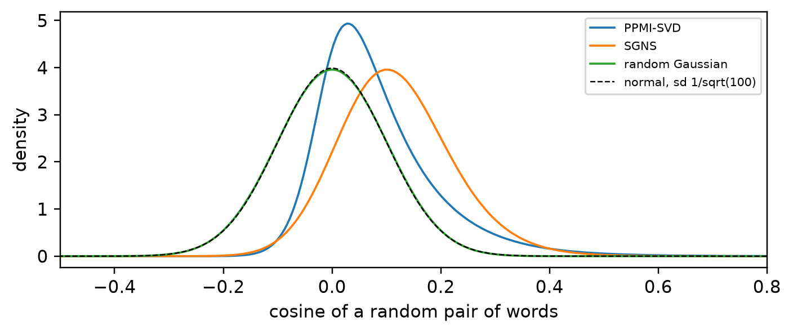
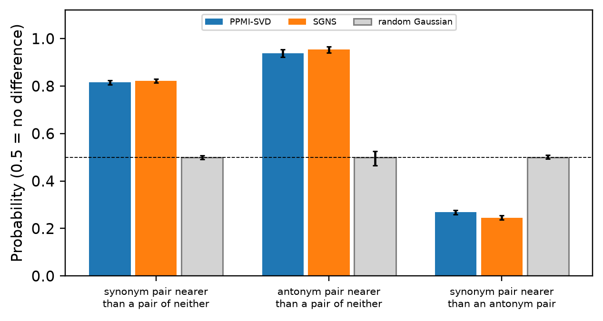
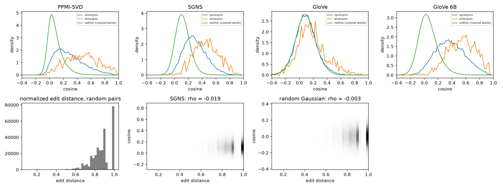

# Meaning as Likeness: What a Distance Can Carry {#sec-ch-meaning-as-likeness}

The last chapter showed a table of one-hot symbols in which every pair of words is equally far apart, so that no pair is nearer than another, and with Rice's theorem putting exact meaning out of reach. What is left is a graded nearness, exactly what learned embedding spaces provide, and the room that high dimensions have for many nearly orthogonal directions (@sec-room-exponentially-many-directions) is where such a nearness can live. This chapter opens Part I, the Librarian Test, with the simplest of its questions.

*The question: what can a distance between static vectors say about likeness?* Alike words should sit near each other and different words far apart: `dog` near `puppy`, less near `wolf`, far from `car`. The librarian's goal is to find things like this one, and the metrics are the probability that a pair judged alike is nearer than a pair that is not (the AUC) and the share of neighbours that two spaces have in common. The chapter is about words, one vector per word. Phrases and sentences (@sec-ch-meaning-across-scales), a word in its context (@sec-ch-meaning-in-context) and images and sounds (@sec-ch-meaning-across-senses) have their own chapters, and so does the step from one meaning to another (@sec-ch-meaning-as-difference).

*Data, models and loss.* One text, one vocabulary and two models carry the whole chapter. The text is text8 [@mahoney2006relationship], 17 million words of Wikipedia, with a vocabulary of the 30,000 most frequent words. The judges are WordNet 3.0 [@princeton2006wordnet] and the Bigger Analogy Test Set (BATS) 3.0 [@gladkova2016analogy], and a reader for the pairs that no dictionary names. The models are PPMI-SVD (@sec-zoo-ppmi-svd), which counts how often words stand near each other, takes the positive pointwise mutual information and reduces it by a singular value decomposition, and skip-gram with negative sampling, SGNS (@sec-zoo-sgns), which predicts the neighbour of a word. Both give each word a vector of $d = 100$ dimensions. Their objectives, counting, predicting and contrasting, are stated once in the zoo (@sec-zoo-objectives), and the chapter reads their results. Both are trained on the same text with one seed each, so that a difference between them comes from the loss and the optimization and not from the data.

*What the chapter does.* It tells apart the nearness that the training put there on purpose from the nearness that appeared on its own. Two words that share a window of text are near because the loss pulled them together, but the same training can put near two words that never occurred together. In a space of 100 dimensions the cosine of two random directions is centred on zero with a standard deviation of $1/\sqrt{d} = 0.1$ and distances concentrate (@sec-concentration-measure), so every statistic is read against a null of random pairs and not against zero. Three tests follow, one per section, and their answers are merged in one box at the end:

- Do the nearest neighbours of random words look alike within and between the two spaces (@sec-gallery-neighbours)?
- Which relations does nearness tell apart (@sec-likeness-relation-split)?
- Is any relation associated with far pairs (@sec-likeness-relations-far)?

Eighteen more questions (Q4 to Q21) come out of the philosophical accounts of likeness and of the first results, and they are not answered with one static vector. Each was handed on to the chapter whose question it belongs to: whether company recovers likeness, whether more text gives more likeness, whether far implies not alike, whether the loss decides what is near, how much of the nearness survives another seed, algorithm or text, and whether a space is more than its coordinates (the Universal Translator, @sec-ch-meaning-as-arrangement); whether nearness is built in or emergent and whether a second sense adds meaning (@sec-ch-meaning-across-senses); whether a raw cosine can be trusted, whether the same word keeps its meaning in another situation, and how the relations that one nearness mixes can be disentangled (@sec-ch-meaning-in-context); whether likeness is a distance, where near is not alike, whether a sentence moves as a word does, whether likeness is graded around a centre, and which relation holds between two near items (@sec-ch-meaning-as-difference); whether a meaning is a point (@sec-ch-meaning-as-region); whether nearness reaches the thing named and its truth (@sec-ch-meaning-and-truth); and how well a space can represent likeness at all (the ceiling, in the Epilogue). They are kept, with their text, in the section "Questions Handed On From the Likeness Chapter" of each of those chapters, and the ceiling in the Epilogue.

## What Is Likeness in Meaning? {#sec-likeness-which .definitive}

Philosophy has not agreed on what meaning is, but different accounts each say something on nearness and likeness that can be asked of a space. As is clear from the history of philosophy, likeness of meaning is not a single relation. Frege (1892) separates the idea, the private image in our heads; the sense, shared by all who use the sign; and the reference, the object [@frege1892sense]. In his telescope the Moon is the reference, the image in the glass is the sense, and the image on each observer's retina is the idea. The image in the glass "is indeed one-sided and dependent upon the standpoint of observation; but it is still objective, inasmuch as it can be used by several observers", which is what a learned vector is. It depends on the corpus, the loss and the seed, and it is shared among its users.

Within the sense, the shared meaning, there are still three relations that the word "alike" hides: similarity, a correspondence between properties (dog and puppy); relatedness, the wider notion of which similarity is a special case (dog and bark); and association, a tendency to occur together (bee and honey) [@budanitsky2006evaluating; @turney2010frequency]. Similarity and association can come apart. A doctor and nurse are similar and associated, horse and platypus are similar and not associated, cradle and baby are associated and not similar, and calculus and candy neither. A reader who judges neighbours has to know which of these relations is being judged. Before asking anything else, we need our null hypothesis:

::: {.test #q-likeness-1}
**Q1. Do the neighbours of random words look alike within and between spaces?** Before any statistic, do the nearest neighbours of randomly drawn words look alike to a reader, and do spaces built in different ways give the same neighbours for the same words?

*See* @sec-gallery-neighbours; *answer*: @sec-likeness-answer.
:::

The first look at the neighbours leaves open how many relations nearness carries. A model trained on company has no reason to favour similarity, and the loss could as well reward any relation that leaves a trace in company, so the three relations of the literature (similarity, relatedness and association) are only a first guess at which ones apply in spaces. The question is then which relations nearness tells apart, which it collapses into the same nearness, and which are not captured at all.

::: {.test #q-likeness-2}
**Q2. Which relations does nearness tell apart?** Of the relations that a judge can name, which are nearer or farther than pairs of no relation, which does nearness not tell apart, how many of the near pairs carry none of them, and is the answer the same for spaces built in different ways?

*See* @sec-likeness-relation-split; *answer*: @sec-likeness-answer.
:::

Q2 looks at the near end. In a graded space, near and far are not complements: between them lies the null, the cosine of unrelated pairs, and "not alike" can sit in the null, or even near. A far cosine does not by itself say that no relation holds, since the cosine of unrelated pairs is not what we get when something pushes two words apart, so the far end needs a test of its own, against the null and not against its opposite.

::: {.test #q-likeness-3}
**Q3. Is any relation associated with far pairs?** Far means at or below the 1st percentile of the cosine of the pairs of two WordNet words that no judge names, in two spaces built in different ways at once. Among the relations that a reader can name, is any of them more frequent among far pairs than among pairs in general?

*See* @sec-likeness-relations-far; *answer*: @sec-likeness-answer.
:::

## A Gallery of Neighbours {#sec-gallery-neighbours .definitive}

In this section, following the questions suggested by the different philosophical viewpoints, we try to establish an initial baseline of the basic properties of these embedding spaces. For that, we answer [Q1](#q-likeness-1), whether nearest neighbours of randomly drawn words look alike to a reader, and whether spaces built in different ways give the same neighbours. It is the null hypothesis or exploratory phase of the chapter, because if the neighbours of random words did not look alike no later statistic would be worth computing. It also fixes the text, the vocabulary and the first two models of this chapter (other losses and texts are in @sec-loss-decides-near).

We run five tests to cover the first question, one at a time, each answering something the previous one could not. Two $d=100$ dimensional spaces are compared, each generated from different machine learning models succinctly explained in @sec-ch-zoo-of-models. PPMI-SVD counts the co-occurrence of words, calculates the Positive Pointwise Mutual Information (PPMI), and from it reduces each word to a $d$-dimensional approximation resulting from the Singular Value Decomposition (SVD) (@sec-zoo-ppmi-svd). Skip-Gram with Negative Sampling (SGNS) predicts the neighbour word (@sec-zoo-sgns). We trained both on the same text (text8 [@mahoney2006relationship], 17 million words of Wikipedia, with a vocabulary of the 30,000 most frequent words), so that a difference between them comes from the models, that is, from the loss, the optimization and the hyperparameters, with one training seed each (the effect of the seed is Q13, in @sec-likeness-many-spaces). There is no sampling in the statistics generated. For every test we use all the 4.5 $\times$ 10$^8$ pairs of the vocabulary. Bootstrap 95% intervals, written in brackets, are calculated by resampling the words, so that they say how much a number would change with another vocabulary.

*The first test is the null: how near are two random words?* A cosine of 0.3 means nothing before we know what random pairs give. We use a null model, a space that carries no meaning, made of vectors drawn from a Gaussian. For two random directions in 100 dimensions the cosine is centred on zero with a standard deviation of $1/\sqrt{100} = 0.1$ (for unit vectors, the cosine of two random directions shrinks as the square root of the dimension), which is what the Gaussian model shows in @fig-gallery-null. As it can be seen in the figure, a trained space is not centred at 0. The mean cosine of random pairs of words is 0.081 [0.081, 0.082] in PPMI-SVD and 0.117 [0.117, 0.118] in SGNS (over all pairs), and the standard deviation of the cosine is 0.108 and 0.105, against 0.100 for the Gaussian. A pair is near only relative to the random pairs of its space, whose cosines differ between the two spaces, so a cosine cannot be compared between spaces.

{#fig-gallery-null width=100%}

*The second test is to look at the data.* The words are grouped into ten bands of equal size by frequency, band 0 holding the 3,000 most frequent. @fig-gallery-neighbours shows one word per band in the first column, with its five nearest neighbours by cosine in each space, and, in the last column, five words drawn at random from the same band. That last column is the control. It shows what a reader sees when nothing is near. Most rows look alike. The neighbours of `dust` are `clouds` and `atmosphere` in both spaces, `debris` in PPMI-SVD, and `radiation` and `storms` in SGNS; and so on. But the neighbours are not alike in one way. Some are forms of the same word (`practise` and `practising`, `practised`, `practiced`), some are words of the same field that no one would call synonyms (`gigs` and `concerts`, `songwriting`), some are of the same kind (`janet` and `patricia`, `linda`, `susan`), some are symbols of the same notation (`theta` and `phi`, `cos`, the pieces of LaTeX that text8 still holds), and some are opposites. No row of the figure shows an opposite, but the nearest neighbour of `benevolent` is its opposite `malevolent`, the first in SGNS and the second in PPMI-SVD. Equally, `cold` is among the five nearest neighbours of `hot` in both. 

![The nearest neighbours of one random word per frequency band, from the most frequent word (top) to the rarest (bottom) and with its number of occurrences in the text, in two spaces, and a control row of random words of the same band. `[lowest overlap]` and `[highest overlap]` mark the rows where the two spaces agree least and most.](../figures/meaning_as_likeness/gallery_neighbours.png){#fig-gallery-neighbours width=100%}

*The third test is to ask a judge.* Looking cannot say how often the neighbours of a word are alike, and a reader cannot be asked about 4.5 $\times$ 10$^8$ pairs. For that, we use WordNet 3.0 [@princeton2006wordnet; design in @miller1995wordnet], which is free to use and to download, as a judge of three classes: synonyms, antonyms or opposites, or "neither" only among words that WordNet covers (so that "unrelated" is not mixed up with "not in the dictionary"). WordNet covers 80% [79%, 82%] of the words of the most frequent band and 47% [45%, 49%] of the rarest, with a vocabulary holding 16,086 synonym pairs and 903 antonym pairs. 

The statistic for this third test is the probability that a randomly chosen synonym pair has a higher cosine than a randomly chosen pair of neither, with ties counting one half. It is 0.5 if the cosine does not tell the two apart and 1 if every synonym pair is nearer. The nulls say what 0.5 looks like (their construction explained above). @fig-gallery-auc shows that synonym pairs are nearer than pairs of neither with a probability of 0.82 [0.81, 0.82] in PPMI-SVD and 0.82 [0.81, 0.83] in SGNS, and antonym pairs are nearer than pairs of neither with probability 0.94 [0.92, 0.95] and 0.95 [0.94, 0.97], surprisingly higher than synonyms in these two spaces. The curve of the pairs that are neither synonyms nor antonyms in @fig-gallery-distributions is the baseline of each space against which the other two classes are read. Against a judge that knows nothing about the spaces, the nearness of the two trained spaces follows lexical relations far above chance, and it follows the slots that words fill and not only their meaning, as antonyms are nearer than synonyms. The antonym values of the next section (0.91 and 0.93) are lower than the 0.94 and 0.95 of this one because that section adds the BATS antonyms (1,258 pairs instead of 903) and takes as baseline the pairs with none of eight relations, not only of the two WordNet ones.

{#fig-gallery-auc width=100%}

{#fig-gallery-distributions width=100%}

*The fourth test turns the antonyms around.* The probability of synonyms being nearer than antonyms is 0.27 [0.26, 0.28] in PPMI-SVD and 0.25 [0.24, 0.25] in SGNS. In about three comparisons out of four, the antonym pair is nearer than the synonym pair. This does not look like an error of the spaces. Opposites occur in the same sentences and in the same positions, `hot` and `cold` fill the same frame, and a space built from company puts them together. It is the first sight of the relations that Q2 separates (@sec-likeness-relation-split) and of the opposites that Q10 takes up (@sec-near-not-alike).

*The fifth and last test is where the spaces disagree.* @fig-gallery-overlap gives, for each frequency band, the percentage of the five nearest neighbours of a word that two spaces have in common. The two spaces agree on 49% [48%, 50%] of the neighbours of the words of band 0, the most frequent, and on 19% [19%, 20%] of those of band 9, the rarest. They agree most where the words are frequent, and the neighbours of rare words depend on the space. Both were trained on the same text, so the difference comes from the models, loss and random seed included. How much of it is the loss, and what more text adds, is tested in @sec-loss-decides-near, and how much is the seed in @sec-likeness-many-spaces.

{#fig-gallery-overlap width=100%}

The answer to Q1 is in the box at the end of the chapter (@sec-likeness-answer).

The gallery showed that near words are related in several ways, not just as synonyms sharing the meaning (forms of one word, words of one field, opposites). The cosine does not and cannot indicate which relation holds, which leads to the next section and to the questions that the chapter hands on (which relation holds between two near items, @sec-ch-meaning-as-difference, and whether context can disentangle the relations that one nearness mixes, @sec-ch-meaning-in-context).

## Which Relations Does Nearness Tell Apart? {#sec-likeness-relation-split .definitive}

The loss of the models rewards any relation between words that shows in company, so near words can have any of several relations. For example, as we saw in the previous section, opposites come nearer than synonyms. In this section, in pursuit of an answer to [Q2](#q-likeness-2), we explore the relations for which we have a judge, and check which ones seem to be expressed by nearness of space. For the different tests, we will continue using the two spaces of the previous section (PPMI-SVD and SGNS, text8, $d=100$, the seed of the gallery).

In the previous exploratory section we used WordNet 3.0 as a judge to identify synonym and antonym pairs. In this section we expand to eight relations, using also the Bigger Analogy Test Set (BATS) 3.0 [@gladkova2016analogy; @gladkova2016batsdata], which adds its pairs to the relations that it names, and we group the eight relations by what each rests on. There are 8 relations grouped in three themes. *Form* is when two words share letters or morphemes: inflection (two forms of one base; `city` and `cities`) and derivation (one word built from the other with an affix; `happy` and `happiness`). *Sense* is when a dictionary records a relation between meanings: synonym (words that share a sense; `car` and `automobile`), antonym (opposites; `hot` and `cold`), hypernym (class-subclass or IS-A relationship; `dog` and `animal`), meronym (part, member or substance; `wheel` and `car`) and co-hyponym (siblings, two words with the same parent; `dog` and `wolf`, both kinds of `canine`). Finally, *World knowledge* is what only an encyclopedia holds: encyclopedic (a country and its capital, an animal and its young, a thing and its colour, a nationality and a famous person; `american` and `lincoln`).

*The first test counts the pairs that have a known relation.* Of the 450 million pairs of the 30,000 words, 467,720 (0.10%) hold at least one of the eight relations, and 0.26% of the 175 million pairs of two WordNet words. Co-hyponyms are the commonest relation (384,411 pairs) and the encyclopedic relation the rarest (610). Of the pairs that hold a relation, 98% hold exactly one, 2% hold two and 0.1% hold three or more, so the relations are almost disjoint. We then look at the distribution of the cosine of the pairs of each relation, against that of the pairs of no relation (@fig-relation-collapse-inventory). The distributions of all the relations lie to the right of those pairs, whose median cosine is 0.06 in PPMI-SVD and 0.11 in SGNS. That is, random pairs without observable relation are not close. The distributions are wide and overlap. The median is 0.59 and 0.51 for inflection, 0.50 and 0.47 for derivation, 0.41 for antonym, 0.35 and 0.36 for the encyclopedic relation, 0.31 and 0.34 for meronym, 0.25 and 0.28 for synonym, and 0.21 and 0.26 for hypernym and 0.17 and 0.22 for co-hyponym. Seen from the other side, the nearest neighbour holds one of the eight relations for only 23% and 25% of the words, the second for 14% and 15%, and those from the 5th to the 9th for 6%, against 0.10% of all pairs, so about three in four nearest neighbours hold no relation (@fig-relation-collapse-neighbours). Of the nearest neighbours whose two words WordNet holds, 56% and 55% hold none. A seeded sample of them reads as relations that no judge here names: near-synonyms that WordNet does not link (`fully` and `completely`, `reintroduced` and `reverted`), a currency and its country (`krone` and `denmark`), two neighbouring places (`karlsruhe` and `mannheim`, `tripolitania` and `cyrenaica`), a maker and its instrument (`moog` and `synthesizer`), two musicians (`oldfield` and `enya`), a garment and a kind of it (`skirt` and `dresses`).

{#fig-relation-collapse-inventory width=100%}

{#fig-relation-collapse-neighbours width=100%}

*The second test asks whether each relation leaves a trace at all.* For each relation it takes the probability that a pair of the relation is nearer than a pair of no relation (0.5 is no trace). A pair that holds several relations counts in each of them. As a check, the same probability is computed on the pairs of WordNet that hold only one relation, with no overlap (below). Every relation leaves a significant trace over pure randomness (@fig-relation-collapse-auc). 

Two additional internal consistency checks agree with the results of this second test. The pairs of WordNet that hold only one relation give the same values within 0.03, and the 35 relations of BATS that have at least 10 pairs in the vocabulary, taken one by one, are all above 0.5 and range from 0.65 (hypernyms, miscellaneous) to 1.00 (plurals, country and capital), with 14 to 552 pairs each.

{#fig-relation-collapse-auc width=100%}

*The third test asks whether the two losses agree.* The Spearman correlation of their eight values of the second test is 1.00 [0.98, 1.00], and both give the same order of the relations.

The answer to Q2 is in the box at the end of the chapter (@sec-likeness-answer).

Nearness carries every relation tested, but synonym, hypernym and co-hyponym show the weakest trace. However, what a single distance cannot do is say which relation holds, since it is one number per pair and one number cannot tell innumerable kinds of relation apart, which is why a space has many dimensions. Which relation holds between two near items is the goal of Q19 (@sec-ch-meaning-as-difference), and whether context can separate what a static space mixes is the one of Q20 (@sec-ch-meaning-in-context). The next section looks at the other end of the cosine. If every relation leaves a trace among near pairs, a relation could still be what keeps two words apart, and Q3 asks whether any relation is associated with far apart pairs (@sec-likeness-relations-far).

## Is Any Relation Associated with Far Pairs? {#sec-likeness-relations-far .definitive}

The previous section found that every named relation is nearer than pairs of no relation. Here we look at the other end of the cosine, since a cosine at or below that of random pairs does not by itself say that nothing holds between two words, and a relation could even be what keeps two words apart. It answers [Q3](#q-likeness-3) for the two spaces of the gallery. A relation that nearness does not capture is not a finding, because the relations that a judge can name are a short list out of an unbounded number. The finding would be a relation that is more frequent among far pairs than among pairs in general, and a closed list of eight cannot find it, since the relation may be one that no dictionary lists. So we ask a reader that is given no list.

The test takes five kinds of pair, all of two WordNet words, drawn uniformly and with a seed from every pair (1.75 $\times$ 10$^8$ per space, scored exactly). Far is the 1st percentile of the cosine of the pairs that hold none of the eight relations, in both spaces at once: at or below -0.096 in PPMI-SVD and at or below -0.103 in SGNS. Of the 1.69 million pairs below the cut in PPMI-SVD and the 1.71 million in SGNS, 111,332 are below it in both (6.6% and 6.5%). Near is the same cut at the top, at or above 0.435 in PPMI-SVD and 0.396 in SGNS, in both (@fig-relation-unlabelled-distribution).

| Kind of pair | How it is drawn | Pairs |
|:---|:---|---:|
| far | below the 1st percentile of both spaces, none of the eight relations | 2,000 |
| near | at or above the 99th percentile of both spaces, none of the eight relations | 200 |
| random, no relation | any cosine, none of the eight relations | 2,000 |
| random, any | any cosine, with a relation or without, as they come | 1,000 |
| known relation | 200 pairs of each of the eight relations, any cosine | 1,600 |

: The five kinds of pair of the test. {#tbl-relation-reader}

*The test asks an open reader.* The 6,800 pairs are shuffled into one list, each with its two words in random order, and a language model (Claude Opus 5.5, through `kiro-cli acp`) reads it in batches of ten pairs, each batch in a new session. The instruction is the only thing it is given: for each pair of English words, list every relation between the two words that you can think of, each as a short name, and give an empty list if you know of none. There is no list of relations, no example and no word on where the words come from. The names are free ("antonym", "opposite", "opposites"), so one more pass of the same model gets the 1,301 distinct names alone, with no pair and no kind of pair, and groups them under 24 canonical names of its choice. The grouping is only used to read the answers of the reader, and it changes no label of WordNet or BATS. The scripts are `relation_unlabelled.py` and `acp_client.py`.

{#fig-relation-unlabelled-distribution width=100%}

*First, the known pairs say what the reader finds when a relation is there.* It names the relation of a pair in 98.0% [96.0%, 99.5%] of the derivations, 95.5% [92.0%, 98.5%] of the antonyms, 91.5% [87.5%, 95.0%] of the inflections, 87.5% [83.0%, 92.0%] of the synonyms, 82.0% [76.5%, 87.5%] of the encyclopedic pairs, 71.5% [65.0%, 77.5%] of the meronyms, 45.0% [38.5%, 52.0%] of the hypernyms and 33.0% [27.0%, 39.5%] of the co-hyponyms, and it names some relation in 69.0% to 100% of the pairs of each relation. The hypernyms are often called synonyms (80 pairs of 200). It answers none for 6.4% [5.3%, 7.7%] of all the known pairs, and for 31.0% of the co-hyponyms. So its silence is informative for the relations of form and of sense, and less so for the relations of kind.

*Second, the near pairs say whether it finds a relation that no dictionary names.* It names a relation for 73.5% [66.5%, 79.0%] of the 200 near pairs, mostly of the world (encyclopedic, 65 pairs), of a field (domain, 42) and of kind (co-hyponym, 37). So it does not answer none out of habit.

*Third, the far pairs.* It names a relation for 4.6% [3.8%, 5.5%] of the 2,000 far pairs (92 pairs, 0.05 relations per pair), against 10.5% [9.1%, 11.9%] of the random pairs with no relation (0.14 per pair) and 10.3% [8.5%, 12.2%] of the random pairs as they come, of which 0.4% [0.1%, 0.8%] hold one of the eight relations, close to the 0.26% of the previous section. The two random groups do not differ (+0.2 points [-2.1, +2.6]), and the far pairs have fewer relations than both: -5.9 points [-7.5, -4.3] against the random pairs with no relation, and -5.7 points [-7.8, -3.6] against those as they come. The far pairs are poorer in relations than ordinary unrelated pairs, which are themselves poor.

*Fourth, which relations are the far pairs left with.* @tbl-relation-far-names compares, for the names given to at least 15 pairs of the far and the random pairs with no relation together, the share of the far pairs with the name and the share of the random pairs with it, with the 95% bootstrap interval over pairs of their ratio. A ratio above 1 would be a relation associated with far. None is above 1. The relations of meaning and of use (co-hyponym, encyclopedic, domain, compound, the grammatical class of the two words) are between 2.6 and 4.5 times rarer among far pairs. The one that is as frequent is the relation of spelling (an anagram, shared letters, `both contain the letter o`), which a reader finds between almost any two words and which does not depend on meaning. Among the rest of the names given to far pairs none is given to more than a handful: `antonym` (5 pairs), `related_to` (5), `collocation` (4), `synonym` (2).

| Name | Far pairs | Random pairs, no relation | Ratio of the shares |
|:---|---:|---:|:---|
| orthographic | 26 | 28 | 0.93 [0.54, 1.54] |
| compound | 6 | 16 | 0.38 [0.10, 0.88] |
| same part of speech | 8 | 22 | 0.36 [0.14, 0.79] |
| co-hyponym | 9 | 36 | 0.25 [0.09, 0.48] |
| encyclopedic | 20 | 82 | 0.24 [0.14, 0.38] |
| domain | 4 | 18 | 0.22 [0.04, 0.55] |

: The canonical names given to at least 15 pairs of the far pairs (2,000) and the random pairs with no relation (2,000) together. {#tbl-relation-far-names}

The answer to Q3 is in the box at the end of the chapter (@sec-likeness-answer).

The answer would change with another reader, another text or another loss. It cannot exclude a relation that covers less than about 0.15% of the far pairs (3 pairs of 2,000). It says nothing of the pairs that only one space puts far apart, which are most of those below the cut in each space (the other 93%): whether they are far because of the pair or because of the space is the question of @sec-likeness-many-spaces.

<!-- salvaged from chapters/properties_of_meaning.qmd (snapshot: embedding-technologies-stubs-v2/properties_of_meaning.qmd), section sec-prop-nearness -->

## Nearness Is Likeness {#sec-prop-nearness}
*Things that mean alike sit close together, and things that mean differently sit far apart.*

Figure (planned): a small map in which "dog", "puppy", and "wolf" cluster, while "car" and "doorbell" sit far away.

Tested in this chapter for static word vectors (Q1 to Q3); the tests of the loss, the seed and the text are in @sec-loss-decides-near and @sec-likeness-many-spaces. Earned here (where the distances come from), in @sec-concentration-measure (why distance still works in many dimensions), and in @sec-ch-memory-retrieval (search by nearness).

Sources (first pass). The distributional idea that likeness of meaning shows as likeness of company [@harris1954distributional; @firth1957synopsis]; the first vector spaces built from counts [@deerwester1990indexing; @lund1996producing]; generalization that falls off with distance in a psychological space [@shepard1987toward]; meanings as points in a space of quality dimensions [@gardenfors2000conceptual]. Two caveats: human similarity judgements are not always symmetric or metric [@tversky1977features] (which axioms a trained score keeps is taken up in @sec-likeness-not-distance), and in some trained spaces all vectors share a large common direction, so that raw nearness is relative to the space (@sec-reading-nearness-correctly). Origins of three ideas, to be read before they are relied on: Frege's levels of difference (idea, sense, reference) [@frege1892sense]; Quine's denial of a criterion for synonymy [@quine1951two]; Wittgenstein's family resemblance, read at §§66–67, as overlapping similarities with no feature common to all [@wittgenstein1953philosophical].

Sceptics and balance. Four objections, each from a source held in `references/`. First, similarity is not relatedness: word-similarity benchmarks mixed the two, so that *cup* and *coffee* are rated more similar than *car* and *train* in WordSim-353 [@faruqui2016problems, p. 2], and SimLex-999 was built to separate similarity from association [@hill2015simlex]; the first paper concludes that word-similarity tasks alone are not a sustainable way to evaluate vectors. Second, raw nearness is shaped by a common mean and a few dominating directions: removing them made off-the-shelf vectors better on similarity, categorization and analogy tasks, across methods and languages [@mu2018allbutthetop], and contextual representations are not isotropic in any layer of BERT, ELMo or GPT-2 [@ethayarajh2019contextual]. Third, cosine similarity can be arbitrary: for embeddings derived from regularized linear models it can yield arbitrary and even non-unique similarities, controlled implicitly by the regularization, and the authors caution that deep models may share the problem, which they discuss and do not prove [@steck2024cosine]. Fourth, the algorithm matters less than it seems: much of the gain attributed to neural embeddings over counting came from design choices and hyperparameters, and the differences between the methods were mostly local or insignificant [@levy2015improving]. The fourth point supports the question of this book, since count-based and predictive spaces then share nearness; the first three say that "near" is relative to the notion of similarity chosen, to the centring of the space, and to the training. What survives: nearness is a robust property of trained spaces when the benchmark separates similarity from relatedness and the space is centred; it is not a property of the raw cosine of any space.

<!-- salvaged from chapters/curse_of_dimensionality.qmd (snapshot: embedding-technologies-stubs-v2/curse_of_dimensionality.qmd), section sec-high-dimensional-trap -->

## The High-Dimensional Trap {#sec-high-dimensional-trap}
*Why volume concentrates in a thin shell and corners are empty, and why the probability mass of a Gaussian, the usual distribution of a random embedding, also sits in a thin shell at a fixed radius [@bishop2024deep].*

<!-- salvaged from chapters/curse_of_dimensionality.qmd (snapshot: embedding-technologies-stubs-v2/curse_of_dimensionality.qmd), section sec-concentration-measure -->

## Concentration of Measure {#sec-concentration-measure}
*Why random vectors are nearly orthogonal and Euclidean distances concentrate [@vershynin2018high], so that the nearest and the farthest neighbour become almost equally far [@beyer1999nearest], which forces the approximate search of @sec-ch-memory-retrieval. Hubness, a few points that appear among the nearest neighbours of very many, is related to distance concentration but distinct from it [@radovanovic2010hubs], and it is a practical problem of shared embedding spaces [@rostami2021transfer] (@sec-ch-meaning-across-senses). Anisotropy, by contrast, is a property of trained spaces (@sec-reading-nearness-correctly).*

## Question and Answer {#sec-likeness-answer}

::: {.test-answer #a-likeness}
**ANSWER. What can a distance between static vectors say about likeness?**

*Q1, the gallery.* Yes, but "alike" is several relations, not only similarity, and the two spaces share half of the neighbours of frequent words and a fifth of those of rare ones.

*Q2, the relations.* In two static word spaces on text8, every relation that a judge names is nearer than pairs with no relation, and both losses give the same order of the relations: forms of one word first, then derived forms, antonyms and the encyclopedic relations, then meronyms, synonyms, hypernyms and co-hyponyms. For synonym, hypernym and co-hyponym the trace is the weakest of the eight, since their distributions overlap with those of random pairs, although still well above chance (0.82, 0.78 and 0.72 in PPMI-SVD).

*Q3, the far pairs.* No. In two static word spaces on text8, an open reader names a relation for 4.6% [3.8%, 5.5%] of the pairs that both spaces put far apart and that no dictionary names, against 10.5% [9.1%, 11.9%] of the random pairs with no relation: far pairs have fewer relations than ordinary unrelated pairs, not more. Every relation of meaning or of use that it names is between 2.6 and 4.5 times rarer among far pairs, and only the relation of spelling is as frequent (0.93 [0.54, 1.54]). The same reader names a relation for 73.5% of the near pairs and for 69% to 100% of the pairs of each known relation, so its silence on far pairs is not a habit.
:::

*In one sentence:* a distance between static vectors says that some relation of company holds, and which relations leave a trace is a finding; it cannot say which relation, and what it says about far pairs is little.

*Next:* a near pair says that some relation holds and not which one, so how is the step from one meaning to another, a difference, built (@sec-ch-meaning-as-difference)?

## Exercises {#sec-likeness-exercises}

Seven questions to think over or look up, and three to reproduce.

::: {.questions}
1. Classify as similar, related or associated the pairs dog and puppy, dog and bark, and bee and honey. Is any of them related and not similar?

2. Why must the neighbours of a word be compared with random words of the same frequency band?

3. What does a judge made of WordNet not see?

4. The probability that a pair of inflection is nearer than a pair of no relation is 0.96. Why can the reader not infer the relation from the distance?

5. Co-hyponyms, two words with the same parent, are the commonest relation (384,411 pairs) but have the weakest trace in nearness. Why might a relation that holds for so many pairs be hard to see in a space built from company?

6. Suppose a space put every pair of every relation above every pair of no relation. What would the probability of the second test be for each relation, and would the figure then tell the relations apart?

7. Why is the share of far pairs with a relation compared with that of random pairs with no relation, and not with that of the known pairs?

8. Draw a few words at random in each of ten frequency bands, list their top-5 neighbours in the PPMI-SVD and SGNS spaces, and print the overlap per band. Which band disagrees most?

9. Reproduce @fig-relation-collapse-neighbours: label the neighbours of every word, by rank, with each WordNet relation that they hold (inflection, derivation, synonym, antonym, hypernym, meronym, co-hyponym, and the encyclopedic relation of BATS), and draw the share that holds at least one and the share, among those whose two words WordNet holds, that holds none. In a few sentences, say what the two panels show and what the share at rank 1 means for the reading of a near pair.

10. Compute, for PPMI-SVD and SGNS, the share of the pairs below the 1st percentile of the cosine of the pairs of two WordNet words with none of the eight relations that are also below it in the other space.
:::

::: {.answers}
1. Dog and puppy are similar, and therefore related, and also associated. Dog and bark are related and associated and not similar, since a bark is not like a dog. Bee and honey are associated, and related, and not similar. Yes: dog and bark, and bee and honey, are related and not similar.

2. Frequency changes the vector, the norm and the neighbours of a word, so a control of random words of another band would differ for that reason alone.

3. The judge only knows lexical relations. `pianist` near `violin` is "neither" in WordNet and alike to a reader, WordNet labels antonyms and does not decide that they are not alike, and it covers fewer rare words and proper nouns, so "neither" mixes "unrelated" with "not covered".

4. The 0.96 says that the cosines of inflection pairs are mostly above those of pairs of no relation, and not which relation holds. The cosines of the other relations, from 0.72 to 0.94 in the same terms, overlap with it and with each other, so a cosine of a given size is compatible with several relations. One number per pair cannot tell innumerable kinds of relation apart, which is why a space has many dimensions.

5. Two siblings, such as `dog` and `wolf`, share a parent in the dictionary's hierarchy, and a parent is not something that the text shows. Two words of one kind can be used in very different contexts, and a vector that serves all the senses of a word may blur the one that makes it a sibling. A relation that the dictionary draws for many pairs is then diffuse in company.

6. The probability would be 1 for every relation. That would show that every relation leaves a trace, and still not tell the relations apart, since they could all lie in the same range of cosines. The probability against pairs of no relation measures a trace and not a separation between relations.

7. The known pairs were chosen because they hold a relation, so the reader finds one in 94% of them whatever it does with far pairs. A far pair is chosen for its cosine and not for a relation, so what it shows only means something against pairs that were not chosen for a relation either, and a reader finds one in 10.5% of those.

8. Draw the words with `numpy.random.default_rng(0)` inside each band (only for display; the statistics use all pairs), rank the others by cosine by the cosine of the two vectors, and compute the overlap of the two lists of five. The overlap is largest for frequent words and smallest for rare ones, whose counts are small: 49% in band 0 and 19% in band 9 (@fig-gallery-overlap).

9. The script `relation_collapse.py` draws it from the labels of the neighbours (`figures.neighbours`). The left panel falls from about 23% and 25% at rank 1 to 0.5% at ranks 500 to 1,000, and the right panel rises from 56% [55%, 57%] (PPMI-SVD) and 55% [54%, 56%] (SGNS) of the nearest neighbours that carry no relation to 79% at ranks 3 and 4 and 99% at ranks 500 to 1,000. The nearer a neighbour is, the more likely that a dictionary names the relation, but even the nearest one is unnamed in more than half of the cases, so near does not say that a named relation holds. The curves of the two spaces almost coincide.

10. The script `relation_unlabelled.py` does it when it draws the sample. The cut is the 1st percentile of the 174.7 million pairs of two WordNet words with none of the eight relations, at -0.096 in PPMI-SVD and -0.103 in SGNS, with 1,690,956 and 1,705,489 pairs below it. 111,332 pairs are below it in both, 6.6% and 6.5% of each, so the two spaces agree on very little of what is far.
:::
