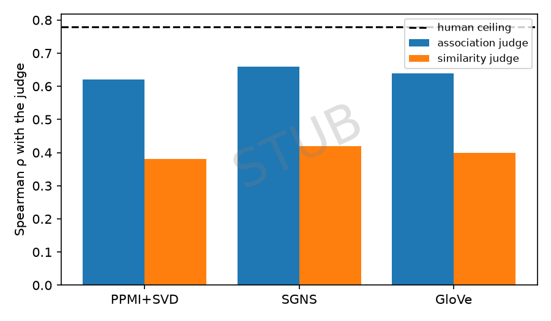
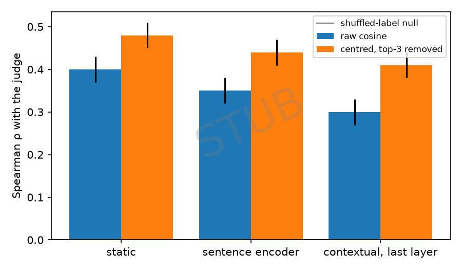
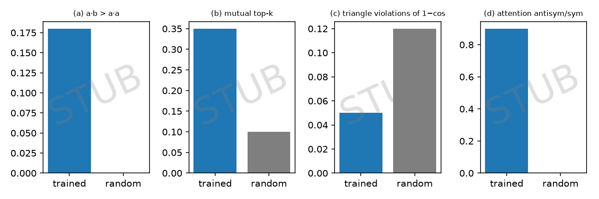
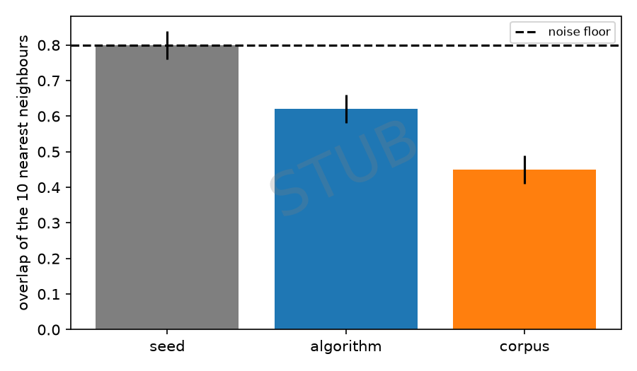

# Meaning Is Likeness: Nearness Across Levels {#sec-ch-meaning-as-likeness}

The last chapter ended with a table of one-hot symbols in which every pair of words is equally far apart, so that no pair is nearer than another, and with Rice's theorem putting exact meaning out of reach. What is left is a graded nearness, but will it work? This chapter asks what learned nearness is worth as a likeness of meaning.

Is likeness of meaning representable as a distance between vectors? Alike things should sit near each other and different things far apart, whether they are words, phrases, sounds, images or clips: `dog` near `puppy`, less near `wolf`, far from `car`. But "alike" is not a single relation but multiple. Similarity, relatedness and association are different interpretations of likeness, but the space between them is to become its judge.

Nearness is also partly made by the loss function used to optimize the models. Sometimes it is put there by construction, as with an image and its caption, and sometimes it shows up without being asked for. We look at neighbours first, then measure them against an impartial judge and the null hypothesis, level by level and loss by loss. Behind the word "near" there is a further question, whether likeness is a distance at all: people's judgements of likeness break the axioms that a distance obeys, and a trained space inherits some of those axioms from its score and not from the data (@sec-likeness-not-distance).

Finally, we will ask which nearness survives a change of seed, algorithm and data, and where near is not alike.

*Goals and expectations (the author's, written before any experiment; each is to be kept or dropped by the run named in its section, and the figures below are stubs with invented numbers, marked STUB, until then).*

| # | Goal | Expectation | Experiment | Figure (stub) |
|:--|:---|:---|:---|:---|
| 1 | Which likeness does a loss reward? | Counting, predicting and weighted least squares agree with each other, and with a judge of association more than with a judge of similarity; all stay below the human ceiling, defined as the agreement between raters and not the score of an average test taker (a method can exceed the latter: 92.5 per cent against 64.5 per cent on the TOEFL items [@turney2010frequency]) | Three losses and the unreduced PPMI rows as a null, one text, a similarity and an association benchmark (@sec-loss-decides-near) | @fig-stub-loss-agreement |
| 2 | What does a raw cosine hide? | Centring and removing the top directions raise the correlation with the judge, and lower the correlation with frequency, against a shuffled-label null and a random-vector null, with a bootstrap over pairs and the judge checked by adding noise to the vectors [@batchkarov2016critique] | Raw against corrected cosine, per model family (@sec-reading-nearness-correctly) | @fig-stub-centring |
| 3 | Is a radius a likeness? | The likeness of the neighbours inside a fixed $\epsilon$ falls as the region gets sparser, so rank ($k$) is safer than radius | Judged likeness inside $\epsilon$ against the distance to the $k$-th neighbour (@sec-reading-nearness-correctly) | @fig-stub-radius-density |
| 4 | Which axioms of a distance does a trained score keep? | Euclidean and angle keep all three; the dot product loses constant self-similarity; two towers and attention are asymmetric; mutual neighbours fall below 1 even for symmetric scores | Four smoke tests against random vectors (@sec-likeness-not-distance) | @fig-stub-axioms |
| 5 | What survives a change of seed, algorithm and data? | Seeds differ least, algorithms more, corpora most; only the local neighbourhood survives all three | Overlap of nearest neighbours, with the seed gap as the null (@sec-likeness-many-spaces) | @fig-stub-many-spaces |

Goals 1 and 5 also run at the levels of sentences, images, sounds and video, and the paired cell of CLIP is separated from the emergent one (@sec-likeness-pairs-senses). The scripts of the stubs are in `code/meaning_as_likeness/stub_figures.py`, a skeleton that the Makefile does not run.

## What Is Likeness in Meaning? {#sec-likeness-which}

Frege: But this is not to say that to the
sense there also corresponds a reference. The words 'the celestial body most distant from the Earth' have a sense, but it is very doubtful if they also have a reference.

Frege: The expression 'the least rapidly convergent series' has a sense; but it is known to have no reference, since for every given convergent series, another convergent, but less rapidly convergent, series can be found.

Frege: This happens, for instance, when the words of another are
quoted. One's own words then first designate words of the other speaker, and only
the latter have their usual reference.

Frege: The reference and sense of a sign are to be distinguished from the associated idea. If the reference of a sign is an object perceivable by the senses, my idea of it is an internal image, arising from memories of sense impressions which I have had and acts, both internal and external, which I have performed.

Frege: The idea is subjective: one man's idea is not that of another. There result, as a matter of course, a variety of differences in the ideas associated with the same sense. A painter, a horseman, and a zoologist will probably connect different ideas with the name 'Bucephalus'.

Frege: The reference of a proper name is the object itself which we designate by its means; the idea, which we have in that case, is wholly subjective; in between lies the sense, which is indeed no longer subjective like the idea, but is yet not the object itself.

Frege: We can now recognize three levels of difference between words, expressions, or whole sentences. The difference may concern at most the ideas, or the sense but not the reference, or, finally, the reference as well.

Frege: This is more doubtfoul: We are therefore driven into accepting the truth value of a sentence as constituting its reference. By the truth value of a sentence I understand the circumstance that it is true or false. There are no further truth values. For brevity I call the one the True, the other the False. Every declarative sentence concerned with the reference of its words is therefore to be regarded as a proper name, and its reference, if it has one, is either the True or the False.[...]From this we see that in the reference of the sentence all that is specific is obliterated. We can never be concerned only with the reference of a sentence; but again the mere thought alone yields no knowledge, but only the thought togetherwith its reference, i.e. its truth value. Judgments can be regarded as advances from a thought to a truth value. Naturally --> This is perhaps neurosymbolic analysis?

If we equate Frege’s sense (Sinn) to an embedding vector, that vector captures the semantic meaning, relationships, and "mode of presentation" of a concept or sentence within a mathematical space—just as a Fregean thought (Gedanke) represents the objective, shared content of a sentence.   However, an embedding vector only tells us what a sentence means (its internal semantic relationships), not whether it corresponds to reality. Frege argues that we need truth values (the True and the False) because meaning alone does not give us knowledge or anchor language to the real world. 

Frege states that "the mere thought alone yields no knowledge, but only the thought together with its reference, i.e. its truth value."   Sense (Embedding Vector): Tells you how concepts relate to each other inside a linguistic or conceptual system (e.g., knowing that "morning star" and "evening star" have different contextual associations, or that "unicorns" are associated with "horns" and "horses").   Truth Value (Reference): Acts as the bridge to objective reality. When we move from merely entertaining a thought to judging it to be true or false, we are testing whether that semantic representation actually holds in the world.   3. Aesthetic Appreciation vs. Scientific InquiryFrege notes that we do not always need truth values. When reading poetry or fiction, we are satisfied with the sense (the thoughts) and the subjective ideas (imagery and feelings) they evoke. Asking whether Odysseus actually existed ruins the aesthetic experience.   

*Plan (the author's notes above, to be rewritten as prose, about 1 page). Frege's three levels of difference give the kinds of likeness, each with its judge: the idea (free association), the sense (similarity, synonymy) and the reference (the world: morning star and evening star) [@frege1892sense]. A space trained on text reaches the sense at best, and the vector gives the thought, not its truth value. Three origins, one line each. Synonymy has no criterion independent of the judge, so likeness is graded [@quine1951two]. Reference is fixed by the world and not by the words around a name, so near is not alike (Kripke 1980, to add; [@putnam1975meaning]). Likeness needs no feature shared by all members, only family resemblance [@wittgenstein1953philosophical].*

*Three further points from a reading of Frege's text itself (checked against the PDF in `tmp/toread`, translation of Geach and Black; page numbers of the printed translation still to be recorded). (1) The telescope: the Moon is the reference, the real image in the object glass is the sense, the retinal image of each observer is the idea. The image "is indeed one-sided and dependent upon the standpoint of observation; but it is still objective, inasmuch as it can be used by several observers". A learned vector is the object-glass image and not the retinal one: one-sided (it depends on the corpus, the loss and the seed, which is the subject of @sec-likeness-many-spaces), yet shared between users. Free association is the retinal image, and the reason an association judge is not a judge of sense. (2) The identity $a = a$ against $a = b$: the two differ in cognitive value, since the second "often contain\[s\] very valuable extensions of our knowledge". In a space the score of a name with itself is the maximum and the score of two names of one object is not, so $1 - \cos(\text{morning star}, \text{evening star})$ is a crude measure of how informative the identity is; a test that needs no model beyond the encoder, using pairs of co-referring names, and a check on the first axiom of @sec-likeness-not-distance. (3) The thought changes when a word is replaced by another of the same reference ("morning star" for "evening star"), "since one who did not know the identity might hold the one thought true and the other false", although the truth value does not change. So substitution of co-referents leaves truth and reference alone and moves the vector, which is the right behaviour for a space of sense and shows that the nearness of the two sentences is a nearness of sense and not of truth. The opposite case is quotation and "believes": there the words "do not have their customary reference but designate what is usually their sense" (indirect reference). A contextual vector sees the quotation marks and the verb; whether it moves the word towards its sense (the words around "Odysseus" in the quote) is untested and is noted for @sec-ch-contextual-vectors. Frege also allows sense without reference ("Odysseus", "the least rapidly convergent series"), which gives the probe in the table of the next section its form: same frame, an empty name and a real one.*

*Four more points from a reading of Harris in the scanned PDF (OCR, pages of the printed article). (1) He denies that a word has a unit of meaning to be found: "There is not even a one-to-one relation between the vocabulary and any independent classification of meaning", no word has "a single or central meaning, or even … a continuous or coherent range of meanings", because of "homonymity, borrowing, forgotten metaphors" (p. 152). A static vector is one point per word, an average over such accidents, so the first limit of nearness is stated by the person who proposed the idea, and it is the reason for @sec-ch-contextual-vectors. (2) The correlation of structure with meaning "is much greater when we consider connected discourse" (p. 152), which makes the sentence and the document, and not the word, the level at which the claim is easiest to keep (@sec-likeness-phrases-sentences). (3) The substitution test is independent of truth: "It is not a question of whether the above sentence with lawyer substituted is true; it might be true in some situation" (p. 157), so what the test measures is selection and not reference, the same separation as Frege's sense and reference above. (4) He compares the structure of language with "human response (e.g. association, transference)" and finds that it does not conform to it (p. 151), so even for him distribution is not association; this is the author's warrant for keeping a judge of association and a judge of similarity apart, though the judges themselves are later (@sec-prop-nearness).*

*Osgood's semantic differential is the oldest space of this chapter with a judge built in, and the reading below is from the PDF (printed pages of Osgood, Suci and Tannenbaum 1957 [@osgood1957measurement]). A concept is rated on bipolar scales ("polar, opposite-in-meaning adjectives", each "a straight line function that passes through the origin"), and "difference in the meaning between two concepts is … a function of the multidimensional distance between the two points" (p. 26). Four things are useful here. (1) The judge is the space: the coordinates are named (evaluation, potency, activity) and the axes come from factor analysis of human ratings, whereas the axes of a trained space are free up to a rotation (@sec-prop-invariance). In the first analysis evaluation takes almost 70 per cent of the common variance and the three factors about half of the total (p. 38), but the author says that the sampling of scales was then deliberately diversified and that the space then needs many more dimensions, so the dimensionality of a space of meaning depends on which scales are sampled, as the ranking of models depends on which benchmark pairs are sampled. (2) Distance against correlation: for a profile of $k$ scores the correlation is blind to level and scale, so concepts that "covary perfectly" despite "gross absolute discrepancies" all correlate at 1.00, and Love would be as similar to Hate as to Affection (pp. 90–91). He adopts the generalized distance $D_{ij}=\sqrt{\sum_j d_{ij}^2}$ and shows that on standardised profiles $D_{ij}=\sqrt{2k(1-r_{ij})}$ (p. 91), with the loss of information that standardising brings. This is the cosine against the Euclidean distance of @sec-reading-nearness-correctly in a different guise: a score that ignores the norm cannot tell a concept from an intensified version of it, and Love and Hate (an antonym pair on one evaluative axis, so opposite in direction and the same in company) are a test case for @sec-near-not-alike. (3) Direction and norm are given meanings: the direction from the origin is the quality and the distance from the origin the intensity (p. 26). In a trained space the norm is said to carry frequency (@sec-ch-embedding-spaces), and the origin is arbitrary, so whether the norm of a word vector tracks the intensity of a rated word (a judged extremeness, or the sentiment lexicon) is a cheap test that Osgood's own ratings would allow. (4) A human noise floor and a check on the geometry: Rowan's triad-based "similarity" space had only slight negative latent roots against a Euclidean representation (the largest in absolute value not above .10 for one of them, p. 144), and the random half-splits of his subjects gave distance matrices that correlated .983 and .975 (p. 144), which is the human version of the seed null of @sec-likeness-many-spaces. The limits are Osgood's own: the rated concepts are few and chosen, the scales are assumed independent for $D$, and "the distribution of $D$ is not known" (in the section on differences between distances, page to be recorded), so he gives distances and not significance.*

*Medin, Goldstone and Gentner state the strongest objection to a single likeness score, and the reading below is from the PDF (OCR; pages of *Psychological Review* 100 [@medin1993respects]). Goodman called similarity "invidious, insidious, a pretender, an imposter, a quack" and argued that "A is similar to B" is "a blank to be filled" until one says in what respects, as motion needs a frame of reference [@goodman1972seven] (p. 254, where Mary says John is like Bill, and the respect is that both are chess players). A cosine has the same fault: it returns a number and not the respect, and the respect is whatever the loss and the corpus made salient. The authors answer that respects are not free but are fixed by the comparison itself, and propose that similarity is an alignment of structured parts, like analogy (Gentner's structure mapping [@gentner1983structure]), in which a match counts for more if it belongs to a larger consistent system, and the two things compared decide which of their features are activated (pp. 259–260). Three findings are usable as tests. (1) Context changes rank: judged alone, black and white (antonyms) get 2.2 on a scale from 1 (not similar at all) to 9 (highly similar), and 4.0 when black is compared with white and red in the same set; sunrise is rated more similar to sunbeam than to sunset when the pairs are separate (5.2 against 4.6) and the order reverses when the three words are shown together (sunset 6.4 against sunbeam 5.7); skin is nearer to bark than to hair when separate and the order reverses together (pp. 267–268). A static space gives one order for every context, so these are pairs for which no static space can match both conditions, and the antonym case is the one this chapter uses for @sec-near-not-alike: hot and cold are not simply "near but not alike", their likeness moves with what else is on the table. (2) The extension effect: Italy and Switzerland are judged less alike among European countries than among European and American ones, because a shared property that every member has carries no diagnostic value (p. 262, a statement of Tversky's diagnosticity). (3) Directionality and mutual constraint: comparing two concepts brings out features of one in the light of the other, as in metaphor ("both look like combs"), and the base is favoured over the target. The reply that follows for this chapter is a division of labour and not a defence of the cosine: a space gives the default respect, the one the training data made dominant, and a scorer that sees both items (a cross-encoder, MaxSim over token sets, @sec-likeness-other-objects) can in principle supply the respect that the comparison needs. How far it does is the question of @sec-likeness-phrases-sentences.*

*Before any model, what we mean by "alike", with examples a reader can judge: dog and puppy (alike), dog and wolf (alike in a different way), dog and bark (related, not alike), dog and car (not alike), hot and cold (opposite, and in some respects alike). Similarity, relatedness and association are not the same relation: coffee and cup are related and not alike, car and train are alike. Human judgements are not always symmetric or metric [@tversky1977features] (the three axioms, and which trained scores keep them, are in @sec-likeness-not-distance), and the benchmark that names the relation (@sec-prop-nearness: WordSim-353 against SimLex-999 [@hill2015simlex; @faruqui2016problems]) decides what a space is credited with. Then what we would like to see in a space: alike things near, different things far, the order of the neighbours agreeing with a person's, and the same at every level, from a word to a clip of sound. The judge and its ceiling (the agreement between human raters) come before any model. Harris is the first to grade likeness by the overlap of environments, and his scale can serve as the section's ladder of "alike" [@harris1954distributional, §2.3, p. 157]: identical environments throughout (free variants); almost identical, except chiefly for sentences that contain both (synonyms: oculist, eye-doctor); some environments shared and some not (different meanings, oculist and lawyer, the difference corresponding roughly to the numerical relation of different to same environments); never the same environment (different grammatical classes). His judge is a procedure and not a rating: ask an informant to substitute any word for the one in the frame, without asking which words mean the same, and count what comes back. That is the operational form of the human judge of this section, and a nearest-neighbour list read against a substitution test is the cheapest version of it. To be written as one paragraph, with the sentence that Harris measures selection ("the probability of particular environments occurring with particular elements") and that his own estimate is rough, "almost no indication of its rarer selection" (p. 157), which is the reason a rare word has a poor vector and a first link to @sec-reading-nearness-correctly.*

## Kinds of Likeness and Where the Judges Come From {#sec-likeness-judges}

*Budanitsky and Hirst (2006) give the judge and the distinction a procedure, read in the PDF (sections cited, since the page numbers of the extraction are not reliable) [@budanitsky2006evaluating]. (1) Relatedness is the wider notion and similarity a special case (§1.1, after Resnik: cars and gasoline are more related than cars and bicycles, but the latter pair are more similar). Antonyms are "dissimilar and hence distant in one sense, and yet strongly related semantically and hence close in the other", so "near" has two readings even before any space, and the pair hot–cold is far on one and near on the other. (2) They list three ways to evaluate a measure (§3): examine its mathematical properties (is it a metric, has it singularities), which "act[s] at best as a coarse filter"; compare it with human judgements, the best assessment "by definition" but costly and limited to a few hundred pairs (Rubenstein–Goodenough: 65 pairs, 51 subjects, scale 0–4; Miller–Charles: 30 pairs, 38 subjects); and measure it in an application (here detecting and correcting real-word spelling errors, §5), which avoids the sense problem of rating words and not concepts. This is the structure of the chapter in advance: the axioms (@sec-likeness-not-distance) are the coarse filter, the judge is the second, and the retrieval or classification task of the later chapters the third. (3) The human ceiling for the Miller–Charles pairs is 0.8848, the mean correlation of ten replication subjects with the mean ratings (§4.4.1), and the five WordNet measures lie between about 0.74 and 0.85, so on this small set they are close to the ceiling, and the gap between the highest and the lowest (about 0.1) is one that a set of 30 pairs may not resolve (a reading of the author: the paper gives no interval, and a bootstrap over pairs is the check). (4) Why a distributional score is not simply a relatedness score (§6.2): it is a relation on words and not concepts, so polysemy blurs it; it is, if conceived as substitutability, potentially asymmetric (the adjectives of *apple* are a subset of those of *fruit*, so fruit substitutes for apple better than the reverse), although the cosine is symmetric; substitutability is "far too strict" for relatedness (window and house are related and not interchangeable); and it is relative to a corpus, with oddities such as captive–westerner (in a news corpus more than half of the "westerners" were captives) and audition–rite (both rare, both modified by *uninhibited*), after Lin. For the correlation with Miller–Charles, Weeds found at best .62 (and at worst .26) for ten distributional measures on British National Corpus data, against .74 to .85 for the semantic measures, with performance "undermined by the effects of varying word frequencies" in the neighbour task. These are results of 2003–2006 on small counts, and they are the baseline that the learned spaces of @sec-loss-decides-near are to be compared with and not a statement about them.*

*Turney and Pantel's survey (JAIR 37, 2010 [@turney2010frequency]) names the kinds of likeness that the examples of the next paragraph mix, and it is read here from the PDF (sections cited). (1) Attributional similarity is the correspondence between the properties of two words (dog and wolf), and relational similarity the correspondence between the relations of two pairs (dog : bark and cat : meow); word–context matrices are the tool of the first and pair–pattern matrices of the second (§2.4, after Gentner [@gentner1983structure]). The second does not reduce to the first: mason, carpenter, potter and glassblower are alike, and so are wood, clay, stone and glass, yet mason : glass and carpenter : clay do not share a relation. (2) "Semantic relatedness" in their usage is attributional similarity, and "semantic similarity" in the sense of Resnik (words that share a hypernym: car and bicycle share vehicle) a special case they prefer to call taxonomical similarity. Words are *semantically associated* if they co-occur often (bee and honey), and the two properties are independent, with a pair for each cell: doctor and nurse (both), horse and platypus (taxonomical, not associated), cradle and baby (associated, not taxonomical), calculus and candy (neither). That is a ready test that a reader can judge before any model (does the cosine of a space rank cradle–baby above horse–platypus, and does a judge of similarity disagree?) and a sharper form of "coffee and cup are related and not alike". (3) Antonyms: "we might not usually think that antonyms are similar, but antonyms have a high degree of attributional similarity (hot and cold are kinds of temperature, black and white are kinds of colour)", which is the same observation as Osgood's single axis and the reason a space puts them near, and the reason a benchmark of similarity must say what it does with them. (4) Paradigmatic and syntagmatic: two words that tend to be neighbours are syntagmatic associates (bee, honey, usually different parts of speech), and two words with similar neighbours are paradigmatic parallels (doctor, nurse; usually the same part of speech), after Schütze and Pedersen. The row of a word–context matrix compared by cosine is paradigmatic by construction, and the entry of a window matrix is syntagmatic, so the same counts give both, and which one a space shows depends on whether the entries or the rows are compared. (5) The ceiling is not an average test taker: Rapp (2003) is quoted there as scoring 92.5 per cent on the TOEFL synonym items against 64.5 per cent for the average applicant, and Turney's pair–pattern matrix 56 per cent on 374 SAT analogy questions against 57 per cent for the average college applicant, the best attributional method reaching 35 per cent (§1 and §6). A mean score is a level to compare with and not an upper bound, and the "ceiling" of this chapter's goals is to be defined as the agreement between raters (the correlation of one rater with the mean of the others, as in Resnik's replication above) and not as the score of an average test taker.*

*The origins of the judges, read in the sources: two facts that settle what the numbers above are. (1) The ceiling of Miller–Charles: Resnik (1995 [@resnik1995using]) replicated the experiment with ten subjects and defines the upper bound as the average correlation of each subject with the mean ratings, 0.8848 with a standard deviation of 0.08 (0.9015 over the 28 pairs that his taxonomy covers), and his measure reaches 0.79; so the ceiling is the mean correlation of single replication raters with the mean of the original raters (the 38 subjects of Miller and Charles, other people), an estimate with its own spread and not a constant. The ways of building it differ (this one, the pairwise IAA-1 and the rater-against-the-others IAA-2 of SimVerb, the split-half of Marjieh et al.), and a result is reported with the one used. (2) WordSim-353 was built to test a system for search in context and what its raters were asked was relatedness: Finkelstein et al. (2002 [@finkelstein2002placing]) had 16 subjects rate 350 noun pairs from 0 (totally unrelated) to 10 (very much related or identical), and on this list a WordNet-based metric reached 39 per cent correlation (where it reached 75 per cent on the 30 Miller–Charles pairs), a vector-based one 41 per cent and LSA 56 per cent, with 82 of the 350 pairs having at least one word that WordNet did not hold. The confound between relatedness and similarity that later benchmarks set out to remove (Hill et al. 2015; Faruqui et al. 2016; @sec-prop-nearness) is therefore in the design of the first large judge and not in its use, and a difference of a few points between a WordNet and a corpus-based measure is, on these sets, mostly a difference of coverage.*

## What the Philosophies Predict {#sec-likeness-philosophies}

*Plan (1 page, a table and three short paragraphs). A philosophy of meaning is a theory of what meaning is, and a trained space is a model built from text; so a "fit" below means that the space behaves as the theory says it should, not that the theory is proved, and a "strain" means that the space cannot do what the theory says is needed, not that the theory is refuted. Every row is the author's reading, and no probe has been run for it; the rows that name a test are the ones the later sections can run. Each position is cited at its origin and is to be read before the row is kept.*

| Position (origin) | What it says | Fit with trained spaces | Status |
|:---|:---|:---|:---|
| Frege, sense and reference [@frege1892sense] | A sign has a sense, and may or may not have a reference | **Fits.** Sense is learned from text with no access to reference; "Sherlock Holmes" and "Emmanuel Macron" get the same kind of neighbourhood | Test: neighbours of an empty name against a real one, same frame |
| Frege, the truth value is the reference of a sentence [@frege1892sense] | All true sentences name one object, the True | **Not a prediction about vectors.** A vector is a sense, so it should keep the content of a sentence. A truth direction that keeps the content is consistent with Frege and with a theory of facts, which says different facts make different sentences true [@marks2024geometry] | Open, see below |
| Harris, meaning as a function of distribution [@harris1954distributional, §2.3, pp. 156–157] | "Difference of meaning correlates with difference of distribution": oculist and eye-doctor occur in almost the same environments, oculist and lawyer in many different ones; the amount of meaning difference corresponds roughly to the amount of difference in environments, weighted more for differences of selectional subclasses | **Fits by construction.** A space built from company turns the correlation into a distance, so the fit is the loss and not a discovery. Harris claims less than "distribution is meaning": the selections of a word can only be listed roughly, and meaning cannot be defined fully from them. The example pair came from Bar-Hillel, who held that distributional correlates of meaning difference cannot be established (footnote, p. 156) | Test: rank pairs by overlap of environments against a human judge of similarity (@sec-gallery-neighbours); the judge's ceiling comes first |
| Quine, holism and no criterion of synonymy [@quine1951two] | A word has meaning only inside the whole web of sentences | **Fits.** Position in a space is defined by relations to all the others, as in the distributional idea [@harris1954distributional; @firth1957synopsis]; likeness is graded, with no sharp synonymy | Test: the many-spaces comparison (@sec-likeness-many-spaces) |
| Quine, indeterminacy of translation [@quine1960word] | Evidence leaves translation underdetermined | **Mixed.** Coordinates are free up to a rotation, so the matching of two spaces is underdetermined in that sense; but when the two languages describe a similar world the relations pin the matching down well (@sec-ch-cross-domain-transfer), which is evidence against a radical indeterminacy | Test: alignment without pairs, and where it fails |
| Wittgenstein, use and family resemblance [@wittgenstein1953philosophical] | Meaning is use; a class has no feature shared by all members | **Fits.** A graded nearness from company is use, and overlapping neighbourhoods are family resemblance | No separate test |
| Tversky, likeness as a contrast of features (a theory of psychology and not of philosophy, kept here as the strongest objection to "likeness is nearness" [@tversky1977features]) | Judged likeness is not a distance: it is not symmetric, not minimal and not transitive in the sense of the triangle inequality, because it weighs the common and the distinctive features of the two things, with weights that depend on which is the subject and on the set compared | **Strained for a distance, open for a score.** A symmetric metric cannot say that *a* is more like *b* than *b* is like *a*; a two-tower score or a learned bilinear form can. Which axioms a trained space keeps is set by its score as much as by its data, and the author has not measured it | Test: the three axioms on a space, and against human judgements of likeness and not of association (@sec-likeness-not-distance) |
| Kaplan, character and content (Kaplan 1989, to add) | A word has a context-free rule and a content fixed in context | **Partly fits.** A static vector is like a character, a contextual vector like a content in context; but a contextual vector sees the surrounding text, not who speaks, where and when, so "I" is not handled as an indexical (the essential indexical of Perry 1979, to add) | Test: "I", "here", "now" with the same text and a changed speaker |
| Kripke and Putnam, reference by the world, not by a description (Kripke 1980, to add; [@putnam1975meaning]) | The meaning of a name is not the descriptions attached to it | **Strained.** A space knows "Aristotle" only through the words around it, which is the description theory the two authors reject as insufficient; that a vector is built from descriptions does not refute them, it is the case they warn about, and a name with no company is an uninformative vector | Test: names whose neighbours change with the corpus while the person does not |
| Goodman, similarity is empty without a respect [@goodman1972seven] (as taken up by [@medin1993respects]) | "A is like B" has no content until one says in what respects; similarity is relative to a frame, as motion is | **Strained for a single score, open for a family.** One cosine fixes one respect, the dominant one of the corpus and the loss; a space can be credited with likeness only relative to a judge that names its respect (@sec-prop-nearness), and context can move the order of the same pairs | Test: pairs whose order flips between a separate and a combined presentation (black, white, red; sunrise, sunset, sunbeam; skin, hair, bark) against a static space and a context-reading scorer |
| Russell, descriptions (Russell 1905, to add) | "The present King of France" is a quantified claim, and false | **Not testable.** It is a logical analysis and not a claim about psychology or statistics. A space gives an empty description a neighbourhood, which shows that meaning does not need existence, and that is what Frege already said | Not run |

The first group, **what fits**, is the distributional core: Frege's sense, Quine's holism and Wittgenstein's use all say that what a sign means is what is around it, and a space built from company is that claim made into a matrix. This is also the reason to be careful. A theory that a space fits by construction is not supported by the fit, since the loss was made to give it. The informative rows are the ones where the theory says that something should be missing, which is the second group.

The second group, **what is missing**, is reference. Kripke, Putnam and the Frege of the truth value agree that a sense alone is not knowledge of the world, and a text-only space has only the sense. This is the chapter's reason to separate what a space is credited with from what it is trusted for, and it is the philosophical form of "near is not alike" (@sec-near-not-alike). Two sources of the book already take sides: that form alone cannot give meaning [@bender2020climbing; @searle1980minds], and that symbols must be grounded in something outside the symbols [@harnad1990symbol].

The third group, **what is open**, has two questions. First, whether a text-only space can reach the reference, or only a better sense: the claim that separately trained models converge on a shared structure of the world is made [@huh2024platonic], and the reply is that what converges is mostly the local neighbourhood, not the global geometry [@groger2026aristotelian; @koepke2026plato]; whether grounding in images and action closes the gap is taken up in @sec-ch-multimodal-embeddings. Second, whether a "truth direction" tracks facts or only what the text asserts: there are linear structures of truth with causal interventions [@marks2024geometry] and unsupervised directions [@burns2023discovering], and also probes that fail to generalise [@levinstein2023still] and a warning that the method may find the most prominent feature and not truth [@farquhar2023challenges]. A direction that separates true from commonly asserted is a test of the first reading, and a direction that separates false from not said is a test of the third region (`notes/ideas.qmd`). In philosophical terms the first reading is correspondence to facts (a theory of truthmakers, Armstrong, to add), and the second is coherence with what the text says, or the deflationist view that "true" only endorses a sentence (Ramsey 1927, to add). A claim that models' truth directions diverge from what is commonly believed has no source in the collection yet, and it is not to be stated before one is read; Frege's "indirect reference" (words in quotation or after "believes") is a different matter and is not the distinction between true and customary.

## A Gallery of Neighbours {#sec-gallery-neighbours}
*Several models side by side, with no statistic yet: random words, phrases, chunks of text, sounds and images, and for each the nearest neighbours in a count-based space, a prediction-based space, a sentence encoder, an image encoder and an audio encoder. The examples are drawn at random and not chosen, and the failures are shown with the successes. The reader judges first and the chapter measures afterwards. Where the models disagree, the loss and the data are the first suspects, and the sections that follow take them one at a time.*

## One Space for Several Senses: CLIP {#sec-likeness-pairs-senses}
*A single image-text model, with examples of multimodal likeness: the image of a dog against "dog", "puppy", "wolf", "car" and "doorbell", a caption against the images it retrieves, a sound against its words if an audio-text model is available. An image and its caption are near because the loss pulled them together, and nothing in the loss says that two images, or an unpaired sound and word, are near; the built-in cell and the emergent cell are separated here, since only the emergent one says something about meaning and not about the loss. The modality gap is taken up in @sec-ch-multimodal-embeddings [@radford2021learning; @liang2022modalitygap].*

## The Loss Decides What Is Near {#sec-loss-decides-near}
*Words, static: counting (SVD of PPMI), predicting (skip-gram with negative sampling) and weighted least squares on log counts (GloVe) on the same text, the cleanest test of whether nearness survives a change of loss. Each rewards co-occurrence, which is not similarity, so the three agree with a judge of association better than with a judge of similarity. Harris is the origin of the shared idea. For him the distribution of an element is "the sum of all its environments", a pair's co-occurrence is to be stated "in terms of probability, based on the frequency of that occurrence in a sample" (p. 146), and the total restriction on an element is its departure from equiprobability, which is what pointwise mutual information measures. He rejects listing it element by element, since that gives no simple description and does not order the restrictions from larger to smaller, and groups elements into ordered sets instead [@harris1954distributional, pp. 146–147]: the sparse-matrix problem that the SVD and the predictor each solve in a different way. Whether the three count as different families is stated with the limit that they share data and the same distributional idea [@levy2015improving; @mikolov2013efficient; @pennington2014glove; @deerwester1990indexing].*

*The expectation of this section is contested at scale, and the contrary result is stated here. Baroni, Dinu and Kruszewski (2014 [@baroni2014dont]) compared count and predict models over many parameter settings on 14 tasks, and "to our own surprise" found a "thorough and resounding victory" of the predicting ones: for the best setting on each task, Spearman or accuracy 84 against 74 on the 65 pairs of Rubenstein–Goodenough, 91 against 76 on the TOEFL synonyms, 75 against 66 on the AP categorisation and 68 against 49 on the analogy task, and the worst setting across tasks 74 against 11 on Rubenstein–Goodenough, so the predicting models are also far less sensitive to the choice of hyperparameters. Levy, Goldberg and Dagan (2015, held in `references/`) then showed that much of the difference came from design choices and hyperparameters which the count models were not given, and that with them the gap mostly closes; the experiment of this section therefore gives the counting model the same hyperparameter budget, and reports the spread across settings (and not only the best) next to the means.*

*What the first counting model already showed, read in the PDF of Landauer and Dumais (1997, *Psychological Review* 104; page numbers from the journal) [@landauer1997solution]. Their SVD of a log-entropy weighted word-by-article matrix (30,473 articles, no word order) chose, by the largest cosine, the right synonym on 51.5 of 80 retired TOEFL items, 64.4 per cent, against 64.5 per cent for a large sample of non-native applicants to US colleges (p. 220), a judge whose ceiling is a population and not a single rater. The finding that matters for this section is the dimension: with two or three dimensions (the factor-analytic and Osgood spaces of @sec-likeness-which) the score corrected for guessing was 13 per cent, with the full transformed matrix and no reduction only 16 per cent of the items were right, and between about 45 and 53 per cent over a broad region around 300 dimensions (p. 220), and they conclude that the right dimensionality "approximately tripled" what was learned. Their footnote says that the unreduced transformed matrix is close to a pointwise mutual information analysis. So the nearness that tracks synonymy is made by the reduction and not by the counting alone, and a fourth arm for the experiment (the PPMI rows with no reduction) is the null of how much the learned dimensions add. Two further points. The cosine was chosen "because [it] usually work[s] best in the information-retrieval application" (their note 4), an empirical and not a principled choice, to be set against the norm discussion of @sec-reading-nearness-correctly. And the estimated gain in words known per paragraph was mostly indirect: 0.0007 words per encounter of a word itself against 0.15 words per text sample from the effect of reading on all other words (p. 224), which is nearness as inference from words that were never seen together, and is also the strength and the risk of a score that gives near to words only through company.*

*Statistics for this section, from Batchkarov, Kober, Reffin, Weeds and Weir (2016, six pages, read in full [@batchkarov2016critique]). Three problems of the judge and one fix. (1) The judge is noisy: for 13 annotators of WordSim-353 the agreement between annotators, converted to Cohen's $\kappa$ over 2 to 5 bins, ranges from 0.21 to 0.62, against 0.7 to 0.91 for sentiment, text classification, entailment and dialogue-act tagging in the sources they quote; "tiger–cat" ranges from 0.5 to 0.9 among the 13; in MEN the two raters differ by more than two points of seven for 10.4 per cent of the pairs, and the scores look bimodal, as if on a three-point scale; the pair chicken–rice scores 0.14 in SimLex and 0.68 in MEN, and man–woman 0.33 and 0.84. (2) The set is small: 30 to 3,000 pairs, of "tidy" frequent words, so that the vocabulary of a real model is almost all outside it. By bootstrapping the pairs 500 times for word2vec (CBOW, negative sampling, window 5, Wikipedia of 2011) the Spearman correlation has a standard deviation of 0.12 on the 30 pairs of Miller–Charles, 0.06 on RG-65, 0.04 on WordSim-353, 0.03 on SimLex-999 (mean 0.31) and 0.01 on MEN, with the range for MEN as wide as 0.06; they conclude that a difference below 0.02 (Swivel against word2vec on three of the sets) may not be significant. (3) There is no single similarity: "every downstream application defines its own kind of similarity", and learning the notion of a similarity benchmark does not transfer to extrinsic performance (they quote Schnabel et al. 2015, held in `references/`). The fix is a sanity check for the judge and not for the model: add uniform noise $U(-n, n)$ to every word vector (mean $L_2$ norm 2.4, $n \in [0, 3]$) and require that the score fall monotonically to zero as $n$ grows, and that random vectors score zero (their Table 1b: means between $-0.08$ and $0.08$). MC and RG fail it (the correlation can rise with noise, with high variance), MEN does best, and WordSim-353 and SimLex behave like MEN with a higher variance. This chapter adopts three of its habits in every figure: a bootstrap over pairs (and not only over seeds, which is the other null of @sec-likeness-many-spaces), a random-vector baseline at zero, and the noise sanity check run on the judge before it is used on a model. The consequence for goal 1 is that "the three bars are close" is stated only when the differences are larger than the bootstrap interval, which for a set of 30 pairs is wide.*

*Two more habits from SimVerb-3500 (Gerz, Vulić, Hill, Reichart and Korhonen 2016, read in the PDF [@gerz2016simverb]), the verb benchmark built with the SimLex-999 instructions (rate similarity from 0 to 10, give low ratings to antonyms, and keep relatedness apart: to snore and to snooze, to walk and to crawl, are related and not similar). (1) The ceiling is the thing that saturates: on the 222 verb pairs of SimLex-999 the pairwise agreement between annotators is Spearman 0.717 and the best system reached 0.727, so "automatic approaches have reached or surpassed the inter-annotator agreement ceiling" on that set and the benchmark could no longer tell. On 3,500 pairs the agreement is 0.84 (the mean pairwise correlation of raters, IAA-1) and 0.86 (one rater against the mean of the others, IAA-2) and the best model is 0.628 (a vector space refined with linguistic constraints on a paraphrase database; the best purely distributional ones are lower), so the gap is again visible. This is the reason for the two definitions of the ceiling and the check that a model is below it before any claim of "human level". (2) The set shifts the result, and not only through its size: the same models on a random subset of 222 pairs vary by up to 0.05 with the subset (so they average over repeated 10-fold splits), 170 pairs shared between the two sets agree at $\rho = 0.91$, and a fixed development set of 500 pairs and a test set of 3,000 are given so that a model is not tuned on what it is scored on. (3) Subsets tell more than the mean: the models are better for frequent verbs, and much more steeply so for the purely distributional ones, whereas a model that uses a hand-made resource is only slightly affected; the score falls with the number of WordNet senses of the verbs, again for distributional models beyond about 5 senses and for the others beyond 10; and of 1,378 pairs of verbs that share a top-level VerbNet class (a linguist's notion of alike), 603 are rated below 5. These three are the frequency, polysemy and judge-versus-taxonomy cuts of this chapter (@sec-reading-nearness-correctly, and the limit of one vector per word in @sec-ch-contextual-vectors), run at the level of a benchmark that already exists.*

*Expected result: the three bars of each colour are close to each other, the association bars are higher than the similarity bars, and all stay below the ceiling of the human raters.*

{#fig-stub-loss-agreement width=70%}

## Reading Nearness Correctly {#sec-reading-nearness-correctly}
*What a raw cosine hides: a common mean vector and a few dominating directions [@mu2018allbutthetop], word frequency [@schnabel2015evaluation], hubs in high dimension [@radovanovic2010hubs], an arbitrary scale for some regularised models [@steck2024cosine], a norm that stops the dot product from giving every vector the same similarity to itself (@sec-likeness-not-distance), and anisotropy in every layer of contextual models [@ethayarajh2019contextual]. For each, a statistic and a null, and what centring changes. The narrow cone has a training-side cause for language models whose output embeddings are tied to the input ones: Gao et al. (2019 [@gao2019representation]) show that likelihood maximisation pushes the embeddings of rare words in a common direction, so that most word embeddings end up in a narrow cone and any two have a large cosine, and they propose a regulariser that widens the aperture (this concerns generation models with tied weights, and is not shown for the encoders used for retrieval). The choice of score is itself a source of bias: Weeds, Weir and McCarthy (2004), cited by Turney and Pantel (§4.4 [@turney2010frequency]), group similarity measures by the frequency of the neighbours they favour, with the cosine among the high-frequency-sensitive ones (and precision low-frequency-sensitive, Jaccard-type measures preferring a neighbour of similar frequency), while Bullinaria and Levy (2007) found the cosine the best of six measures on four word-similarity tasks. So the frequency statistic of this section is to be reported per score, and not only for the cosine.*

*Two readings from a debate on whether likeness is nearness, both stated as claims to test and not as findings. (1) Anisotropy decouples proximity from likeness: when a few high-variance directions dominate, two points can be near in cosine or L2 because they share a frequency or surface-form artefact, and not because they are alike. A few rogue dimensions are reported to dominate the cosine of contextual models [@timkey2021rogue], and a common mean and a few top directions to inflate it [@mu2018allbutthetop]. The test is the one already in the list: the correlation of cosine with a judge before and after centring, whitening or removing the top directions, and the correlation of cosine with frequency, against a shuffled-label null. If the correlation with the judge rises after the correction, the raw nearness was partly the artefact. (2) A fixed radius is not a fixed likeness. A threshold $\epsilon$ on cosine or distance is read the same way everywhere, but the density of a space varies, so the same $\epsilon$ can hold only synonyms in a dense region and unrelated words in a sparse one; this is why a number of neighbours ($k$) and a rank are safer to compare than a radius, and why a similarity threshold taken from one model or one corpus does not carry to another. The test: for each query, the human-judged likeness of the neighbours inside a fixed $\epsilon$, plotted against the local density (the distance to the $k$-th neighbour), and the fraction of queries whose $\epsilon$-ball is empty or holds a large share of the vocabulary. The geometric reason (a space made of regions of different intrinsic dimension) is a hypothesis of @sec-manifold-hypothesis and not established here; the practical consequence for search is in @sec-ch-vector-databases. No source for the claim that latent spaces are stratified in this sense is held yet, and it is not to be stated as fact before one is read.*

*Expected result: correction helps most for the contextual model, where anisotropy is strongest, and little for the static one; if a bar does not rise, the raw nearness was not an artefact there. In the second figure, the likeness of the neighbours falls as the local distance to the $k$-th neighbour grows.*

{#fig-stub-centring width=70%}

{#fig-stub-radius-density width=70%}

## Is Likeness a Distance? Tversky's Three Axioms {#sec-likeness-not-distance}

*Plan (1.5 pages, a table and four smoke tests; none has been run). Every score of this chapter, a cosine, a dot product or a Euclidean distance, reads likeness as nearness, and a distance obeys three axioms. Tversky's claim is that judged likeness breaks all three, and that what a person computes is a contrast of features, not a distance [@tversky1977features]. This section states the three, says which trained scores keep them, and gives the cheap checks. The reading below began as the author's, from a discussion of the paper, and has now been checked against the PDF of *Psychological Review* 84 (1977) (pages are those of the journal): the three axioms and the evidence against minimality and symmetry are on p. 328, the triangle example (Jamaica, Cuba, Russia) on p. 329, the focusing hypothesis ($\alpha > \beta$) on p. 333, the prototype data (Rosch) on p. 336, similarity against difference on pp. 339–340 and diagnosticity on pp. 340–342.*

*Two things read in the PDF that the sections of this chapter had not used. (1) Direction in language: "We tend to select the more salient stimulus, or the prototype, as a referent, and the less salient stimulus, or the variant, as a subject" (p. 328); "the portrait resembles the person", "an ellipse is like a circle", "Turks fight like tigers" and not the converse. The judged similarity of North Korea to Red China exceeds that of Red China to North Korea. A usable probe for a language model, with no vectors involved: for pairs with a clear prominent member, does the model prefer "a is like b" with the less prominent $a$ as the subject? The same probe applies to a two-tower score. (2) Similarity and difference: for letters, the similarity and difference ratings correlate at $-.98$ (slope $-.91$), so when the stimuli are simple the two are complements; for countries, with a prominent pair (USA–USSR) and a non-prominent pair (Tunis–Morocco), the percentages choosing the prominent pair as more similar and as more different add to 113.5 on average, against 100 if they were complements ($t(59)=3.27$, $p<.01$, p. 340). So the effect is real but is found in a contrast of well-known against less well-known pairs, and a space cannot show it with one score: a model that has $\text{sim}(a,b)$ and $\text{dissim} = 1-\text{sim}$ is a complement by construction.*

*The three axioms, each with his evidence in one line. Minimality: the similarity of a thing to itself is not constant, since in identification data some stimuli are taken for another stimulus more often than for themselves. Symmetry: $\delta(a,b) \neq \delta(b,a)$, and the direction is set by salience: the subject of the comparison is weighted more than the referent, so the less prominent variant is judged more like the prominent prototype than the reverse. Triangle inequality: Jamaica is like Cuba (geography), Cuba is like Russia (politics), and Jamaica is not like Russia, so two near pairs do not force the third to be near.*

His alternative is the contrast model. With $A$ and $B$ the feature sets of $a$ and $b$, $f$ a non-negative measure of salience, and $\theta, \alpha, \beta \ge 0$ weights,

$$S(a,b) = \theta\, f(A \cap B) - \alpha\, f(A - B) - \beta\, f(B - A).$$

*When $f$ is additive, a calculation by hand gives $S(a,b) - S(b,a) = (\alpha - \beta)\,[f(B) - f(A)]$. So symmetry fails exactly when the weights differ and the two things differ in salience, and with $\alpha > \beta$ the less salient thing is the one that is more like the other. No coordinate of a trained space is a feature of this kind: the coordinates are free up to a rotation (@sec-prop-invariance), so $A \cap B$ is not defined on them. The nearest candidates are the dictionary features that an interpretability method finds (@sec-ch-contextual-vectors).*

*Which scores keep which axiom (the entries are standard facts, and the numbers are checked by hand):*

| Score | Same value for every thing against itself | Symmetric | Triangle inequality |
|:---|:---|:---|:---|
| Euclidean distance | Yes (0) | Yes | Yes |
| Angle, $\arccos(\cos)$ | Yes (0) | Yes | Yes (a metric on the sphere) |
| $1 - \cos$ | Yes (0) | Yes | **No**: $\mathbf{u}=(1,0)$, $\mathbf{v}=(0,1)$, $\mathbf{w}=(1,1)/\sqrt{2}$ give $1 > 0.586$ |
| Dot product | **No**: $\mathbf{a}\cdot\mathbf{a} = \lVert\mathbf{a}\rVert^2$, and $\mathbf{a}\cdot(2\mathbf{a}) > \mathbf{a}\cdot\mathbf{a}$ | Yes | Not a distance |
| Two towers, $g(\mathbf{q})\cdot h(\mathbf{d})$, as in dense retrieval [@karpukhin2020dense] | No | **No**, when the towers differ | Not a distance |
| Attention logit, $\mathbf{x}_i^\top \mathbf{W}_Q^\top \mathbf{W}_K\, \mathbf{x}_j$ | No | **No**, unless $\mathbf{W}_Q^\top \mathbf{W}_K$ is symmetric | Not a distance |

*Three readings follow, and the first corrects a common shorthand. (1) "Dense scores enforce symmetry and the triangle inequality" is true only of the Euclidean distance and the angle. The cosine keeps symmetry, the dot product keeps symmetry and loses constant self-similarity, which is the form of Tversky's first violation (the cause is different: a norm in the vector, confusability in his data), and the two-tower score and the attention logit are asymmetric by construction, so for them the open question is whether the learned asymmetry has the direction that salience asks for, not whether it exists. (2) The triangle inequality bounds the angle between two vectors by the sum of the other two, yet a threshold on the cosine can still reproduce Jamaica, Cuba and Russia (three unit vectors at $0°$, $45°$ and $90°$ have cosines $0.71$, $0.71$ and $0$), so the example alone does not refute a space. What refutes a distance is judged dissimilarities $\delta(a,c) > \delta(a,b) + \delta(b,c)$, and the check needs those judgements and not a threshold. (3) The score is symmetric, the neighbour relation is not: $b$ can be among the $k$ nearest neighbours of $a$ without $a$ being among those of $b$, and a hub is exactly a point that is among those of many [@radovanovic2010hubs]. This is the prototype pull in rank form, and it appears without any asymmetric score.*

*What has been measured on word association, read in the three papers (all use association and not similarity, the first caveat of this chapter, @sec-prop-nearness). Nematzadeh, Meylan and Griffiths (CogSci 2017) argue that Word2Vec and GloVe cannot capture some aspects of human association data because of the metric constraints (paper not retrievable by script: still unread, to request). Rodriguez and Merlo (CoNLL 2020 [@rodriguez2020word]) compare BERT and static spaces with the Nelson et al. (2004) association norms on three properties, association rank, asymmetry and the triangle inequality: the embeddings replicate the human associations well, the context-aware ones violate the triangle inequality as people do, and they show asymmetry whose direction does not follow the asymmetry of the human norms. Zhang, Campbell, Yu and Kumaravel (AAAI 2021 [@zhang2021circles]) use three evocation datasets, with a Bayesian asymmetry score derived from the conditional probabilities of BERT in many Wikipedia contexts, and find that contextual embeddings are rather random on similarity judgements and do well on asymmetry judgements. So a violation of the axioms found in a trained space is a fact about association, and says little about likeness until a similarity judge with the same design is used; the rank of the human first associate in a space (median rank, precision at $k$) is the statistic of the first paper. The largest association resource now is the Small World of Words (De Deyne, Navarro, Perfors, Brysbaert and Storms 2019 [@deDeyne2019small]): 12,292 cues, 88,722 participants, three responses per cue and the 1,661 primes and targets of the South Florida norms of Nelson et al. included, so that the same cues can be compared with the older norms and with a space.*

*Two further points of the theory, stated as properties of a score and not as results. Diagnosticity: the weight of a feature depends on the set of things being sorted, so that changing one item of the set reorders the classification of the others. A pairwise score in a static space does not look at the set, so the effect can come only from the clustering step; a contextual vector changes with the sentence and not with the comparison set, and a cross-encoder or a reranker, which reads both items together, can in principle use it. Similarity against difference: in a space, "more different" is the reverse of "more similar", whereas the theory has people weighing common features more in judging similarity and distinctive features more in judging difference, so the two judgements are not complements (pp. 339–340, with the effect size given above: 113.5 against 100). The second point can be tried on a judge: ask for the more similar pair and for the more different pair, and count how often the answers are not opposite.*

*Where the theory has been put into a network: a differentiable parameterisation of the contrast model, with learned prototypes and features, replaces the linear projection layer in image and language networks, and its authors report gains (a 24.7% relative accuracy gain for a frozen ResNet-50 adapter on NABirds, and a 7.8% lower perplexity for GPT-2 on PTB with 34.8% fewer parameters; the authors' figures, which the abstract and the introduction of the paper agree on [@doumbouya2025tversky]; the layer can model XOR, which a linear projection cannot, and the paper gives a unified reading of both layers as similarities to learned prototypes). So the objection "the contrast model is discrete, hence out of reach of gradient descent" is not standing, and the question for the book is whether such a score gives a better likeness of meaning and not only a better classifier.*

*Shepard's law of generalization gives a precedent for the two repairs and for the score that sits behind a distance [@shepard1987toward], read in the PDF (OCR; pages of *Science* 237). From a matrix of probabilities $p_{ij}$ that a response learned to stimulus $i$ is made to $j$, he forms the symmetric measure $g_{ij} = \sqrt{(p_{ij}\,p_{ji})/(p_{ii}\,p_{jj})}$ before scaling (p. 1318): the geometric mean removes the asymmetry and the division by the self-responses removes the non-constant self-similarity, the first two axioms put back by normalisation, which is also what a cosine does to a dot product. Then $g$ falls with the scaled distance in a way that is "monotonic, generally concave upward, and more or less approximates a simple exponential decay" (p. 1318), whatever the stimulus and the species tested; the law is derived from a random consequential region and a maximum-entropy prior on its size, and multidimensional scaling does not impose the exponential, only monotonicity. Two consequences for this chapter. (1) A score of the form $\exp(-d)$ or $\exp(\cos/\tau)$ is a likeness that decays with distance by the same law, so the question of whether a trained space is a metric space is separate from the question of whether a monotone function of its distance is the likeness that people show; the order of neighbours is invariant under that function and the values are not (which matters for thresholds, @sec-reading-nearness-correctly). (2) The metric depends on the stimuli: Euclidean ($r=2$) for integral dimensions and a city-block metric ($r=1$) for separable ones (pp. 1318–1319). Which metric of a trained space (L2, L1, angle) correlates best with a judge is therefore an experiment, and the text-based dimensions are neither clearly integral nor clearly separable. He also says that a concave "star-shaped" region ($r<1$) violates the triangle inequality, which Tversky and Gati find for separable stimuli (pp. 1321–1322; page numbers from an OCR of two columns, to be confirmed), and that noise bends the exponential towards a Gaussian, where "failure of discrimination" is mixed with generalization: the same confusion of identity with likeness as the off-diagonal entries of Tversky above.*

*The same axioms were tested on relational likeness, which the parallelogram of analogies assumes symmetric, by Chen, Peterson and Griffiths (CogSci 2017 [@chen2017evaluating], read in the PDF). Given 1,102 participants rating pairs of word pairs, they find that the cosine of difference vectors fails entirely for some relation types (similar, contrast, non-attribute) and the Euclidean distance rescues two of them, so that no single comparison strategy covers all relations; that people rate angry : smile with exhausted : run at 4.76 and the reverse order at 2.36 (hairdresser : comb with pitcher : baseball at 6.10 against 4.84), because the pair "takes" a different relation in each order, so relational similarity is not symmetric; and that triads such as nurse : patient, mother : baby, frog : tadpole violate the triangle inequality (the first two and the last two are good analogies and the first with the last is not), because the middle pair has several relations. This is Tversky's three results for pairs, and it sits with the two readings that this chapter keeps for difference (@sec-prop-difference): a single offset is a first-order summary, and the distinctions that people make are carried by the relation selected.*

*Smoke tests, none run. (a) Self-similarity: the fraction of pairs in a trained space for which $\mathbf{a}\cdot\mathbf{b} > \mathbf{a}\cdot\mathbf{a}$, and the correlation of the norm with word frequency (@sec-ch-embedding-spaces says the norm encodes frequency and salience). (b) Mutual neighbours: among the pairs where $b$ is in the top $k$ of $a$, the fraction in which $a$ is in the top $k$ of $b$, against random vectors of the same dimension, where hubness already appears [@radovanovic2010hubs]. (c) Triangle violations of $1-\cos$ on random triples of a trained space, which can only be counted (the angle has none). (d) Asymmetry of attention: the norm of the antisymmetric part of $\mathbf{W}_Q^\top\mathbf{W}_K$ over that of the symmetric part, per head, in a held model. What survives is stated after they are run: nearness is the cheap, symmetric, context-free summary of likeness, and the asymmetry, the context and the weights live in the scorer, which is where the later chapters put them (@sec-ch-vector-databases, @sec-ch-contextual-vectors, @sec-ch-graph-embeddings).*

*Expected result: (a) a minority of pairs with $\mathbf{a}\cdot\mathbf{b} > \mathbf{a}\cdot\mathbf{a}$ in a trained space and none for random unit vectors; (b) mutual neighbours well above the random baseline and well below 1; (c) a count of triangle violations of $1-\cos$ above zero, the angle having none by construction; (d) an attention head with a large antisymmetric part, which is a property of the weights and not of the data.*

{#fig-stub-axioms width=100%}

## Changing the Object Changes the Likeness {#sec-likeness-other-objects .idea}

*Plan (1 page, a table and three short paragraphs; the section only states which likeness each representation defines, and the models are taken up in the chapters named, so nothing here is measured). The last section asked whether likeness is a distance. This one asks what happens when the object is not a point. The distributional hypothesis [@harris1954distributional; @firth1957synopsis] says that words in similar contexts are alike, and a point in $\mathbb{R}^d$ with a cosine or a Euclidean distance turns that into proximity. Proximity brings the metric axioms, and the previous section showed that judged likeness breaks them. Each alternative below keeps the distributional idea and changes the object that is learned, or the score that compares two objects, so that one axiom is given up on purpose. The reading is the author's, from a discussion, and each claim of a source is to be read before it is kept.*

| Object and score | What "alike" becomes | Axiom given up | What it is meant to carry | Chapter |
|:---|:---|:---|:---|:---|
| Point, cosine or Euclidean | Small angle or distance | None (the baseline) | Topical association, symmetric synonymy | here |
| Point in hyperbolic space, geodesic distance [@nickel2017poincare] | A short path, which passes near a common ancestor | Flatness: volume grows exponentially with the radius, so a tree fits in few dimensions | Taxonomy, with the norm read as level of generality | @sec-hyperbolic-spaces |
| Box, volume of intersection [@vilnis2018probabilistic] | $\mathrm{Vol}(A \cap B) / \mathrm{Vol}(B)$, read as $P(A \mid B)$ | Symmetry | Entailment: "dog" is inside "mammal", not near it | @sec-hyperbolic-spaces |
| Gaussian, divergence [@vilnis2015word] | Overlap of two densities | A point's lack of width; symmetry too, if the divergence is KL | Breadth, so a polysemous or general word has a large covariance | @sec-hyperbolic-spaces |
| Sparse code, shared active features (Bricken et al. 2023, to add) | Overlap of the sets of active features | Dense, rotation-free coordinates | Alike if the same features fire | @sec-features-directions |
| Set of token vectors, MaxSim [@khattab2020colbert] | $\sum_i \max_j \mathbf{q}_i \cdot \mathbf{d}_j$, an alignment | Symmetry, and one vector per item | Every constraint of the query found in the document | @sec-hybrid-search-multi-vector |
| Structural alignment of parts (Gentner 1983 [@gentner1983structure]; [@medin1993respects]) | Similarity is a one-to-one, relationally consistent mapping of the parts of two things, and matches that belong to a larger system count for more | Symmetry, additivity and one score per pair | Respect fixed by the comparison, and inferences carried from one thing to the other | @sec-likeness-phrases-sentences |
| Entity, relation as a rotation in $\mathbb{C}^d$ [@sun2019rotate] | Two pairs are alike if one operator maps both | The relation of likeness between the two ends of a pair | Typed relations: Paris and France are not alike, and are related by *capital of* | @sec-ch-graph-embeddings |

*Three points of care, since the discussion put them in a strong form. (1) Distinct objects do not each give a better likeness; they give a different one. A box and a hyperbolic point both encode hierarchy, but a box answers "is $A$ inside $B$" and a point answers "how far up the tree is it", and which is better is a question for a hierarchy benchmark, not for this chapter. The hyperbolic norm as generality is a claim for a model trained on a tree; whether a space trained on text puts "entity" near the origin is the test of @sec-tree-geometry. (2) The Gaussian row needs the divergence named: KL is asymmetric and Wasserstein is symmetric, so "Gaussians break symmetry" holds for one and not for the other. (3) The sparse-code row says that two inputs are alike when they use the same features, which is a claim about a dictionary; whether the features are circuits of the model is a different claim, and the section does not make it.*

*What the three sources read for this table say (PDFs). Vilnis et al. (2018) embed concepts as boxes (hyperrectangles) whose volumes are probabilities, so that an asymmetric, transitive relation such as entailment or hypernymy is containment and the conditional probability is the fraction of one box inside the other, with results on WordNet hypernymy and on Flickr entailment; they present it as a probabilistic extension of order embeddings, with a better treatment of uncertainty (the claim of the table, that "dog" is inside "mammal", is the design purpose of the model and not a result about text corpora). Khattab and Zaharia (2020) compute the relevance of a document to a query as the sum over the query tokens of the maximum similarity to any document token (MaxSim, "late interaction"), with the two sides encoded independently so that document vectors can be stored, which is the cheap approximation to the alignment of Medin, Goldstone and Gentner and the reason it is asymmetric. Sun et al. (2019) define a relation as a rotation of the head entity vector into the tail in complex space and show that this can express symmetry and antisymmetry, inversion and composition of relations, which a translation cannot; the relation of two entities is then the existence of a relation-specific operator and not a small distance.*

*What the table does not support, and the section says so. The summary "the field has moved from one scalar likeness to separate geometric properties for topic (angle), generality (norm or volume), ambiguity (variance) and analogy (operator)" is a hypothesis about the direction of the field, and in practice a cosine on a dense vector is still the default of retrieval and of evaluation. The claim to keep is the weaker one: a likeness is defined by an object together with a score, so the question "are these two alike" has no answer until both are given. A test the book can run is the one this chapter uses everywhere: the same pairs, the same judge, and the ordering of the representations by the likeness each is credited with.*

## Phrases and Sentences {#sec-likeness-phrases-sentences}
*What the benchmark of the level offers, read in the SemEval-2017 STS report (Cer, Diab, Agirre, Lopez-Gazpio and Specia [@cer2017semeval], the PDF, tables cited). The judge is a 6-point ordinal scale for pairs of sentences, from 0 (completely dissimilar) to 5 (completely equivalent), with anchors between: 4 "mostly equivalent, but some unimportant details differ", 3 "roughly equivalent, but some important information differs", 2 "not equivalent, but share some details", 1 "on the same topic" (Table 1); the gold score is the mean of five crowd annotations, and the score of a system is the Pearson correlation with it. STS is explicitly graded, unlike entailment or paraphrase, and the report separates it from relatedness: "night" and "day" are "highly related but not particularly similar" and contradictory material "still [is] a candidate for a high score" for relatedness (§1), which is the same line as in @sec-likeness-which. Four facts that matter for this section. (1) The pairs were not drawn at random: for the 2017 data they were chosen from SNLI captions with the cosine of a sum of word embeddings (§3.4, eq. 1) "to find interesting pairs", with new pairings built so that the gold entailment label does not leak into the score. So the benchmark is filtered by the very null that this section wants to use (the average of word vectors), and a correlation of that null with the judge is measured on pairs it already considered promising. (2) The null is cheap and not at zero: the cosine of binary bag-of-words vectors (one dimension per word, after machine translation for cross-lingual pairs) has an average Pearson correlation of 53.7 on tracks 1 to 5 and would rank 23rd of 44 systems (§6.4). On the English STS Benchmark the averaged-embedding baselines (Table 14, Pearson $\times 100$ on development and test sets) range from 70.0 and 56.5 for skip-gram, 68.9 and 55.8 for a weighted factorisation of PPMI, and 52.4 and 40.6 for GloVe fitted to counts, to a bidirectional LSTM trained on the SNLI entailment labels with 80.1 and 75.8, and the best 2017 ensemble at 84.7 and 81.0; the best single English track result was r = 0.8547. The gap between development and test for the averaged embeddings (12 to 14 points) is as large as the gap between a baseline and a trained encoder, and so the split, and not only the model, is reported. (3) The same table shows that trained supervision on a related pair judge (SNLI) beats counting by a wide margin, which is nearness made by the loss and not found (@sec-likeness-pairs-senses). (4) The error analysis lists the cases of @sec-near-not-alike for sentences: word sense ("making" and "preparing" are similar in the context of food, "picture" and "movie" are not similar when the picture is followed by "day"), attribute importance, composition ("a man is carrying a canoe with a dog" against "a dog is carrying a man in a canoe", the same content words and a different meaning), negation (systems score "with goggles and a swimming cap" as nearly equivalent to "without goggles or a swimming cap"), and *semantic blending*, in which appending "with a woman" to "boy" brings the representation of "a young boy with the woman" nearer to "a young girl". The report states no agreement between the annotators or any ceiling for the 2017 data in the part read, so the ceiling of this section is to be taken from the sources that report it (and not assumed), and a smoke test per error class, with the averaged embedding as the null, is the first experiment of the section.*

*Three more sets of readings for this level (from the PDFs; the SIF paper of Arora, Liang and Ma, ICLR 2017, the weighted average with the first principal component removed, could not be downloaded by script and is still unread; Turney and Pantel and the STS report both name it as the strong null, so it is the first to request). (1) A raw contextual vector is a worse likeness than the average of static ones: in the Sentence-BERT paper (Reimers and Gurevych 2019 [@reimers2019sentence], Table 1) the Spearman correlation of the cosine with the gold labels of seven STS sets averages 61.3 for averaged GloVe, 54.8 for averaged BERT outputs and 29.2 for the BERT [CLS] vector, against 74.9 for a BERT trained on NLI pairs with a siamese contrastive loss (on STSb alone 58.0, 46.4, 16.5 and 77.0). The nearness of the raw model is thus below the null, and the loss that fixes it is the one that was built from pairs (the "built in" cell of the final table). SimCSE (Gao, Yao and Chen 2021 [@gao2021simcse]) shows that the pair does not need labels: positive pairs are the same sentence encoded twice with two different dropout masks, which lifts the average of the seven sets to 76.3 for BERT-base without labels (STS-B development, dropout 0.1: 82.5; with no dropout 71.1, and with the same mask for both copies 43.6), and the authors read the gain as improved *uniformity* of an anisotropic space with the *alignment* of positives kept (the alignment and uniformity of Wang and Isola 2020, held in `references/`). So here the likeness is made by the augmentation: the neighbour is "alike" because the loss was told that two noisy copies are. (2) Negation: Kassner and Schütze (2020 [@kassner2020negated]) query pretrained language models with "Birds can [MASK]" and "Birds cannot [MASK]" and find that the rank-1 predictions overlap strongly (the Spearman correlation between the predicted distributions is above 85 per cent in most cases), so the models "are equally prone to generate facts ("Birds can fly") and their incorrect negation". Ettinger (2020 [@ettinger2020what]) finds that BERT can tell good from bad completions in shared-category or role-reversal items, though less than people, retrieves hypernyms well, and shows "clear insensitivity to the contextual impacts of negation". Both are about word prediction and not about sentence vectors, so the reading for this section is by analogy, and the sentence-vector version of the test (the cosine of a sentence with its negation, against the cosine with a paraphrase) is the experiment. (3) Composition: Winoground (Thrush et al. 2022 [@thrush2022winoground]) pairs two captions with the same words in another order with two images; people score 89.5 on the text score, 88.5 on the image score and 85.5 on the group score, against chance levels of 25, 25 and 16.7; the best model reaches 38.0 on the text score (UNITER; CLIP with ViT-B/32 30.75), 20.5 on the image score (below chance) and 14.5 on the group score (about as low as chance), so a score built for retrieval does not carry word order and the models are further from people on the image side than the text side. This is the sentence-level form of "dog bites man" and "man bites dog", with the same judge for all models.*

*Nearness of a chunk is not nearness of its words: an average of word vectors ignores order ("dog bites man" and "man bites dog"), and a contrastive sentence encoder is near what was paired as alike. A benchmark of human sentence similarity as the judge, the average of word vectors as the null, and negation and planted contradiction as the cases where near is not alike (the critical literacy test).*

## Images, Sounds and Video {#sec-likeness-images-sounds-video}
*What the human judges of the other levels say (read in the PDFs; none was run here). The section had no human judge for images and sounds, and they exist. (1) Peterson, Abbott and Griffiths (2018 [@peterson2018evaluating]) compare the similarity implied by networks trained on ImageNet with human ratings over six sets of natural images: the variance explained by the raw representations ($R^2$) is 0.58 for animals, 0.51 automobiles, 0.37 "various", 0.27 fruits, 0.27 vegetables and 0.19 furniture, against a human inter-rater reliability between 0.57 and 0.90; a linear reweighting of the feature dimensions learned from the ratings roughly doubles it (0.84 for animals, 0.67 for furniture), and with cross-validation as control 0.74 and 0.35, but a transformation learned on one category does not transfer well to another (for example $R^2$ of 0.02 to 0.25 from animals or fruits to the others). It is Goodman's problem in numbers: the weights of the respects are those of the domain (@sec-likeness-which). (2) Muttenthaler et al. (2023 [@muttenthaler2023human]) use the odd-one-out task of THINGS, with a maximum achievable accuracy of 67.2 per cent, and find that scale and architecture "have essentially no effect" on alignment with human judgements, whereas the training objective and the dataset matter more, that image-text and larger diverse datasets help, that a linear transformation learned on one human dataset improves two others, and that food and animals are well represented and royal or sports-related objects are not: scaling alone is unlikely to be enough. (3) Zhang et al. (2018 [@zhang2018unreasonable]) find on a dataset of human two-alternative judgements that deep features beat the classical pixel and structure metrics by wide margins whatever the architecture and the level of supervision (supervised, self-supervised or unsupervised), so that "perceptual similarity is an emergent property shared across deep visual representations"; Fu et al. (2023 [@fu2023dreamsim]) show that these metrics miss mid-level similarity (layout, pose, content) and tune a metric on 20,000 synthetic triplets that reaches 96.2 per cent agreement with human choices on its own set. (4) Marjieh et al. (2022 [@marjieh2022words]) evaluate 611 pretrained models on human similarity judgements of images, audio and video and find a large gap to the human judgements (the split-half reliability being the ceiling), and a better prediction from the embeddings of text descriptions (tags, captions) than from the vision, audio or video models, with a correlation of 0.74 for the best tag-based method on one set against 0.64 for the best method on the dataset labels; and a language model asked directly for the pairwise judgement reproduces human data across six modalities, recovering the colour wheel and the pitch spiral (Marjieh et al. 2023 [@marjieh2023large]). The consequence is that, for modalities other than text, a text description is already a good stand-in for likeness, and a caption-trained space gets its likeness partly through the words. (5) Sound: CLAP (Elizalde et al. 2023 [@elizalde2023clap]; Wu et al. 2023 [@wu2023large]) trains audio and text encoders with a contrastive loss on pairs, and classifies a sound zero-shot by the cosine between the audio embedding and the text embedding of each class name, so audio-to-text nearness is built in (the paired cell of the final table) while audio-to-audio nearness is the emergent cell and is not reported as such in the parts read. (6) Time: Wei et al. (2018 [@wei2018learning]) train a network to tell whether a video plays forwards or backwards, reaching about 80 per cent on large real-video benchmarks and, on the Reverse Film set, 76 and 72 per cent for the two pretrainings against 80 per cent for people (their Table 9), and show that black frames and camera motion are shortcuts (removing them lowers the accuracy by about 10 points each); so the question "is a clip played backwards near the forward one" is a question about how much of the clip is direction and how much is an artefact, and a space trained with forward-only pairs cannot say.*

*What is near when the training signal is a label, an augmentation or a caption: the same class, the same content under a change, the same description. A pair-level statistic works for a categorical judge (the chance of ranking a same-class pair above a different-class pair, 0.5 under the null). A bark against other barks and against a doorbell. In video, time is a new question: is a clip played backwards near the forward one, and should it be?*

## Near but Not Alike {#sec-near-not-alike}
*The reverse direction: the neighbours of a vector that are not alike in meaning, such as a negated sentence, an antonym ("hot" and "cold" occur in the same contexts), a contradiction. The antonym has measured numbers (Mohammad, Dorr, Hirst and Turney 2013, read in the PDF [@mohammad2013computing], §5.2, Table 8): with Lin's distributional similarity, the average over 1,358 WordNet opposites (direct and indirect, single words) is 0.064 (standard deviation 0.071), over a set of near-synonyms 0.056 (0.057) and over random pairs 0.036 (0.034), the three sets built with a shared focus word per triple (agitation with calmness, with ferment, and with a random word of the same frequency as calmness), a design that controls for frequency and that this chapter can copy; the contrasting set is significantly higher than both, and the large deviations mean that "distributional similarity alone is not sufficient to determine whether two words are contrasting or synonymous". Opposites also co-occur more often than chance and than synonyms (§5.1, Table 7: average PMI 1.47, against 0.41 and 0.03), although a focus word has other words with a higher PMI than its opposite, so co-occurrence is a cue and not a definition, which they use as a cue (PMI) and not as a likeness. Two readings follow. First, the nearness that a distributional space gives is a nearness of company, and opposites keep more company than synonyms, so the claim that is safe is that a space is a judge of *contrast or likeness together* (their "degree of contrast" tracks co-occurrence), and the claim that it puts synonyms nearer than antonyms is a hypothesis to test against a set of synonym and antonym pairs, with the standard deviation as the reason to expect an overlap. Second, a person does not confuse them when asked to fill the slot: Charles and Miller found that given a sentence with the adjective removed, most people did not supply its opposite (§5.2), so the informant test of Harris, which asks what word may stand in the frame and not what co-occurs, separates what the count does not; the likeness of the counts and the likeness of the informants are different judges (@sec-likeness-which). Third, the human judge also shows the structure: agreement that a pair has *some* contrast is high (verbs 94.7 per cent) and falls when asked whether the two are opposites (75.2 per cent), and opposites are of several kinds (antipodals such as top–bottom, complementaries such as open–shut, gradable such as long–short; §3 and Table 6), many pairs belong to more than one kind, and warm–cold or tropical–freezing have contrast without being opposites. The benchmark that asks for "contrast" is therefore not the one that asks for "opposite", and a space is credited with neither until the question is named. Where nearness detects likeness and where it only detects company, and what the next chapters add to say no. The antonym is the case where even the human judge moves: black and white are rated 2.2 alone and 4.0 beside red [@medin1993respects], and Osgood puts the two ends of a pair on one axis, so a benchmark rating of an antonym pair depends on the presentation, and a space that puts them near is not simply wrong (see the two paragraphs on Osgood and Medin in @sec-likeness-which). A third case is direction: a cosine puts "dog" and "animal" as near one way as the other, while "a dog is an animal" does not entail "an animal is a dog", and Tversky's asymmetry is the psychological form of the same fact (@sec-likeness-not-distance). The repairs are asymmetric scores and geometries, such as Gaussian embeddings compared by a divergence [@vilnis2015word] and Poincaré embeddings [@nickel2017poincare] (@sec-ch-tangent-spaces-geodesics, @sec-ch-graph-embeddings), with boxes, sparse codes, token sets and relation rotations compared in @sec-likeness-other-objects. A fourth is the pull of a prototype: a rare or novel item is assimilated to a prominent neighbour, which Tversky's focusing hypothesis predicts for people and the hubs of @sec-reading-nearness-correctly show in rank form; whether it explains plausible-but-wrong completions of a model is an untested reading (`notes/ideas.qmd`). Harris already names the exceptions of his own correlation: oculist and eye-doctor differ in "An oculist is just an eye-doctor under a fancier name", a sentence about the words and not about the doctors, and a corpus finds these by growing [@harris1954distributional, §2.3, p. 156]; the correlation is stated for a word and its company, not for an affirmed and a negated sentence, which have almost the same company and opposite truth. A fifth case is distance: a straight line in the ambient space is not a path along the data. If the data lie on a curved manifold of low dimension, nearness measured in the ambient space is the likeness measured along the manifold only inside a small neighbourhood, where the manifold is close to flat, and over a larger distance the straight line crosses regions where there is no data. So a high cosine between close neighbours is more trustworthy than a low cosine between far ones, and the order of far pairs is the weakest part of any space. This is a reason to read the top of a neighbour list and not its tail, and to compare ranks of near neighbours across spaces (@sec-likeness-many-spaces); the geometry (tangent space, geodesic, and the graph-based estimate of geodesic distance) is in @sec-tangent-spaces-geodesics, and the check on a toy manifold is there.*

## Many Runs, Many Spaces {#sec-likeness-many-spaces}
*This is the global check, and it comes late on purpose: it needs the models, the losses and the statistics of the sections before it. We expect diversity, and the question is what to make of it. A model is one draw from a family of spaces, and three kinds of difference separate two spaces, each with a different reading: (1) the same data, algorithm and compute, with another seed; (2) another algorithm on the same data; (3) another algorithm on other data. Coordinates are not comparable in any of them, because the loss leaves a rotation free (@sec-prop-invariance), so the comparison is of what the coordinates say about nearness: the overlap of the nearest neighbours of each word, the correlation of the two similarity matrices over the same items [@kriegeskorte2008representational], a rotation-invariant similarity of representations [@kornblith2019similarity], or the position of each item relative to a set of anchors [@moschella2023relative]. The order matters. The difference between seeds is the noise floor, the null for the other two: a gap between two algorithms that is not larger than the gap between two seeds says nothing about the algorithms, and the same holds for a gap between two corpora that is smaller than the gap between two algorithms. What survives the three differences is the candidate for a property of meaning and not of a run; what changes with the seed is an accident of one run; what changes with the algorithm but not the data is the loss; what changes with the data is the corpus, its language and its size. Whether separately trained models converge on a shared structure is claimed [@huh2024platonic] and disputed, and what remains after calibration is mostly the local neighbourhoods and not the global geometry [@groger2026aristotelian; @koepke2026plato]. For nearness this is the natural test, since the neighbourhood is the object that the property talks about. The same three differences apply at every level (words, sentences, images, pairs of senses), and a result is stated with the one it was measured under.*

*Three papers already measure the seed and corpus null, and they put the expectation at risk (read in the PDFs; none of the numbers below was reproduced here). Antoniak and Mimno (2018 [@antoniak2018evaluating]) train 50 models per algorithm (LSA, SGNS, GloVe, PPMI-SVD) in three settings, the same corpus fixed, with shuffled documents, and with a bootstrap sample of the documents, and find that nearest-neighbour similarities "are highly sensitive to small changes in the training corpus", more so for smaller corpora and for longer documents, with cases of "zero set overlap" in the top 10 of the same query word between bootstrap samples; their remedy is to average over bootstrap samples and never to rely on one model. Wendlandt, Kummerfeld and Mihalcea (2018 [@wendlandt2018factors]) define stability as the percentage overlap of the 10 nearest neighbours of a word between spaces (a word such as *international* has 40 per cent across three models) and find that even words of 100 to 200 occurrences are often unstable; a regression finds that part of speech and domain matter, and frequency, by itself, adds almost nothing (R² 0.301 with and without it), which is not what the frequency-as-cause reading of @sec-reading-nearness-correctly would have predicted. Hellrich and Hahn (2016 [@hellrich2016bad]) find the same low reliability for English and German, historical and modern, and conclude that word neighbourhoods are not a safe basis for conclusions about meaning or its change. Two consequences. First, the seed null is not small and not the same for every word, so the comparison of @sec-likeness-many-spaces is run per word (or per frequency and part-of-speech stratum) and with bootstrap resamples of the documents as well as seeds; the same words that are unstable between runs are the weakest cases of every other section. Second, the expectation "the local neighbourhood survives all three" is to be tested at the level of the set (overlap of 10 neighbours, rank correlation of the neighbours) and stated with the baseline that a random pair of bootstrap runs already gives; the safer form is "the first few neighbours of a frequent, well-defined word".*

*Expected result: the overlap of the nearest neighbours is highest between seeds, lower between algorithms and lowest between corpora, and the algorithm and corpus bars count only where they lie clearly below the seed bar.*

{#fig-stub-many-spaces width=70%}

## Likeness Found {#sec-likeness-found}

*Plan (1 page). Findings: for each level and loss, whether nearness holds against a judge and a null, which likeness it tracks, and whether it is built in, partly built in or emergent, each with its date, model family and evidence class. Achieved for the representation of meaning: nearness (@sec-prop-nearness) read at every level with its conditions, and a table of cells where "untested" is written when no honest probe exists. Computation: nearness is the cheap property (a dot product), and it is the one every loss pays for; what each loss costs is taken from @sec-ch-embedding-spaces. Evidence at scale: benchmark comparisons exist for words, sentences and image-text retrieval (names to be checked against the sources before they enter the text), and not, to the author's knowledge, for phrases and for video. Smoke tests: a gallery of random neighbours per level, read by a person before any number; the judge checked first (noise test, bootstrap over pairs, two definitions of the ceiling); the four cells of taxonomical against associated pairs (doctor–nurse, horse–platypus, cradle–baby, calculus–candy); synonym, antonym and random pairs with a shared focus word and matched frequency; pairs whose order flips with the presentation (black, white, red); sentence pairs for the five error classes of the STS report; neighbour overlap per word under seed, bootstrap-of-documents and algorithm changes (Antoniak and Mimno; Wendlandt et al.); the sentence with its negation, its paraphrase and its word-order swap, against averaged GloVe and a raw BERT as nulls (Reimers and Gurevych; Gao et al.; Thrush et al.); human similarity or odd-one-out data for images and sounds as the judge, with the split-half ceiling (Peterson et al.; Muttenthaler et al.; Marjieh et al.); CLIP examples of paired and unpaired likeness; the same text with three losses and two or more seeds each, so that the gap between seeds is the null of the gap between losses; centred against raw cosine; frequency against cosine; a sentence with its negation; the three axioms on a space (constant self-similarity, mutual neighbours, triangle violations) and the asymmetry of attention (@sec-likeness-not-distance). Working claim of the chapter, to be kept or dropped by these tests: nearness is likeness locally and conditionally, and not globally. Locally, because the straight line approximates the path along the data only in a small neighbourhood (@sec-tangent-spaces-geodesics); conditionally, because anisotropy, frequency and a density that varies from region to region (@sec-reading-nearness-correctly) can make two points near for reasons that are not likeness; and it depends on where in a model it is read, since what is near in the input table (company), in the middle layers (the same word in the same context) and in the last layer (the same next-token distribution, or the same label under a contrastive loss) are different relations (@sec-nearness-across-layers). The claim is a summary of arguments from a debate and none of its four parts has been measured here. Still out of reach: nearness is likeness of company, and checking a text against what is true is a different question; and likeness as a contrast of features, with weights that depend on the subject and on the set compared, is not nearness, so a space is credited with the symmetric, context-free summary of it. The first practical limit is finding the nearest vector among billions (@sec-ch-vector-databases).*

*Expected summary table (stub: every cell is the author's guess and none has been measured; the real table replaces it, and a cell stays "untested" where no honest probe exists).*

| Level | Built in | Partly built in | Emergent | Near but not alike |
|:---|:---|:---|:---|:---|
| Word, static | | co-occurrence is the loss | graded similarity, analogies | antonyms, frequency |
| Sentence | pairs of paraphrases | | topic, style | negation, contradiction |
| Image and caption (CLIP) | the pair | | image against image | the modality gap |
| Sound | label or caption | | untested | untested |
| Video | untested | untested | untested | direction of time |
