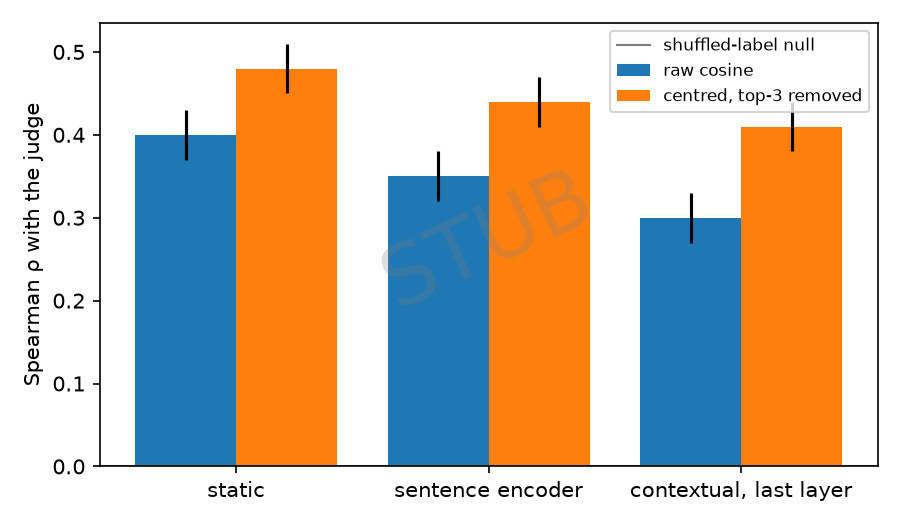
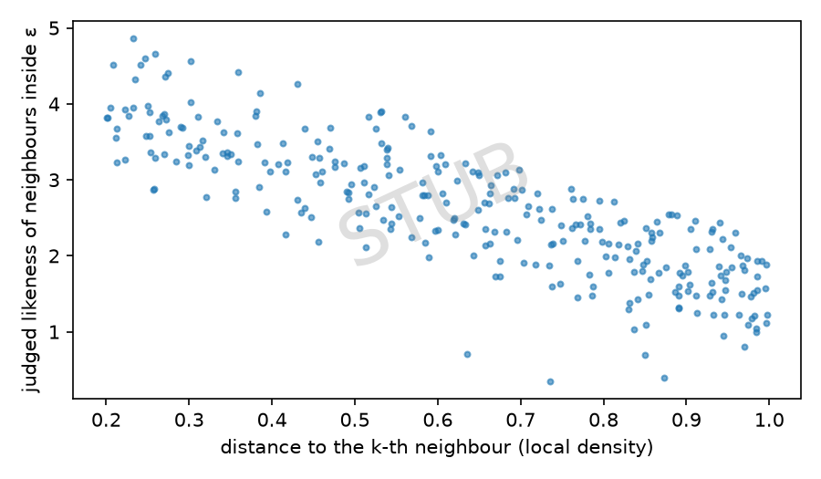

# Meaning in Context: One Word, Many Vectors {#sec-ch-meaning-in-context}

A word means different things in different sentences, and the same sentence means different things said by different people in different places. If meaning is context-dependent in many cases, a space of meanings needs a way for the vector of a word to depend on what surrounds it. Harris already set homonymy aside from his classification of words by environment [@harris1954distributional]; Firth stated meaning at a series of levels, one of which is the context of situation [@firth1957synopsis]; Kaplan separated a rule that does not depend on context (character) from the content it yields in one [@kaplan1989demonstratives]. Attention is the mechanism that makes a vector depend on its sentence. The question of this chapter is how much of the dependence on context a contextual vector carries, which part of it lies outside the text, and what is near at each layer of a model.

The scope is dependence on the sentence and the situation. The static nearness that the contextual one is measured against is the chapter on nearness (@sec-ch-meaning-as-likeness); the representation of the sense of a word as a region is the chapter on regions (@sec-ch-meaning-as-region); how a part is put into a whole is the chapter on composition (@sec-ch-meaning-and-structure); and whether what the sentence says is true is the chapter on truth (@sec-ch-meaning-and-truth).

*Goals and expectations (proposed, to be confirmed by the author before any experiment).*

*Goal 1, a static vector averages the senses (Harris).* The expectation is that for a polysemous word the static vector lies between the clusters of its senses, and that the contextual vectors of its occurrences cluster by sense, in a measure that also shows how anisotropic each layer is [@ethayarajh2019contextual]. The run takes the occurrences of a few polysemous words in a corpus with sense labels (the data are to be specified), clusters their contextual vectors and compares the clusters with the senses and with the static vector (@sec-from-word-vectors-contextual). *This goal receives Q15 of @sec-likeness-which.*

*Goal 2, attention is similarity-weighted retrieval.* The softmax of the dot products of a query with the keys, applied to the values, is a kernel-weighted average, the same operation that a retrieval system performs over a database and that associative memories perform [@ramsauer2021hopfield]. The expectation, analytic, is that one attention head with the right keys retrieves a stored value exactly in the limit of a sharp softmax; the run is a toy memory (@sec-attention-similarity-weighted-retrieval).

*Goal 3, nearness changes with the layer.* The expectation is that the nearness of two occurrences of a word changes with depth: in the early layers it follows the surface form, in the later ones the context, with anisotropy that varies across layers [@ethayarajh2019contextual; @timkey2021rogue]. The run measures the cosine of occurrences of one word in different senses and in the same sense at each layer of an open model (@sec-nearness-across-layers).

*Goal 4, what lies outside the text (Kaplan).* A text encoder gets the text and not the situation. The expectation, which a demonstration suffices to confirm, is that "I am here now" gets one vector whoever says it, and that a model can condition on an utterance's situation only if the situation is written into the text; this is the hand-off from the chapter on nearness, here with a contextual model (@sec-ctx-situation). *This goal receives Q15 of @sec-likeness-which.*

*Goal 5, reasoning in text or in the space.* A chain of thought written in text is a path through discrete tokens, and a model can also keep the path in its hidden states. The expectation is that the two differ in what can be inspected and in what they cost [@wei2022chain; @hao2024training]; the run, if any, needs a reasoning benchmark and is not planned for the first phase (@sec-reasoning-text-space).

*Goal 6, a context that selects the relation.* A static cosine mixes the relations that make two words near (form, field, kind, opposite). The expectation is that a contextual encoder, given a context that names the respect in which two items are compared, orders the pairs of the four cells of SimLex-999 (similar or not, associated or not) closer to the matching judge than the context-free cosine does, and that where it does not, the relation is not recoverable from the text alone. The run, if any, needs an open encoder and a fixed list of context phrases written before the run, against a shuffled-phrase null (@sec-nearness-across-layers). *This goal receives Q20 of @sec-gallery-neighbours.*

## What the Philosophies Say About Context {#sec-ctx-philosophy}
*Plan (about 3 pages). Harris on homonymy and on connected discourse [@harris1954distributional]; Firth on the context of situation and on collocation as one level [@firth1957synopsis]; Kaplan on character and content, and Perry's essential indexical [@kaplan1989demonstratives; @perry1979problem]; Wittgenstein on use, with the hedge that it holds for a large class of cases [@wittgenstein1953philosophical, §43]; and Tversky's diagnosticity, by which the weight of a feature depends on the context in which the comparison is made [@tversky1977features]. For each: which part of context it names (the sentence, the discourse, the situation, the comparison class), and what a vector can carry of it. The situation of use is the part that a corpus of text does not hold.*

## The Situation Is Not in the Text {#sec-ctx-situation}
*Plan (about 1 page). Goal 4. A short demonstration with a static and a contextual encoder: the same sentence with a different speaker, place or date, the same vector; and a sentence in which the situation is written in, and the vector that moves.*

<!-- salvaged from embedding-technologies-stubs/contextual_vectors.qmd, section sec-from-word-vectors-contextual -->
## From Word Vectors to Contextual Vectors {#sec-from-word-vectors-contextual}
*Why the vector of a word must depend on its sentence, and what transformers compute. Harris already sets homonymy aside from his classification of words by environment (p. 157) and holds that the correlation between language and meaning "is much greater when we consider connected discourse" (p. 152) [@harris1954distributional]; a contextual vector is the distributional description taken to the environment of one occurrence, so that a polysemous word has as many regions as it has distinct environments, not one point. Tversky's diagnosticity (the weight of a feature depends on the context in which things are compared) is the psychological form of the same need, and a contextual vector answers it only in part: it changes with the sentence, not with the set of things compared (@sec-likeness-not-distance). His further remark that a discourse has its own substitution sets and subdomains, which hold only inside it (p. 160), is an untested reading for a per-document subspace; it is kept in the Epilogue, in the section on the methods of Harris that nobody uses.*

<!-- salvaged from embedding-technologies-stubs/contextual_vectors.qmd, section sec-attention-similarity-weighted-retrieval -->
## Attention as Similarity-Weighted Retrieval {#sec-attention-similarity-weighted-retrieval}
*The dot-product machinery of retrieval (@sec-ch-meaning-and-truth) inside the model, and its link to associative memory: the Hopfield network stores patterns as energy minima and recalls one by descent [@hopfield1982neural], with about $0.15N$ patterns held by $N$ units, and its continuous version has the attention update as its update rule [@ramsauer2021hopfield]. The attention score is a bilinear form with two learned matrices, $\mathbf{x}_i^\top \mathbf{W}_Q^\top \mathbf{W}_K\, \mathbf{x}_j$, so it is asymmetric unless their product is symmetric, unlike a cosine between two vectors of one table; whether the learned asymmetry has the direction that salience asks for in Tversky's theory of similarity is untested, and the check, the antisymmetric part of the product per head, is in @sec-likeness-not-distance.*

<!-- salvaged from embedding-technologies-stubs/contextual_vectors.qmd, section sec-nearness-across-layers -->
## What Is Near at Each Layer? {#sec-nearness-across-layers}
*Idea, from the debate in @sec-ch-meaning-as-likeness; each stage is an assertion to test and none is established here. Nearness is not one relation along the depth of a model. After tokenization and in the input table, near means company in a corpus, one point per token. In the middle layers the same token splits into different points according to its context, and near means the same word sense or the same function in context; how far the contextual vectors of one word differ from layer to layer is reported [@ethayarajh2019contextual], and how the intrinsic dimension of the representation changes with depth is a measurement to look for (not held in `references/`). At the last layers near is made by the objective: two contexts are near if they predict the same next-token distribution (the unembedding head), or two inputs are near if the angular margin of a contrastive loss put them there on the hypersphere (@sec-ch-meaning-as-likeness). Anisotropy is also reported to differ by layer [@ethayarajh2019contextual], and the cosine between different words rises with depth while that between instances of the same word falls, with the high cosines coming from isolated clusters that vanish after a per-cluster centring [@cai2021isotropy]; and a few dimensions are reported to dominate the cosine [@timkey2021rogue], so a raw cosine is not comparable between layers. Test: the correlation of cosine with a similarity judge, layer by layer, raw and centred, with the layer chosen on a held-out set; the many-seeds null of @sec-likeness-many-spaces applies. If the best layer for a task is in the middle and not at the end, then "the embedding" of a model is a choice and not a given. A further probe from Frege's indirect reference [@frege1892sense]: inside quotation marks or after "believes", a word designates its usual sense and not its object, so the same token should move in a contextual space between "Odysseus sailed home" and "the poet says that Odysseus sailed home"; whether the layer that represents the referent switches to the layer that represents the sense is untested.*

<!-- salvaged from embedding-technologies-stubs/contextual_vectors.qmd, section sec-reasoning-text-space -->
## Reasoning in Text or in the Space {#sec-reasoning-text-space}
*Chain of thought [@wei2022chain] as a path through the model's space that is rounded to a token at every step, which puts reasoning on Shannon's boundary (@sec-ch-symbols-without-interior); pause tokens (2023) [@goyal2023think] and filler tokens (2024) [@pfau2024lets] as extra computation that is not quite language; and the latent alternatives that keep the steps in the space, continuous chain of thought (Coconut, 2024) [@hao2024training] and recurrent-depth models (2025) [@geiping2025scaling]. Planning in latent space is taken up in @sec-ch-meaning-across-senses.*

*A path is not a geodesic. A sampled chain is one draw from a distribution over paths, and nothing guarantees that a single draw converges on the answer. What training raises is the probability $p_x$ that a draw ends in the set of answers a verifier accepts, summed over every path that does. The picture is old: problem solving as search in a problem space [@simon1971human; @newell1972human], which has guarantees only when the structure supplies them (A\* [@hart1968formal], UCT [@kocsis2006bandit]). A language model samples instead of searching, and gives up the guarantee. The same sum is the marginal likelihood of a latent-variable model whose latent variable is the chain of thought [@phan2023training], and self-consistency marginalizes it by voting [@wang2022self].*

*How the probability is raised, at inference and at training. At inference, repeated sampling raises coverage log-linearly over orders of magnitude [@brown2024large], but only an oracle verifier turns coverage into accuracy: majority voting and reward models saturate [@brown2024large, Section 4.1], and a learned verifier can get worse as the search finds adversarial solutions that fool it [@cobbe2021training, Section 5.1]. At training, REINFORCE [@williams1992simple] with a binary reward is, up to a factor, a step of fine-tuning on the model's own successful samples, the expectation-maximization reading of Dayan and Hinton [@dayan1997using]; ReST-EM is that loop and STaR approximates it [@singh2023beyond; @zelikman2022star], while group-normalized variants such as GRPO change the weighting [@shao2024deepseekmath]. The search is paid for once and amortized into the weights, as in expert iteration and AlphaZero [@anthony2017thinking; @silver2017mastering], and train-time and test-time compute can be traded [@jones2021scaling]. Whether training discovers new paths is contested: pass@k at large $k$ suggests that it reweights paths the base model already had and can lose coverage [@yue2025does], while self-training reports gains that transfer to held-out benchmarks [@singh2023beyond].*

*Why length is not the whole story. More tokens add serial computation that a fixed-depth transformer lacks [@feng2023towards; @merrill2023expressive], and test-time compute can stand in for pretraining on easy and medium questions but not on hard ones [@snell2024scaling]. Yet forcing a chain to run longer eventually stops helping [@muennighoff2025s1] and can hurt, in part because length tracks distraction [@gema2025inverse], and on easy problems it mostly wastes tokens [@chen2024do]. Search at inference and amortization in training are both real; neither alone explains the gain.*

*A score on the path (provisional). A latent chain has no token to read, so the small looped reasoners HRM and TRM need a separate learned head to say when to stop [@wang2025hierarchical; @jolicoeur2025less]. Energy-Based Reasoners put the three jobs in one learned scalar energy over the latent state [@chen2026energy]: the update is gradient descent on it (iterative reasoning as energy minimization [@du2022learning], in the frame of energy-based learning [@lecun2006tutorial]), the size of the gradient says when to stop, and the value picks among independent draws. On Sudoku-Extreme a model of 1.8M parameters reaches 99.4% from one draw and 99.9% from the lowest-energy of five [@chen2026energy, Table 1], with no separate verifier network. Two limits keep this from settling the question. A small gradient does not mean a correct answer, since a trajectory can stop at a spurious minimum; the authors have to train stationarity to coincide with correctness, and without that term single-draw accuracy falls from 99.0% to 45.3% [@chen2026energy, Table 3]. And the energy is itself a learned verifier, so whether it resists the adversarial search that defeats learned verifiers [@cobbe2021training] is not tested. The tasks are small, algorithmic and checkable (Sudoku, mazes, N-Queens, graph colouring), the paper is a preprint by the authors of the method, and they leave open whether it scales to language. Which properties of the space it relies on is listed in @sec-prop-paths.*

*What the tokens mean. An outcome reward does not constrain the text. Chains are plausible yet can be unfaithful [@turpin2023language], faithfulness varies by task and falls with model size on most tasks [@lanham2023measuring], and scaling outcome-based RL leaves it on a low plateau [@chen2025reasoning]. Rounding to a token is therefore no guarantee that the token carries the step. Reward hacking is the same Goodhart effect seen from the other side: proxy rewards are rarely unhackable [@skalse2022defining], and optimizing harder hurts the true reward [@gao2022scaling]. Whether a continuous chain escapes this, and how one is trained when there is no sampled token to reward, is open.*

## Technologies That Exploit Context {#sec-ctx-technologies}
*Plan (about 1 page). Contextual encoders and their use in retrieval and classification, word-sense disambiguation, attention and its efficient variants, interpretability by layer, and chain-of-thought and latent reasoning. For each: the cost of attention, quadratic in the length of the context, and whether the gain over a static vector holds at matched tuning.*

## What Did the Network Find? {#sec-what-did-network-find}
*Plan (1 page). Findings: which of the structures that Part II designs by hand trained transformers discover on their own, if any (a parse tree in a linear subspace, features as directions, a geometry shared across models), each told with its dated experiment and its evidence class. Achieved for the representation of meaning: directions as meanings (@sec-prop-direction), meanings that combine (@sec-prop-combine), and a vector that depends on its sentence. Computation: here the geometry is learned rather than designed. For reasoning, the question is whether keeping the steps in the space is a prior that sampling, verification and amortization absorb, or a different use of compute (serial depth, a distribution over paths held in one vector). The question that decides it: at matched compute, does a latent chain beat sampled token chains plus a verifier, on problems with an oracle verifier and on problems without one? The book cannot run that comparison. The chapter reports the best evidence at scale with its class (Coconut is the authors' own, partly on a benchmark they introduced, and no independent matched-compute comparison is known to the author) and says so when none exists. Smoke test: a sparse autoencoder on synthetic data with more features than dimensions, to see whether near-orthogonality lets it recover them. Still out of reach: a model that reads its context still produces what is plausible without checking it. Every one of these models rewards nearness, and what that nearness says about likeness of meaning, level by level, is the first question of Part II (@sec-ch-meaning-as-likeness).*

*Sources and gaps (first pass).* Sourced in `references/`: Harris, Firth, Kaplan and Perry, Wittgenstein, Tversky, the anisotropy of contextual models, attention as associative memory, chain of thought and latent reasoning. Not yet sourced: a corpus with sense labels for the polysemy test; any benchmark of word-sense disambiguation; the size of the reasoning gains at scale (the comparisons cited by the earlier chapter are to be re-read).

<!-- salvaged from chapters/properties_of_meaning.qmd (snapshot: embedding-technologies-stubs-v2/properties_of_meaning.qmd), section sec-prop-context -->

## Meaning Depends on Context {#sec-prop-context}
*A word does not have one vector: the vector it needs depends on its sentence and, beyond the text, on the situation of use.*

Earned in this chapter. Last update: 2026-11-22, a promise.

Sources (first pass). Harris on homonymy and connected discourse [@harris1954distributional]; Firth on the context of situation [@firth1957synopsis]; Kaplan on character and content [@kaplan1989demonstratives]; the anisotropy and context-specificity of contextual vectors [@ethayarajh2019contextual]. Sceptics and balance: a contextual vector carries the context that is in the text; the situation of the speaker is not in it.

<!-- salvaged from chapters/meaning_as_likeness.qmd (snapshot: embedding-technologies-stubs-v2/meaning_as_likeness.qmd), section sec-likeness-which: the questions that the likeness chapter hands on -->

## Questions Handed On From the Likeness Chapter {#sec-likeness-handed-to-meaning-in-context}

Wittgenstein also says that the members of a class like the games need share no feature. They form "a complicated network of similarities overlapping and criss-crossing" [@wittgenstein1953philosophical, §66]. Goodman argues that counting shared features cannot define likeness, since any two things share countless properties until we say in which respect they are compared [@goodman1972seven]. In a space this means that a concept is not a ball around a prototype, so a fixed radius is a poor model of it, and that a cosine returns a number and not the respect in which two items are alike.

::: {.test #q-likeness-8}
**Q8. Is a raw nearness a measure of likeness?** Before it is corrected for what inflates it, does the number behind "near" follow judged likeness, and does a fixed radius around an item hold a concept?

*See* @sec-reading-nearness-correctly.
:::

Kaplan (1989) separates the character of an expression, a rule that does not depend on the context, from its content, which is fixed in the context: "I am here now" says something different each time [@kaplan1989demonstratives]. An encoder that takes the text and not the situation as input errs on the side of the character.

::: {.test #q-likeness-15}
**Q15. Does the same word keep its meaning when the speaker, the place or the sentence changes?** A vector that does not take the situation as input can have one meaning at most.

*Not answerable in this chapter with one vector per item. See* @sec-ch-meaning-in-context.
:::

If a cosine does not say which relation holds, can the relations be disentangled in a different space? Perhaps context is an answer:

::: {.test #q-likeness-20}
**Q20. How can the relations that nearness mixes be disentangled?** Given a space in which near words are similar, associated, opposite, or forms of one word, what has to be changed to answer about different kinds of relations, and does the answer hold for sentences, images and sounds as well as for words?

*See* @sec-ch-meaning-in-context.
:::

<!-- salvaged from chapters/meaning_as_likeness.qmd (snapshot: embedding-technologies-stubs-v2/meaning_as_likeness.qmd), section sec-reading-nearness-correctly -->

## Reading Nearness Correctly {#sec-reading-nearness-correctly .idea}
Here we check what the number behind "near" is made of, and whether a raw cosine can be trusted as a measure of likeness before it is corrected for the artefacts that inflate it. It answers Q8 of @sec-likeness-which.

*What a raw cosine hides: a common mean vector and a few dominating directions [@mu2018allbutthetop], word frequency [@schnabel2015evaluation], hubs in high dimension [@radovanovic2010hubs], an arbitrary scale for some regularised models [@steck2024cosine], a norm that stops the dot product from giving every vector the same similarity to itself (@sec-likeness-not-distance), and anisotropy in every layer of contextual models [@ethayarajh2019contextual]. For each, a statistic and a null, and what centring changes. The narrow cone has a training-side cause for language models whose output embeddings are tied to the input ones: Gao et al. (2019 [@gao2019representation]) show that likelihood maximisation pushes the embeddings of rare words in a common direction, so that most word embeddings end up in a narrow cone and any two have a large cosine, and they propose a regulariser that widens the aperture (this concerns generation models with tied weights, and is not shown for the encoders used for retrieval). The choice of score is itself a source of bias: Weeds, Weir and McCarthy (2004 [@weeds2004characterising], read in the PDF, cited also by Turney and Pantel §4.4 [@turney2010frequency]) compare similarity measures on 2,000 nouns split into high-frequency and low-frequency targets and find strong tendencies in the frequency of the neighbours they select, in three classes: measures that favour high-frequency neighbours whatever the target (cosine, Jensen–Shannon, $\alpha$-skew and recall), one that favours low-frequency neighbours (precision), and those that choose neighbours of a frequency like the target's (Jaccard, Lin, harmonic mean); and, since recall prefers distributionally more general words and precision more specific ones, the relative values of precision and recall predict the direction of the hyponym–hypernym relation for the 20,415 WordNet pairs among those nouns (the asymmetry of @sec-near-not-alike obtained from the same counts, with the caveat that it is correlated with the frequency of the hypernym). The cosine is thus a high-frequency-sensitive score, and Bullinaria and Levy (2007) found the cosine the best of six measures on four word-similarity tasks. So the frequency statistic of this section is to be reported per score, and not only for the cosine.*

*Two readings from a debate on whether likeness is nearness, both stated as claims to test and not as findings. (1) Anisotropy decouples proximity from likeness: when a few high-variance directions dominate, two points can be near in cosine or L2 because they share a frequency or surface-form artefact, and not because they are alike. A few rogue dimensions are reported to dominate the cosine of contextual models [@timkey2021rogue], and a common mean and a few top directions to inflate it [@mu2018allbutthetop]. The test is the one already in the list: the correlation of cosine with a judge before and after centring, whitening or removing the top directions, and the correlation of cosine with frequency, against a shuffled-label null. If the correlation with the judge rises after the correction, the raw nearness was partly the artefact. (2) A fixed radius is not a fixed likeness. A threshold $\epsilon$ on cosine or distance is read the same way everywhere, but the density of a space varies, so the same $\epsilon$ can hold only synonyms in a dense region and unrelated words in a sparse one; this is why a number of neighbours ($k$) and a rank are safer to compare than a radius, and why a similarity threshold taken from one model or one corpus does not carry to another. The test: for each query, the human-judged likeness of the neighbours inside a fixed $\epsilon$, plotted against the local density (the distance to the $k$-th neighbour), and the fraction of queries whose $\epsilon$-ball is empty or holds a large share of the vocabulary. The geometric reason (a space made of regions of different intrinsic dimension) is a hypothesis of @sec-manifold-hypothesis and not established here; the practical consequence for search is in @sec-ch-meaning-and-truth. A source now bears on the claim, and only partly: Cai, Huang, Bian and Church (2021 [@cai2021isotropy], read in the PDF) find that the high cosines of BERT, DistilBERT, GPT, GPT-2 and ELMo come from a few isolated clusters of the space, and that after subtracting the mean *of each cluster* the cosine between different word types is close to zero in every layer (inside each cluster the space is isotropic), whereas the cosine between instances of one word falls with depth and that between different words rises (their Figure 1); that GPT-2 has an effective dimension $d(0.8)$ of 1 in layers 2 to 6 (against about 270 to 290 for BERT); and that the local intrinsic dimension, estimated from nearest-neighbour distances, averages 5.6 for BERT, 6.8 for GPT, 7.0 for GPT-2 and 9.1 for ELMo, against 18.0 for static GloVe (100 dimensions), 21.1 for GNEWS and 26.1 for GloVe-2M. A Swiss-roll manifold related to word frequency appears for GPT and GPT-2 and not for BERT. This supports that density and dimension are not uniform over the space, and that a global centring is not the right correction when the space has clusters; it does not show regions of *different* intrinsic dimension compared with one another, nor that a fixed radius varies in likeness, which remains this section's test. So the correction arm of the first experiment is run twice, with a global mean and with the mean of each cluster, and the correlation with the judge and with frequency are reported for both.*

*Expected result: correction helps most for the contextual model, where anisotropy is strongest, and little for the static one; if a bar does not rise, the raw nearness was not an artefact there. In the second figure, the likeness of the neighbours falls as the local distance to the $k$-th neighbour grows.*

{#fig-stub-centring width=70%}

{#fig-stub-radius-density width=70%}

::: {.questions}
1. What do centring the vectors and removing their top principal directions change in a cosine, and why can it raise the correlation with a human judge?

2. Why is the rank of a neighbour a safer measure than a fixed radius?

3. Reproduce @fig-stub-centring and @fig-stub-radius-density: the correlation of the cosine with a judge before and after the correction, with a null, and the judged likeness of the neighbours against the density of the region.
:::

::: {.answers}
1. A mean vector and a few dominant directions are shared by all the words of a space, so they add the same component to every cosine: all the cosines become high, and the part that tells the words apart is a small share of the vector. Subtracting the mean and removing the top directions removes that common part [@mu2018allbutthetop]. The correlation with the judge rises if the common part was noise for the judgement, for example when it follows the frequency of the words, and it does not rise if the raw nearness was not an artefact; the test needs a null (the judge with its labels shuffled, random vectors) to say how much of a change is more than chance.

2. A fixed radius $\epsilon$ contains many neighbours in a dense region and few in a sparse one, so the same $\epsilon$ does not mean the same likeness everywhere, and in a sparse region the nearest neighbour may already be far. The rank, the $k$-th nearest, adapts to the density: the $k$ neighbours of a word are the nearest it has, whatever the distance. The price is that the rank is not symmetric (a word can be among the neighbours of another without the reverse) and ignores how far the $k$-th is.

3. The script `reading_nearness.py` does it with the spaces of `train_spaces.py`. For the first figure: score the pairs of the judge by the raw cosine, by the cosine after subtracting the mean and after also removing the first 1, 3 and 10 principal directions (`np.linalg.svd` of the centred matrix), with a bootstrap interval over pairs, the 95th percentile of the correlation with shuffled labels and the same correlation for Gaussian vectors; add the correlation of the cosine with the mean log frequency of the two words. For the second: for each judged pair take the cosine to the 10th neighbour of each word as the density of the region, cut the pairs in three groups of density, and compare in each group the correlation with the judge of the cosine and of the rank. The scripts were written and not yet run together, so the figures of the chapter are still stubs.
:::
